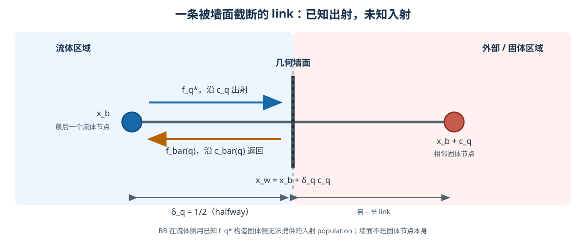
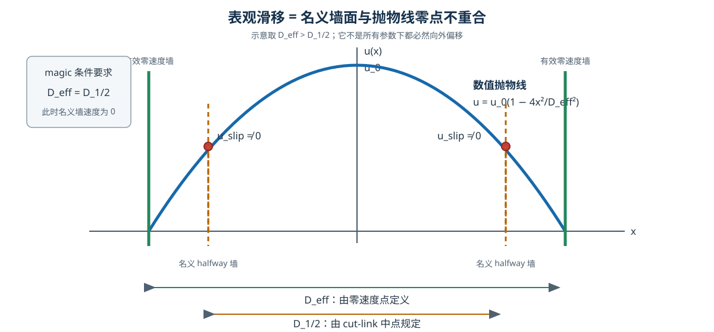

# 第 3 章：从边界缺失 population 到 boundary magic

> 本章只回答一个受限而精确的问题：把静止墙面放在最后一个流体节点与相邻外部节点的连线中点，并把出射分布反向弹回时，为什么特定的偶、奇松弛参数能让数值剖面的无滑移零点也回到这个中点？

## 0. 先定义预告中的量，再看结论

为避免“先见公式、后猜符号”，先把本节预告会用的量全部定义：

| 量 | 本章中的含义 |
| --- | --- |
| halfway bounce-back（halfway BB） | 墙面位于一条流体—外部链接的中点，出射 population 沿反方向返回的静止壁面规则；第 1 节会按迁移顺序展开 |
| $D_{1/2}$ | 按两侧链接中点量出的**名义通道宽度**，规定 $D_{1/2}>0$ |
| $D_{\mathrm{eff}}$ | 从数值抛物线向两侧外推到零点后量出的**有效通道宽度**，规定 $D_{\mathrm{eff}}>0$ |
| $H_{\mathrm{even}},H_{\mathrm{odd}}$ | 流场偶、奇碰撞通道的 Hénon 参数；第 3 节会从碰撞率逐步定义 |
| $\Lambda^2$ | Ginzburg 对偶奇乘积采用的归一化，$\Lambda^2\equiv(4/3)H_{\mathrm{even}}H_{\mathrm{odd}}$ |
| $I_f$ | 论文在宏观动量定义中放置半步体力修正的 forcing gauge；本章固定采用论文算例的 $I_f=-1/2$ |

在看到任何一个“magic 数字”以前，必须先保留以下红线：

- 本章对象是 D2Q9/D3Q15 两率简化**流场**模型，不是 D2Q5 温度模型；
- 边界是静止、平行、格线对齐的平壁；
- 流动是稳态、线性、不可压 Stokes/Poiseuille；
- 驱动是与墙面平行、沿主格子轴的均匀体力；
- 边界规则是 Ginzburg Eq. (23) 的 halfway bounce-back；
- forcing gauge 是论文实际采用的 $I_f=-1/2$。

离开这些条件，后面的抵消链不能自动外推。

在上述定义与限制内，本章最终会逐步得到

\[
D_{\mathrm{eff}}^2=D_{1/2}^2+4\Lambda^2-1,
\tag{3.1}
\]

\[
\Lambda^2=\frac14,
\tag{3.2}
\]

\[
H_{\mathrm{even}}H_{\mathrm{odd}}=\frac{3}{16}.
\tag{3.3}
\]

式 (3.2) 与式 (3.3) 是**同一个流场边界约束的两种归一化**，因为 $\Lambda^2$ 的定义包含因子 $4/3$。它们都不是 D2Q5 温度体相的 $1/6$ 条件。

**推导身份：** Ginzburg 论文直接给出通用有效宽度 Eq. (40) 和专门化结果 Eq. (42)。本章不会把 Eq. (40) 冒充主稿从头证明；主稿要做的是补齐论文在 Eq. (40) 到 Eq. (42) 之间省略的每一次代入，并从 Eq. (42) 独立推出 magic 条件。

---

## 1. 为什么边界会“缺一个 population”

### 1.1 七个最小几何词

先只看一条连接流体与固体的格子链接。

先约定两个记号：下标 $q$ 表示一个离散速度方向，$\bar q$ 表示反向方向；星号表示“已经碰撞、尚未迁移”。因此 $f_q^*$ 是沿方向 $q$ 的碰撞后 population。

| 词 | 本章定义 |
| --- | --- |
| 流体节点 $\boldsymbol x_b$ | 仍执行正常碰撞、存有流体 populations 的最后一个格点 |
| 外部/固体节点 | 不属于流体计算域的相邻格点 |
| 几何墙面 | 希望施加无滑移条件的物理表面；它可以截在两个格点之间，不必经过格点 |
| 离散链接 | 从 $\boldsymbol x_b$ 沿某个离散速度 $\boldsymbol c_q$ 指向相邻节点的线段 |
| cut link | 被几何墙面截断的流体—外部链接 |
| 出射 population | 从流体节点沿 $\boldsymbol c_q$ 朝墙面运动的 $f_q^*$ |
| 入射 population | 边界处理后沿反向 $\boldsymbol c_{\bar q}=-\boldsymbol c_q$ 回到流体域的 $f_{\bar q}$ |

下标 $q$ 是方向编号，$\bar q$ 是反向方向编号，并满足

\[
\boldsymbol c_{\bar q}=-\boldsymbol c_q,
\qquad
\bar{\bar q}=q.
\tag{3.4}
\]

这里的定义顺序很重要：几何墙面是预先想放置的物理位置；有效墙面则要等第 2 节从数值剖面的零点反求，二者不能预先当成相同。

**图 3-1。** $\boldsymbol x_b$ 是最后一个流体节点，$\boldsymbol x_b+\boldsymbol c_q$ 是外部节点；墙面截断二者之间的 link。出射的 $f_q^*$ 已知，而从固体侧正常迁移回来的 $f_{\bar q}$ 不存在，必须由边界规则重构。

### 1.2 按迁移顺序看“缺失”

对内部两个流体节点，迁移式是

\[
f_i(\boldsymbol x+\boldsymbol c_i,t+1)=f_i^*(\boldsymbol x,t).
\tag{3.5}
\]

格子单位下一个时间步和一个主轴格距都记为 1。

若 $\boldsymbol x_b+\boldsymbol c_q$ 是固体，已知的 $f_q^*(\boldsymbol x_b,t)$ 会指向计算域外。与此同时，正常拉式迁移本来需要

\[
f_{\bar q}(\boldsymbol x_b,t+1)
=f_{\bar q}^*(\boldsymbol x_b-\boldsymbol c_{\bar q},t).
\]

因为 $-\boldsymbol c_{\bar q}=\boldsymbol c_q$，右端来源点是

\[
\boldsymbol x_b-\boldsymbol c_{\bar q}
=\boldsymbol x_b+\boldsymbol c_q,
\]

正好是固体节点。那里没有正常流体碰撞结果，所以入射值缺失。

边界条件的离散任务就是：用已知流体侧信息构造这个缺失的 $f_{\bar q}(\boldsymbol x_b,t+1)$。

### 1.3 stationary bounce-back 的最小数字例

最简单的静止壁面 bounce-back（BB）取

\[
f_{\bar q}(\boldsymbol x_b,t+1)
=f_q^*(\boldsymbol x_b,t).
\tag{3.6}
\]

例如碰撞后有

\[
f_q^*(\boldsymbol x_b,t)=0.12.
\]

则边界直接设置

\[
f_{\bar q}(\boldsymbol x_b,t+1)=0.12.
\]

数值份额没有变，但速度方向从 $\boldsymbol c_q$ 变成 $-\boldsymbol c_q$。若只看这份 population 的动量贡献，它从

\[
0.12\,\boldsymbol c_q
\]

变为

\[
0.12\,\boldsymbol c_{\bar q}
=-0.12\,\boldsymbol c_q.
\]

这就是“反弹”二字的离散含义。

Ginzburg 的通用六-population 边界式 Eq. (22) 是一个线性重构：它把当前边界节点以及沿同一链接向流体内部一、两个节点上的正反向 populations 加权相加，再加入规定的壁面动量项和一个附加项。把论文的碰撞后记号 $\widetilde f$ 改写成本教程的星号，原式结构是

\[
\begin{aligned}
f_{\bar q}(\boldsymbol x_b,t+1)={}&
\kappa_1 f_q^*(\boldsymbol x_b,t)
+\kappa_0 f_q^*(\boldsymbol x_b-\boldsymbol c_q,t)\\
&+\kappa_{-1}f_q^*(\boldsymbol x_b-2\boldsymbol c_q,t)
+\bar\kappa_{-1}f_{\bar q}^*(\boldsymbol x_b,t)\\
&+\bar\kappa_{-2}f_{\bar q}^*(\boldsymbol x_b-\boldsymbol c_q,t)
-w_qt_p^*j_{qw}+t_p^*F_{\bar q}^{pc}.
\end{aligned}
\]

现在每个符号的身份可以直接从它所乘的项读取，而不猜测下标含义：

- $\kappa_1,\kappa_0,\kappa_{-1}$ 分别乘式中列出的三个正向碰撞后 populations；$\bar\kappa_{-1},\bar\kappa_{-2}$ 分别乘式中列出的两个反向碰撞后 populations；
- $w_q$ 是乘在规定壁面方向动量项 $t_p^*j_{qw}$ 前面的边界系数，不是 D2Q9 平衡态的格子权重；
- $t_p^*$ 是论文按离散速度组给定的模型系数；本章不需要它的数值，因为它所乘的两个边界项都会取零；
- $F_{\bar q}^{pc}$ 是论文保留上标 `pc` 的附加项，原文在 Sec. III E 进一步讨论；它不是这里的宏观均匀体力 $F$，本章普通 BB 专门化取其为零。

普通 BB 特例 Eq. (23) 为

\[
\kappa_1=1,
\qquad w_q=2,
\qquad
\kappa_0=\kappa_{-1}=\bar\kappa_{-1}=\bar\kappa_{-2}=0.
\tag{3.7}
\]

对静止壁面，规定壁面沿链接方向的动量 $j_{qw}=0$；本章还取附加校正 $F_{\bar q}^{pc}=0$。把 Eq. (23) 的权重代入 Eq. (22) 后，只有 $\kappa_1=1$ 所乘的碰撞后出射项留下，因此得到式 (3.6)。[Ginzburg–d'Humières 2003，PDF p. 4，Eqs. (22)–(23)]

### 1.4 halfway 的 $1/2$ 是几何位置

墙面沿 cut link 的位置写成

\[
\boldsymbol x_w
=\boldsymbol x_b+\delta_q\boldsymbol c_q,
\qquad 0\le\delta_q\le1.
\tag{3.8}
\]

这里 $\delta_q$ 是从最后一个流体节点出发、以整条链接为 1 的无量纲距离比例：

- $\delta_q=0$：墙面落在流体节点上；
- $\delta_q=1$：墙面落在相邻外部节点上；
- $\delta_q=1/2$：墙面位于链接中点，即 halfway。

halfway 中的 $1/2$ 是几何长度比例；它不是偶奇投影的平均，也不是 Hénon shift 的时间离散修正，更不是 forcing gauge 的 $I_f=-1/2$。

### 1.5 BB 与温度 ABB 必须分开

BB 的静止流场公式是式 (3.6)，右端前是正号。Wang 的定温边界对 D2Q5 温度 population 使用 anti-bounce-back（ABB）：

\[
g_{\bar i}(\boldsymbol x_b,t+1)
=-g_i^*(\boldsymbol x_b,t)
+\frac{4+a}{10}\,\theta_w.
\tag{3.9}
\]

其中 $\theta_w$ 是规定壁温，$a$ 是 D2Q5 平衡矩参数。[Wang et al. 2013，PDF p. 6，Eq. (31)]

ABB 不只是“把 BB 换个名字”：它有负号和壁温补偿项。本章后面的 Ginzburg Eq. (40)–(43) 是流场 BB 的边界分析，不能直接当成式 (3.9) 的温度 ABB 证明。

宏观边界类型也不同：流场 no-slip 规定流体速度等于静止壁速度 0；温度 Dirichlet 规定 $T=T_w$；温度 Neumann 规定法向温度梯度或热流，绝热时为零。Wang 对绝热温度边界使用温度 BB，而定温边界使用 ABB。规则名称相似，不代表它们共享同一条 magic 推导。

---

## 2. 什么叫表观滑移与有效壁面

### 2.1 从 Stokes 方程手算 Poiseuille 抛物线

考虑两块静止平板，坐标为

\[
x=-\frac D2,
\qquad
x=+\frac D2.
\]

$D>0$ 是两壁之间的物理宽度。流动沿与 $x$ 垂直的方向发展；$x$ 只表示跨通道坐标。

设沿流向有均匀体力 $F$，运动黏度为 $\nu>0$，稳态线性 Stokes 方程化为

\[
\nu\frac{\mathrm d^2u}{\mathrm dx^2}+F=0.
\tag{3.10}
\]

这里 $u(x)$ 是流向速度。移项并除以 $\nu$：

\[
\frac{\mathrm d^2u}{\mathrm dx^2}=-\frac F\nu.
\]

对 $x$ 第一次积分：

\[
\frac{\mathrm du}{\mathrm dx}
=-\frac F\nu x+C_1.
\]

再积分一次：

\[
u(x)=-\frac F{2\nu}x^2+C_1x+C_2.
\tag{3.11}
\]

两壁无滑移条件是

\[
u\left(-\frac D2\right)=0,
\qquad
u\left(+\frac D2\right)=0.
\tag{3.12}
\]

把 $x=D/2$ 代入式 (3.11)：

\[
0=-\frac{FD^2}{8\nu}+\frac{C_1D}{2}+C_2.
\]

把 $x=-D/2$ 代入：

\[
0=-\frac{FD^2}{8\nu}-\frac{C_1D}{2}+C_2.
\]

第一式减第二式：

\[
C_1D=0.
\]

因为 $D>0$，所以

\[
C_1=0.
\]

代回任一壁面式：

\[
C_2=\frac{FD^2}{8\nu}.
\]

于是

\[
u(x)=\frac F{2\nu}\left(\frac{D^2}{4}-x^2\right).
\tag{3.13}
\]

中心 $x=0$ 的速度是（若约定 $F>0$ 且 $\nu>0$，它也是最大速度）

\[
u_0=u(0)=\frac{FD^2}{8\nu}.
\tag{3.14}
\]

用 $u_0$ 重写式 (3.13)：

\[
\boxed{
u(x)=u_0\left(1-\frac{4x^2}{D^2}\right)
}.
\tag{3.15}
\]

这就是对称平行平板 Poiseuille 抛物线；它在 $x=\pm D/2$ 正好为零。

### 2.2 名义宽度和有效宽度

在离散网格中，我们先按 cut link 中点指定两面墙，由此得到名义宽度

\[
D_{1/2}>0.
\]

但是数值剖面的零点可能实际落在

\[
x=\pm\frac{D_{\mathrm{eff}}}{2},
\]

其中 $D_{\mathrm{eff}}>0$ 称有效宽度。数值抛物线可写成

\[
u(x)=u_0\left(1-\frac{4x^2}{D_{\mathrm{eff}}^2}\right).
\tag{3.16}
\]

把名义墙面 $x=D_{1/2}/2$ 代入：

\[
u_{\mathrm{slip}}
\equiv u\left(\frac{D_{1/2}}2\right)
=u_0\left(1-\frac{D_{1/2}^2}{D_{\mathrm{eff}}^2}\right).
\tag{3.17}
\]

整理为

\[
\frac{u_{\mathrm{slip}}}{u_0}
=\frac{D_{\mathrm{eff}}^2-D_{1/2}^2}
{D_{\mathrm{eff}}^2}.
\tag{3.18}
\]

所以：

- 若 $D_{\mathrm{eff}}=D_{1/2}$，名义墙面速度为零；
- 若二者不同，名义墙面处出现非零速度，等价于零速度点向内或向外偏移；
- 这类由离散边界位置偏差产生的非零速度称表观滑移，不表示真实物理墙面一定具有 Navier slip。

**图 3-2。** 名义墙面由链接中点给出，有效墙面由抛物线零点给出。两者不重合时，在名义墙面读取到非零 $u_{\mathrm{slip}}$。

---

## 3. Ginzburg 两率模型与本章符号

### 3.1 两个碰撞率

Ginzburg 的简化模型把中心反演下不变的偶/黏性通道率写成 $\lambda_\nu$，把另一奇通道率写成 $\lambda_2$。本教程统一为

\[
r_{\mathrm{even}}=\lambda_\nu,
\qquad
r_{\mathrm{odd}}=\lambda_2.
\tag{3.19}
\]

对应 Hénon 参数是

\[
H_{\mathrm{even}}
=\frac1{\lambda_\nu}-\frac12,
\qquad
H_{\mathrm{odd}}
=\frac1{\lambda_2}-\frac12.
\tag{3.20}
\]

所有倒数都要求相应碰撞率非零。

### 3.2 黏度只由偶通道决定

Ginzburg Eq. (10) 给出

\[
\nu=\frac13\left(\frac1{\lambda_\nu}-\frac12\right).
\]

使用式 (3.20)：

\[
\boxed{\nu=\frac13H_{\mathrm{even}}}.
\tag{3.21}
\]

这说明 $\lambda_\nu$ 是黏性/偶通道率。[Ginzburg–d'Humières 2003，PDF p. 3，Eq. (10)]

### 3.3 Ginzburg 的大写 $\Lambda^2$

论文 Eq. (41) 定义

\[
\boxed{
\Lambda^2
=\frac43
\left(\frac1{\lambda_\nu}-\frac12\right)
\left(\frac1{\lambda_2}-\frac12\right)
=\frac43H_{\mathrm{even}}H_{\mathrm{odd}}
}.
\tag{3.22}
\]

因此

\[
H_{\mathrm{even}}H_{\mathrm{odd}}
=\frac34\Lambda^2.
\tag{3.23}
\]

千万不要漏掉 $4/3$，也不要写成 $\Lambda^2=H_{\mathrm{even}}H_{\mathrm{odd}}$。

### 3.4 forcing gauge $I_f$

论文不直接把 population 的一阶矩 $\boldsymbol j$ 当作最终动量，而定义

\[
\boldsymbol J=\boldsymbol j-I_f\boldsymbol F.
\tag{3.24}
\]

$I_f$ 决定离散体力在动量定义中放在哪个时间位置。本章使用论文实际采用的 modified definition

\[
I_f=-\frac12.
\tag{3.25}
\]

这里的 $-1/2$ 是 forcing gauge，不是 Hénon shift，也不是 halfway 几何位置。[Ginzburg–d'Humières 2003，PDF p. 3，Eq. (9) 及随后说明]

### 3.5 $\Theta_q$ 是方向投影

对方向 $\boldsymbol c_q$，论文用 $\Theta_q$ 表示它在墙面法向上的格子单位投影。沿主格子轴驱动时：

- 若该方向上的流向动量分量 $j_q=0$，它不负责决定本节有效宽度；
- 对参与宽度关系的相关链接，$\Theta_q^2=1$。

$\Theta_q^2=1$ 不是所有几何、所有链接的恒等式，而是本章主轴 forcing 场景的专门化条件。[Ginzburg–d'Humières 2003，PDF p. 6，Eq. (41) 后一句]

---

## 4. 论文的有效宽度方程

### 4.1 Eq. (38)–(39) 说什么

论文沿某条格子方向 $\boldsymbol c_q$，以通道中点为坐标原点，写出

\[
j_q(x_q)
=j_{0q}\left(1-\frac{4x_q^2}{W_{q,\mathrm{eff}}^2}\right),
\tag{3.26}
\]

\[
F_q
=j_{0q}\frac{8\nu}{\Theta_q^2W_{q,\mathrm{eff}}^2}.
\tag{3.27}
\]

原文把几何有效宽度写作 $H_{q\mathrm{eff}}$。为避免与本教程 Hénon 参数 $H$ 淆，本章改记为 $W_{q,\mathrm{eff}}$；规定的几何宽度同样改记为 $W_q$。

式 (3.26) 与前面手算的式 (3.15) 结构相同；$j_q$ 是方向动量而不是速度，但在本线性定密度语境中二者具有同一抛物线零点。

### 4.2 Eq. (40) 是本章的论文输入

下面的 Eq. (40) 含有三个分母。必须在写式子以前声明其定义域：

\[
\Theta_q\ne0,
\qquad
\lambda_2\ne0,
\qquad
1-\bar\kappa_{-1}-\bar\kappa_{-2}\ne0.
\tag{3.28}
\]

Ginzburg 使用其边界闭合 Eq. (29)、线性平衡 Eq. (11)、黏性 Eq. (10) 和 Eqs. (35)–(38)，并取 $F_{\bar q}^{pc}=0$、舍去非线性项，得到

\[
\begin{aligned}
W_{q,\mathrm{eff}}^2={}&W_q^2
+6\Lambda^2
-4\delta_q^2
-\frac{8\nu}{\Theta_q^2}
\left(\frac1{\lambda_2}+I_f\right)\\
&+\frac{4(\kappa_{-1}-\bar\kappa_{-2})}
{1-\bar\kappa_{-1}-\bar\kappa_{-2}}\\
&+\frac{12\nu}
{1-\bar\kappa_{-1}-\bar\kappa_{-2}}
\Bigl[
1-2\delta_q
+(1+2\delta_q)\bar\kappa_{-1}
+(3+2\delta_q)\bar\kappa_{-2}
\Bigr].
\end{aligned}
\tag{3.29}
\]

这是论文 Eq. (40) 的教程符号改写，不是主稿从 LB 方程重新证明的结果。[Ginzburg–d'Humières 2003，PDF p. 6，Eq. (40)]

逐项读式 (3.29)：

1. $W_q^2$ 是规定的几何宽度平方；
2. $6\Lambda^2$ 来自偶奇碰撞参数组合；
3. $-4\delta_q^2$ 来自墙面在线段上的几何位置；
4. 含 $\nu,\lambda_2,I_f,\Theta_q$ 的项耦合黏性、奇率、forcing gauge 和方向；
5. 最后两行含一般边界闭合系数。

式 (3.29) 已经直接说明：一般情况下有效壁面不只由一个松弛时间决定，而同时依赖几何、碰撞、forcing 实现与边界闭合。

---

## 5. 从 Eq. (40) 一项不漏地代到 Eq. (42)

### 5.1 本次专门化使用的值

| 量 | 专门值 | 来源或原因 |
| --- | ---: | --- |
| $\delta_q$ | $1/2$ | halfway 几何 |
| $\kappa_{-1}$ | $0$ | BB Eq. (23) |
| $\bar\kappa_{-1}$ | $0$ | BB Eq. (23) |
| $\bar\kappa_{-2}$ | $0$ | BB Eq. (23) |
| $I_f$ | $-1/2$ | modified momentum/forcing gauge |
| $\Theta_q^2$ | $1$ | 主轴 forcing 的相关链接 |
| $\nu$ | $H_{\mathrm{even}}/3$ | Ginzburg Eq. (10) |
| $1/\lambda_2-1/2$ | $H_{\mathrm{odd}}$ | Hénon 定义 |

BB 下边界分母为

\[
1-\bar\kappa_{-1}-\bar\kappa_{-2}
=1-0-0=1,
\]

所以没有除零。

### 5.2 第一项：保留 $6\Lambda^2$

式 (3.29) 的碰撞参数项直接是

\[
A=6\Lambda^2.
\tag{3.30}
\]

### 5.3 第二项：halfway 几何给 $-1$

\[
B=-4\delta_q^2
=-4\left(\frac12\right)^2
=-4\cdot\frac14=-1.
\tag{3.31}
\]

### 5.4 第三项：黏性—奇率项给 $-2\Lambda^2$

从

\[
C=-\frac{8\nu}{\Theta_q^2}
\left(\frac1{\lambda_2}+I_f\right)
\]

开始。先代 $\Theta_q^2=1$ 与 $I_f=-1/2$：

\[
C=-8\nu
\left(\frac1{\lambda_2}-\frac12\right).
\]

括号就是 $H_{\mathrm{odd}}$：

\[
C=-8\nu H_{\mathrm{odd}}.
\]

再代 $\nu=H_{\mathrm{even}}/3$：

\[
C=-\frac83H_{\mathrm{even}}H_{\mathrm{odd}}.
\]

由式 (3.22)，

\[
\Lambda^2=\frac43H_{\mathrm{even}}H_{\mathrm{odd}},
\]

所以

\[
\frac83H_{\mathrm{even}}H_{\mathrm{odd}}
=2\Lambda^2.
\]

最终

\[
C=-2\Lambda^2.
\tag{3.32}
\]

### 5.5 第四项：第一组边界系数为零

\[
\begin{aligned}
D
&=\frac{4(\kappa_{-1}-\bar\kappa_{-2})}
{1-\bar\kappa_{-1}-\bar\kappa_{-2}}\\
&=\frac{4(0-0)}{1-0-0}=0.
\end{aligned}
\tag{3.33}
\]

### 5.6 第五项：第二组边界系数也为零

先算方括号：

\[
\begin{aligned}
&1-2\delta_q
+(1+2\delta_q)\bar\kappa_{-1}
+(3+2\delta_q)\bar\kappa_{-2}\\
&=1-2\left(\frac12\right)
+\left(1+2\cdot\frac12\right)0
+\left(3+2\cdot\frac12\right)0\\
&=1-1+0+0=0.
\end{aligned}
\]

因此

\[
E=\frac{12\nu}{1-0-0}\cdot0=0.
\tag{3.34}
\]

### 5.7 五项相加

将式 (3.30)–(3.34) 加起来：

\[
\begin{aligned}
A+B+C+D+E
&=6\Lambda^2-1-2\Lambda^2+0+0\\
&=4\Lambda^2-1.
\end{aligned}
\tag{3.35}
\]

代回式 (3.29)：

\[
W_{q,\mathrm{eff}}^2
=W_q^2+4\Lambda^2-1.
\tag{3.36}
\]

对论文 p. 7 的双平壁整体直径记号，$W_{q,\mathrm{eff}}\to D_{\mathrm{eff}}$、$W_q\to D_{1/2}$，得到

\[
\boxed{
D_{\mathrm{eff}}^2
=D_{1/2}^2+4\Lambda^2-1
}.
\tag{3.37}
\]

这与论文 Eq. (42) 完全一致。论文给出 Eq. (40) 和 Eq. (42)；式 (3.30)–(3.36) 是主稿独立展开的中间代数复核。

---

## 6. magic 条件怎样出现

### 6.1 让有效宽度等于名义 halfway 宽度

希望数值抛物线的零点正好落在链接中点指定的墙面，即

\[
D_{\mathrm{eff}}=D_{1/2}.
\tag{3.38}
\]

两者都是正的物理直径，所以式 (3.38) 等价于平方相等：

\[
D_{\mathrm{eff}}^2=D_{1/2}^2.
\]

代入式 (3.37)：

\[
D_{1/2}^2
=D_{1/2}^2+4\Lambda^2-1.
\]

两边减 $D_{1/2}^2$：

\[
0=4\Lambda^2-1.
\]

移项并除以 4：

\[
\boxed{\Lambda^2=\frac14}.
\tag{3.39}
\]

这就是本受限场景中 Ginzburg 归一化下的 boundary magic。

### 6.2 转成未归一化 Hénon 乘积

把式 (3.22) 代入式 (3.39)：

\[
\frac43H_{\mathrm{even}}H_{\mathrm{odd}}
=\frac14.
\]

两边乘 $3/4$：

\[
H_{\mathrm{even}}H_{\mathrm{odd}}
=\frac14\cdot\frac34
=\frac{3}{16}.
\]

所以

\[
\boxed{
\Lambda^2=\frac14
\quad\Longleftrightarrow\quad
H_{\mathrm{even}}H_{\mathrm{odd}}=\frac{3}{16}
}.
\tag{3.40}
\]

反向检查：

\[
\Lambda^2
=\frac43\cdot\frac{3}{16}
=\frac4{16}=\frac14.
\]

因此 $1/4$ 属于带 $4/3$ 的 $\Lambda^2$；$3/16$ 属于未归一化的 Hénon 乘积。二者不能互换标签。

### 6.3 表观滑移直接写成 magic 偏差

由式 (3.18) 与式 (3.37)：

\[
\frac{u_{\mathrm{slip}}}{u_0}
=\frac{4\Lambda^2-1}{D_{\mathrm{eff}}^2}.
\tag{3.41}
\]

在本受限模型中，$4\Lambda^2-1$ 正是名义墙面表观滑移的宽度偏差来源。取 $\Lambda^2=1/4$，分子为零，因而 $u_{\mathrm{slip}}=0$。

还可以把中心速度 $u_0=FD_{\mathrm{eff}}^2/(8\nu)$ 代入式 (3.41)：

\[
\boxed{
u_{\mathrm{slip}}
=\frac{F}{8\nu}(4\Lambda^2-1)
}.
\]

这里要求 $\nu\ne0$。若 $F=0$，整条 Poiseuille 剖面都为零，不能再靠“零速度点”或 $u_{\mathrm{slip}}=0$ 反推出有效宽度和 magic 参数；本章讨论的是非平凡受迫剖面。

这并不表示所有 Knudsen layer 或所有边界误差都消失；它只表示本 Poiseuille 抛物线的有效零速度位置与名义 halfway 位置一致。

---

## 7. 从 $3/16$ 解出两个碰撞率的关系

令

\[
a\equiv r_{\mathrm{even}},
\qquad
b\equiv r_{\mathrm{odd}}.
\]

则

\[
H_{\mathrm{even}}=\frac1a-\frac12
=\frac{2-a}{2a},
\]

\[
H_{\mathrm{odd}}=\frac1b-\frac12
=\frac{2-b}{2b}.
\]

代入 $H_{\mathrm{even}}H_{\mathrm{odd}}=3/16$：

\[
\frac{(2-a)(2-b)}{4ab}=\frac3{16}.
\tag{3.42}
\]

这里要求 $a\ne0$、$b\ne0$。两边乘 $16ab$：

\[
4(2-a)(2-b)=3ab.
\]

先展开括号：

\[
(2-a)(2-b)=4-2a-2b+ab.
\]

乘 4：

\[
16-8a-8b+4ab=3ab.
\]

右边移到左边：

\[
16-8a-8b+ab=0.
\]

把含 $b$ 的项放在一起：

\[
b(a-8)=8a-16=8(a-2).
\]

若 $a\ne8$，

\[
b=8\frac{a-2}{a-8}
=8\frac{2-a}{8-a}.
\]

恢复原记号：

\[
\boxed{
r_{\mathrm{odd}}
=8\frac{2-r_{\mathrm{even}}}{8-r_{\mathrm{even}}}
}.
\tag{3.43}
\]

这正是 Ginzburg Eq. (43)。[Ginzburg–d'Humières 2003，PDF p. 7，Eq. (43)]

定义域还要注意：

- $r_{\mathrm{even}}\ne0$、$r_{\mathrm{odd}}\ne0$，才能定义 Hénon 参数；
- 式 (3.43) 的分母要求 $r_{\mathrm{even}}\ne8$；
- $r_{\mathrm{even}}=2$ 会给 $r_{\mathrm{odd}}=0$，不属于可用的 Hénon 换算点；
- 常见局部松弛区间 $0<r<2$ 仍不是完整边界算法稳定性的充分证明。

### 7.1 与 Wang/Contrino 流场率的对应

Wang 和 Contrino 的 D2Q9 流场写

\[
s_q=8\frac{2-s_\nu}{8-s_\nu}.
\tag{3.44}
\]

对应关系是

\[
s_\nu=r_{\mathrm{even}},
\qquad
s_q=r_{\mathrm{odd}}.
\]

因此它与式 (3.43) 完全相同，并精确等价于

\[
\left(\frac1{s_\nu}-\frac12\right)
\left(\frac1{s_q}-\frac12\right)
=\frac3{16}.
\tag{3.45}
\]

这里的 $3/16$ 是 D2Q9 **流场边界**偶奇 Hénon 乘积。它不是 Wang/Contrino D2Q5 温度体相 Eq. (17) 的 $1/6$。

---

## 8. 四个不同的“二分之一”再核对

| 出现位置 | 数学来源 | 能否互换 |
| --- | --- | --- |
| $h_i^\pm=(h_i\pm h_{\bar i})/2$ | 两个数的和差平均 | 不能 |
| $H=1/r-1/2$ | 碰撞—迁移二阶时间离散 | 不能 |
| $\delta_q=1/2$ | 墙面位于 cut link 中点 | 不能 |
| $I_f=-1/2$ | 论文采用的 forcing/momentum gauge | 不能 |

Eq. (40) 到 Eq. (42) 的抵消同时使用后面三个 $1/2$，但“同时出现”不表示它们有同一来源。

---

## 9. 不能从本章外推什么

以下结论都**没有**被式 (3.37)–(3.45) 自动证明：

1. **曲壁或斜壁也精确 halfway。** Ginzburg p. 7 明确指出，任意倾斜 Poiseuille 流不能用恒定 $\lambda_\nu,\lambda_2,I_f$ 对所有 $\delta_q$ 消掉误差。
2. **不同 forcing 实现仍使用同一 magic。** Eq. (40) 显含 $I_f$；压力梯度驱动、非均匀体力或其他半步方案必须重做代数。
3. **非稳态仍精确。** 论文 p. 26 明说理论分析针对稳态流，非稳态扩展仍待研究。
4. **非线性 Navier–Stokes 剖面也精确。** 非线性平衡会引入本推导舍去的高阶导数。
5. **温度 ABB 由 $3/16$ 控制。** 式 (3.9) 属于 D2Q5 温度边界，不能用本流场 BB 推导替代。
6. **任意复杂几何的渗透率黏性无关已被严格证明。** Ginzburg 对复杂流的相关说法明确标为尚无理论证明、但数值强烈支持。
7. **Knudsen layer 被消除。** 有效壁面校准只修正其平均位置影响，不能消除一般近壁动力学层。
8. **整个热对流算法全局高阶或绝对稳定。** 本章只校准一个受限流场边界剖面的有效位置。
9. **off-halfway 壁面仍使用同一个 $3/16$。** 当 $\delta_q\ne1/2$ 时，Eq. (40) 的几何项和插值系数都会改变，必须从通式重新专门化。
10. **移动壁面仍由本章静止 BB 公式覆盖。** 移动壁面有非零 $j_{qw}$，还涉及新生/消失流体节点；本章把 $j_{qw}$ 设为零，不能直接外推。
11. **换成任意边界闭合仍保留同一个 magic。** 线性/二次插值、multireflection 或其他闭合会改变 $\kappa$、$\bar\kappa$、$w_q$ 及可能的 $F_{\bar q}^{pc}$，必须各自重做 Eq. (40) 的代入。

---

## 10. 本章可独立复算的检查

1. 将 $\delta_q=1/2$ 代入 $-4\delta_q^2$，必须得到 $-1$。
2. 用 $\nu=H_{\mathrm{even}}/3$、$I_f=-1/2$、$\Theta_q^2=1$，把黏性项算成 $-2\Lambda^2$。
3. 将 BB 三个相关系数代回，验证最后两项分别为 0。
4. 检查 $6\Lambda^2-1-2\Lambda^2=4\Lambda^2-1$。
5. 从正宽度相等推到 $\Lambda^2=1/4$。
6. 用 $\Lambda^2=(4/3)H_{\mathrm{even}}H_{\mathrm{odd}}$ 双向验证 $1/4\leftrightarrow3/16$。
7. 从 $3/16$ 展开到式 (3.43)，再反向代回。
8. 说清 $3/16$ 与 D2Q5 温度 $1/6$ 为什么不是同一个条件。

如果第 2、6、7 项不能独立完成，先不要进入温度四阶误差章节。

---

## 11. 本章来源边界

- cut link、边界节点、通用边界式和 BB 系数：Ginzburg–d'Humières 2003，PDF p. 4，Eqs. (22)–(23)。
- forcing gauge、黏性和线性 Stokes 模型：同文 PDF p. 3，Eqs. (9)–(12)。
- Poiseuille 剖面、forcing 关系、通用有效宽度与 $\Lambda^2$：同文 PDF p. 6，Eqs. (38)–(41)。
- halfway BB 有效直径和率关系：同文 PDF p. 7，Eqs. (42)–(43)。
- Wang/Contrino 的 D2Q9 流场率：两篇应用论文 PDF p. 3 的相应两率式。
- 温度 ABB 对照：Wang et al. 2013，PDF p. 6，Eq. (31)。
- 本章 Stokes ODE 积分、表观滑移重写、Eq. (40) 的五项专门化和 Eq. (43) 的反向代数均为主稿独立教学复算，不冒充论文逐式原文。

下一章将换到 D2Q5 温度**体相**，从 Taylor/等效方程区分“四阶各向同性”与“两个四阶系数同时为零”。
