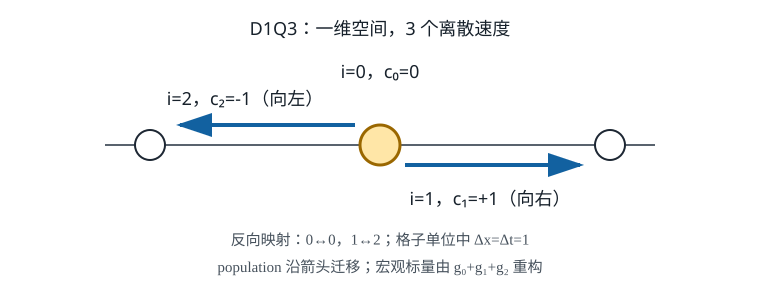
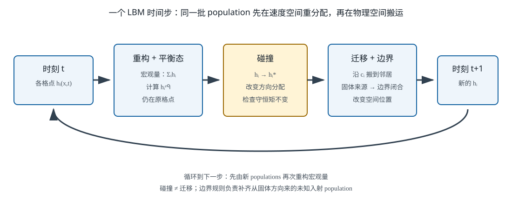
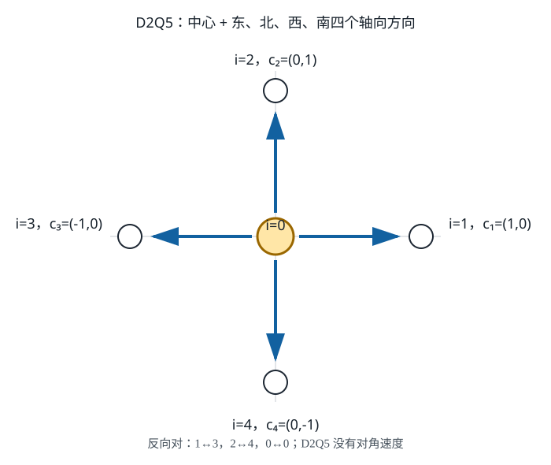
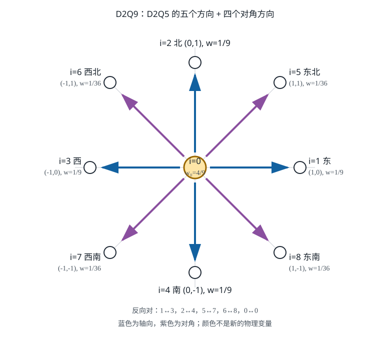
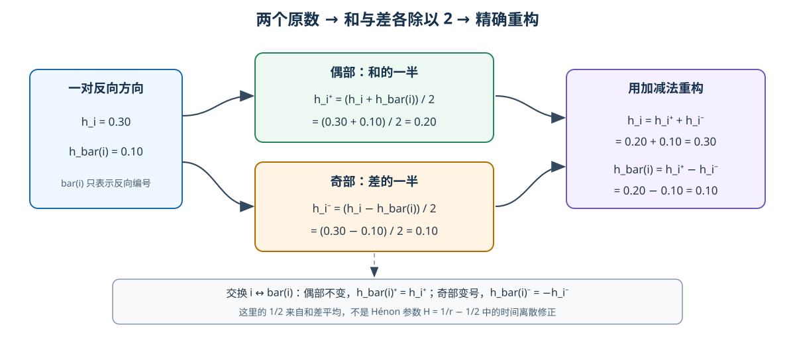
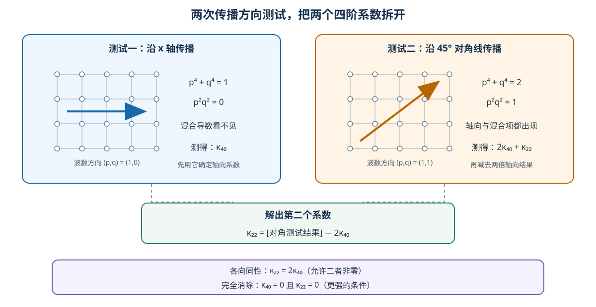
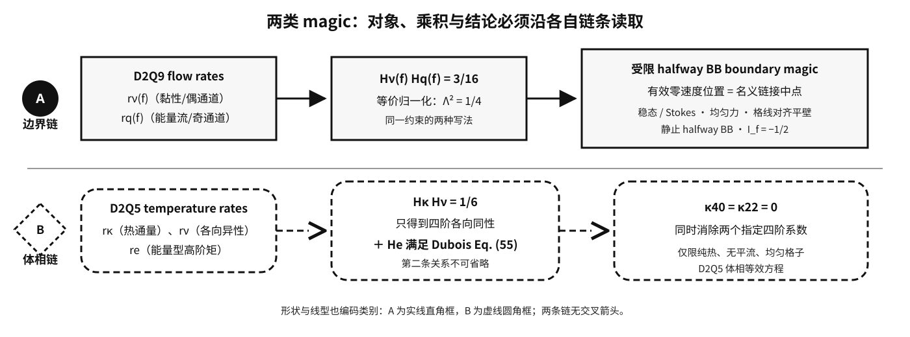

# 阅读说明 {.unnumbered #reading-guide}

这是一份面向 **完全没有 LBM 基础** 的教程。报告从标量场、导数、格子、population、矩、碰撞和迁移开始，再逐步建立 BGK、TRT、Hénon 参数、边界表观滑移以及 D2Q5 体相四阶误差的完整关系。

核心结论只依据下列四篇本地 PDF：

1. Wang et al., *Lattice Boltzmann simulations of thermal convective flows in two dimensions*;
2. Contrino et al., *LB simulations of the thermally driven 2D square cavity at high Rayleigh numbers*;
3. Dubois and Lallemand, *Towards higher order lattice Boltzmann schemes*;
4. Ginzburg and d'Humières, *Multireflection boundary conditions for lattice Boltzmann models*.

本地第 2 篇 PDF 的文件名含 `[Luo2014]`，但论文第一作者是 **Dario Contrino**；本报告按论文实际作者书写。

## 先记住两条绝对不能混用的链 {.unnumbered}

- 受限的 D2Q9 流场 halfway bounce-back 边界链：$\Lambda^2=1/4\Longleftrightarrow H_{\mathrm{even}}H_{\mathrm{odd}}=3/16$。
- D2Q5 纯热体相四阶链：$H_\kappa H_\nu=1/6$ 只代表四阶各向同性；要同时消去两个指定四阶系数，还必须满足 Dubois Eq. (55) 中决定 $H_e$ 的关系。

这两条链的格子、场变量、误差对象和适用条件都不同。本报告不把局部体相系数消失宣称为整个热对流程序“全局四阶”，也不把受限平壁结论外推到任意边界。

# 第 1 章　从“完全没学过 LBM”开始 {#chapter-1}

> 本章目标只有一个：让你在看到 TRT、magic 参数和四阶误差之前，先知道每个符号“是什么、从哪里来、下一步为什么需要它”。本章不推导 magic 常数，也不推导温度四阶系数；那些结论只能由后面的四篇本地论文推导支撑。

## 0. 阅读路线：我们究竟要搭哪几级台阶？

先给五个只够看懂路线图的最小定义，完整数学定义在第 3 节：

- **population**：每个格点按离散方向分栏保存的数值分量；它不是一颗真实粒子；
- **碰撞**：在同一格点内部重新分配各方向数值；
- **迁移**：把重新分配后的数值沿各自方向搬到邻居；
- **宏观量**：把多栏 population 求和或按方向加权后得到的温度、密度、动量等整体量；
- **松弛率**：控制一次碰撞让“偏离平衡的量”改变多少的参数；第 4 节会用数字定义。

后面的推导会沿下面这条链前进：

1. 用偏微分方程描述温度怎样扩散、怎样被流动带走；
2. 不直接离散宏观方程，而是在每个格点保存若干个沿离散方向的 **population**；
3. 每个时间步先让 population 在原地“碰撞”，再沿格线“迁移”；
4. 把若干 population 求和，重构密度、动量或温度；
5. 两个速度方向若大小相同、方向相反，就叫一对反向方向；把这一对 population 分成“交换方向后不变”和“交换方向后变号”两部分，便得到 TRT（two-relaxation-time，两松弛时间方法）的两组更新量；
6. 边界闭合会把偶、奇通道耦合起来，因此某些松弛参数乘积会影响表观壁面位置；
7. 对离散更新做 Taylor 展开，再把它改写成连续偏微分方程，会看到二阶、三阶、四阶等效项；调节松弛参数，可以让其中**特定的局部四阶系数**各向同性或为零。这不等于整个耦合求解器自动具有全局四阶精度。

现在不要试图记住第 5–7 步。先把第 1–4 步的语言学会。

---

## 1. 最低数学前置

### 1.1 标量、向量和坐标

**标量**只有大小，没有方向。例如温度 $T=300\,\mathrm K$、密度 $\rho=1$ 都是标量。

**向量**同时有大小和方向。二维速度写成

\[
\boldsymbol u=(u_x,u_y).
\]

例如 $\boldsymbol u=(3,-1)$ 表示：沿 $x$ 正方向每单位时间走 3 个长度单位，沿 $y$ 负方向走 1 个长度单位。

二维位置写成 $\boldsymbol x=(x,y)$。粗体 $\boldsymbol x$ 表示一个位置向量，普通字体 $x$ 表示它的第一坐标；后文会始终保持这个区别。

### 1.2 函数、偏导数和“其余变量暂时不动”

温度通常同时依赖位置和时间：

\[
T=T(x,y,t).
\]

符号 $\partial T/\partial x$ 的意思是：只观察 $x$ 变化时 $T$ 怎样变化，把 $y,t$ 暂时当常数。

取一个可以手算的例子：

\[
T(x,y)=x^2+3xy+2y^2.
\]

对 $x$ 求偏导时，$y$ 暂时是常数：

\[
\frac{\partial T}{\partial x}=2x+3y.
\]

对 $y$ 求偏导时，$x$ 暂时是常数：

\[
\frac{\partial T}{\partial y}=3x+4y.
\]

在点 $(x,y)=(1,2)$，两者分别为

\[
\left.\frac{\partial T}{\partial x}\right|_{(1,2)}=2+6=8,
\qquad
\left.\frac{\partial T}{\partial y}\right|_{(1,2)}=3+8=11.
\]

### 1.3 梯度：标量场“往哪里升得最快”

把两个方向的偏导排成一个向量，就得到梯度：

\[
\nabla T=
\left(
\frac{\partial T}{\partial x},
\frac{\partial T}{\partial y}
\right).
\]

对上面的例子，

\[
\nabla T=(2x+3y,\,3x+4y),
\qquad
\nabla T(1,2)=(8,11).
\]

梯度指向温度增加最快的方向。它不是速度，但速度与梯度做点积以后，会描述流体把温度沿自身方向带走的强弱。

### 1.4 点积与对流项

先拿前面的两个具体向量来算：$\boldsymbol a=(3,-1)$，$\boldsymbol b=(1,2)$。把对应位置的数字相乘，再相加：

\[
3\times1+(-1)\times2=1.
\]

一般地，二维向量 $\boldsymbol a=(a_x,a_y)$ 和 $\boldsymbol b=(b_x,b_y)$ 的这种运算叫点积：

\[
\boldsymbol a\cdot\boldsymbol b=a_xb_x+a_yb_y.
\]

因此温度的对流项展开为

\[
\boldsymbol u\cdot\nabla T
=u_x\frac{\partial T}{\partial x}
+u_y\frac{\partial T}{\partial y}.
\]

若 $T=x+2y$，则 $\nabla T=(1,2)$。再取 $\boldsymbol u=(3,-1)$，就有

\[
\boldsymbol u\cdot\nabla T=3\times1+(-1)\times2=1.
\]

这一步没有省略任何“向量乘法”：它就是两个对应分量相乘后再相加。

### 1.5 散度：一个向量场在一点“向外流出多少”

先看 $\boldsymbol v=(x^2,xy)$：第一个分量沿 $x$ 的变化率是 $2x$，第二个分量沿 $y$ 的变化率是 $x$。把这两个“各自沿本方向的流出率”相加，得到

\[
2x+x=3x.
\]

一般地，对二维向量场 $\boldsymbol v=(v_x,v_y)$，这种求和叫散度：

\[
\nabla\cdot\boldsymbol v
=\frac{\partial v_x}{\partial x}
+\frac{\partial v_y}{\partial y}.
\]

在 $(1,2)$ 处，散度为 3。注意第二项是 $\partial(xy)/\partial y=x$，不是 $y$。

### 1.6 拉普拉斯算子：两个方向的二阶弯曲相加

仍用 $T=x^2+3xy+2y^2$。先对 $x$ 连续求两次偏导，再对 $y$ 连续求两次：

\[
T_x=2x+3y,\qquad T_{xx}=2,
\]

\[
T_y=3x+4y,\qquad T_{yy}=4.
\]

把两个方向的二阶导数相加：$2+4=6$。一般地，这个和叫标量场的拉普拉斯：

\[
\nabla^2T
=\frac{\partial^2T}{\partial x^2}
+\frac{\partial^2T}{\partial y^2}.
\]

所以对本例

\[
\nabla^2T=2+4=6.
\]

扩散方程中的 $\nabla^2T$ 衡量温度曲面的局部弯曲；它驱动尖峰变平、低谷被填充。

### 1.7 四阶导数和双拉普拉斯

“四阶”在本报告中首先指微分次数，而不是一句笼统的“算法四阶精度”。例如

\[
\frac{\partial^4T}{\partial x^4}=T_{xxxx},
\qquad
\frac{\partial^4T}{\partial x^2\partial y^2}=T_{xxyy}.
\]

把拉普拉斯再作用一次，得到双拉普拉斯：

\[
(\nabla^2)^2T
=T_{xxxx}+2T_{xxyy}+T_{yyyy}.
\]

为什么混合项前面是 2？把括号当普通代数展开即可：

\[
(\partial_{xx}+\partial_{yy})^2
=\partial_{xxxx}
+\partial_{xx}\partial_{yy}
+\partial_{yy}\partial_{xx}
+\partial_{yyyy}.
\]

若 $T$ 至少具有连续的四阶偏导，混合偏导可交换，两个中间项相等，于是合并成 $2\partial_{xxyy}$。

取 $T=(x^2+y^2)^2=x^4+2x^2y^2+y^4$。先沿 $x$ 方向逐次求导：

\[
\begin{aligned}
T_x&=4x^3+4xy^2,\\
T_{xx}&=12x^2+4y^2,\\
T_{xxx}&=24x,\\
T_{xxxx}&=24.
\end{aligned}
\]

混合导数从已经得到的 $T_{xx}$ 继续对 $y$ 求两次：

\[
T_{xxy}=8y,
\qquad
T_{xxyy}=8.
\]

沿 $y$ 方向对称地计算：

\[
\begin{aligned}
T_y&=4x^2y+4y^3,\\
T_{yy}&=4x^2+12y^2,\\
T_{yyy}&=24y,\\
T_{yyyy}&=24.
\end{aligned}
\]

现在才把三个结果代入双拉普拉斯：

\[
(\nabla^2)^2T=24+2\times8+24=64.
\]

这个“轴向项 : 混合项 = $1:2$”的结构，后面判断二维四阶误差是否各向同性时会再次出现。

### 1.8 $O(h^n)$ 到底在说什么

先做一个会精确终止的数字例子。令 $T(x)=x^2$、$x=1$、$h=0.1$，直接算左边：

\[
T(1+0.1)=1.1^2=1.21.
\]

而 $T(1)=1$、$T_x(1)=2$、$T_{xx}(1)=2$，三阶及更高导数全为零，所以逐项相加为

\[
1+0.1\times2+\frac{0.1^2}{2}\times2=1+0.2+0.01=1.21.
\]

这个数字例子说明 Taylor 展开是“当前位置的函数值 + 各阶导数贡献”的逐项相加。

令 $h$ 表示一个趋近于零的小步长，例如格距 $\Delta x$ 或时间步 $\Delta t$。写

\[
R(h)=O(h^n)
\]

表示：当 $h\to0$ 时，余项 $R$ 的大小至多按常数乘 $h^n$ 的量级缩小。它不是说余项等于 $h^n$，也不是说系数一定为 1。

若 $T$ 在 $x$ 到 $x+h$ 之间至少四次连续可导，一维 Taylor 公式可写成

\[
T(x+h)=T(x)+hT_x(x)+\frac{h^2}{2}T_{xx}(x)
+\frac{h^3}{6}T_{xxx}(x)
+\frac{h^4}{4!}T_{xxxx}(\xi),
\]

其中 $\xi$ 位于 $x$ 与 $x+h$ 之间。若只把前三次导数显式保留，就写成

\[
T(x+h)=T(x)+hT_x(x)+\frac{h^2}{2}T_{xx}(x)
+\frac{h^3}{6}T_{xxx}(x)+O(h^4).
\]

这里的小参数是 $h$；显式保留到 $h^3$；首个舍弃项是 $h^4T_{xxxx}(\xi)/4!$，量级为 $O(h^4)$。若函数还具有更高阶导数，形式级数中的后续舍弃项依次为 $h^5T_{xxxxx}/5!=O(h^5)$、$h^6T_{xxxxxx}/6!=O(h^6)$ 等。以后每次做近似，都要同样说明“小参数、保留阶、具体首个舍弃项及其阶数”。

---

## 2. 温度方程、扩散、对流和热源

### 2.1 最基本的对流—扩散方程

常系数温度方程可写成

\[
\frac{\partial T}{\partial t}
+\boldsymbol u\cdot\nabla T
=\kappa\nabla^2T+Q.
\]

每一项的意思是：

- \(\partial T/\partial t\)：固定在空间某一点看，温度随时间怎样变化；
- \(\boldsymbol u\cdot\nabla T\)：流动把温度沿速度方向搬运，即对流；
- \(\kappa\nabla^2T\)：温度因局部弯曲而抹平，即扩散；
- \(\kappa\)：热扩散率，控制抹平速度；
- $Q$：单位时间内直接加入的热源；若 $Q<0$，可理解为热汇。

若没有流动，$\boldsymbol u=\boldsymbol0$；若没有体热源，$Q=0$。这时方程退化为

\[
\frac{\partial T}{\partial t}=\kappa\nabla^2T.
\]

这个纯扩散情形是 Dubois–Lallemand 高阶分析的基础模型。后文不能把纯扩散推导自动外推为“所有带对流热问题的误差都消失”。

### 2.2 一个扩散项的数字例子

取

\[
T(x,y)=x^2+y^2,
\qquad \kappa=0.1.
\]

因为 \(T_{xx}=2\)、\(T_{yy}=2\)，所以

\[
\kappa\nabla^2T
=0.1(2+2)=0.4.
\]

如果此刻 $\boldsymbol u=\boldsymbol0$、$Q=0$，方程说 $T_t=0.4$。这是局部瞬时变化率，不是说一个任意大小时间步之后温度一定增加 0.4；若显式走一步，还要乘时间步并考虑离散误差。

### 2.3 Dirichlet 与 Neumann 边界

边界条件是在计算域边缘补充的信息。

**Dirichlet 条件**直接规定边界上的场值：

\[
T\big|_{\Gamma}=T_w.
\]

其中 $\Gamma$ 表示计算域边界，$T_w$ 表示在该边界上规定的壁面温度。

例如左壁恒温 100 ℃，就是 \(T(0,t)=100\)。

**Neumann 条件**规定法向导数或热通量：

\[
-k\frac{\partial T}{\partial n}=q_w,
\]

其中 $\boldsymbol n$ 是边界单位法向，$\partial T/\partial n=\boldsymbol n\cdot\nabla T$，$k$ 是导热系数，$q_w$ 是给定热通量。绝热壁对应 $q_w=0$，即法向温度梯度为零。

一维杆 $0\le x\le1$ 若有 $T(x)=100-10x$，则

\[
T(0)=100
\]

是一个 Dirichlet 值，而

\[
\frac{dT}{dx}=-10
\]

描述恒定梯度。若右端外法向为 $+x$ 且 $k=2$，则右端向外热通量为

\[
q_w=-k\frac{dT}{dx}=-2(-10)=20.
\]

“定温”和“绝热”不是同一件事。后文会为这两类条件分别定义不同的 population 边界闭合，不能把一种规则直接当成另一种。

---

## 3. LBM 保存的不是一个温度，而是一组 population

### 3.1 先用“分方向的账本”建立直觉

想象一个十字路口。你不仅记录“路口共有 100 辆车”，还分栏记录：停着多少、向东多少、向北多少、向西多少、向南多少。把五栏相加，才得到总数 100。**车辆只帮助理解“分栏”；LBM 的 population 可以取小数，是数值分量，不代表真实车辆或真实分子数。**

LBM 在每个格点也保存这样的“分方向账本”。第 $i$ 栏的数记作

\[
h_i(\boldsymbol x,t),
\]

其中：

- $\boldsymbol x$：格点位置；
- $t$：当前离散时刻；
- $i$：离散速度方向的编号；
- $\boldsymbol c_i$：第 $i$ 栏对应的离散速度；
- $h_i$：该方向上的 population。

**population 不是程序逐颗跟踪的真实分子个数。** 它是离散分布函数分量，是用来重构宏观量的数值变量。为区分用途，后文通常用

- $f_i$：流场 population；
- $g_i$：温度或被动标量 population；
- $h_i$：不区分具体物理场时的通用写法。

### 3.2 格点、格距、时间步和离散速度

规则格子由一组节点组成。相邻节点间距记为 \(\Delta x\)，一次更新的时间间隔记为 \(\Delta t\)。离散速度满足

\[
\boldsymbol x+\boldsymbol c_i\Delta t
\]

仍落在某个格点上。

在常用“格子单位”中取 $\Delta x=\Delta t=1$，于是 $\boldsymbol c_i$ 的分量通常是 $-1,0,1$。这只是单位选择，不是说真实流体速度只能取这几个值；真实宏观速度由 population 的加权和重构。

### 3.3 DnQm 的两个数字是什么意思

名称 D2Q9 中：

- `D2` 表示物理空间是二维；
- `Q9` 表示每个格点保存 9 个离散速度方向的 population。

同理，D1Q3 是一维、3 个方向；D2Q5 是二维、5 个方向。D2Q5 和 D2Q9 的速度集合、可构造的方向加权和以及可调自由度不同，不能只因它们都在二维就随意互换。“矩”这个名称到第 6 节再正式定义。

### 3.4 从 population 重构宏观量

先看一组数字，不急着写求和符号。假设一维三个方向的速度是 $c_0=0,c_1=+1,c_2=-1$，某格点的流场 population 是

\[
(f_0,f_1,f_2)=(0.60,0.25,0.15).
\]

三栏直接相加得到密度

\[
0.60+0.25+0.15=1.00,
\]

用方向速度加权后得到一维动量

\[
0(0.60)+1(0.25)-1(0.15)=0.10.
\]

把这种具体加法推广到任意离散方向，才得到下面的紧凑写法。

对流场，一个最基本的无外力重构是

\[
\rho=\sum_i f_i,
\qquad
\rho\boldsymbol u=\sum_i\boldsymbol c_i f_i.
\]

第一式说“各方向质量份额相加得到密度”；第二式先用方向速度加权，再相加得到动量。

若方程中加入体力，算法还要把体力转换成 population 的增量；这种“把外力放进离散更新”的做法常称为 forcing（强迫项实现）。不同实现可能给宏观动量增加半时间步修正。这里暂时只使用无外力定义，后面的边界章节会为所用强迫方案重新给出动量定义。

对温度场，Wang 和 Contrino 两篇热对流论文直接使用

\[
T=\sum_i g_i.
\]

因此温度来自最直接的 population 总和，而不是某一个单独方向的 $g_i$。Dubois–Lallemand 的 pure-thermics D2Q5 用守恒量 $\rho=\sum_i p_i$ 表示同一种“零阶矩是总和”的结构；本教程只在明确说明 $\rho\mapsto T$、$p_i\mapsto g_i$ 时才做这个记号映射。Ginzburg–d'Humières 的核心用途是流场边界分析，不是这条 D2Q5 温度重构式的来源。第 6 节会把这种“不乘速度、直接求和”的操作命名为零阶矩。

### 3.5 平衡 population 与权重

符号 $h_i^{\mathrm{eq}}$ 表示第 $i$ 个方向的平衡 population。它不是由“碰撞后自动算出来”的自然常数，而是为了恢复目标宏观方程而设计的模型函数。

在写平衡式以前，先定义 $w_i$：它是分配给第 $i$ 个离散方向的模型权重。不同速度集合和不同平衡模型会给出不同的 $w_i$；它不是任意概率。

在静止的纯扩散示例中，常写

\[
g_i^{\mathrm{eq}}=w_iT,
\qquad
\sum_iw_i=1.
\]

于是

\[
\sum_i g_i^{\mathrm{eq}}
=T\sum_iw_i=T,
\]

保证平衡 population 与当前 population 具有相同的总温度。

---

## 4. 第一个完整数值闭环：D1Q3 碰撞、迁移和守恒

### 4.1 D1Q3 的三个方向

我们采用

\[
c_0=0,\qquad c_1=+1,\qquad c_2=-1.
\]

方向 0 留在原地，方向 1 向右，方向 2 向左。反向编号是

\[
\bar0=0,\qquad \bar1=2,\qquad \bar2=1.
\]

本例使用静止扩散平衡权重

\[
w_0=\frac23,\qquad w_1=w_2=\frac16,
\]

它们确实满足 \(2/3+1/6+1/6=1\)。

*图 1-1　D1Q3 的静止、向右和向左 population。图中箭头表示迁移方向，不表示宏观速度只能取 \(-1,0,1\)。*

### 4.2 三个周期格点的初始 population

取三个格点 $x=0,1,2$，左右首尾相接，即周期边界。初值为

| 格点 | $g_0$（静止） | $g_1$（向右） | $g_2$（向左） | $T=\sum_i g_i$ |
| --- | ---: | ---: | ---: | ---: |
| $x=0$ | 0.70 | 0.20 | 0.10 | 1.00 |
| $x=1$ | 0.50 | 0.10 | 0.10 | 0.70 |
| $x=2$ | 0.80 | 0.10 | 0.10 | 1.00 |

全域总温度是

\[
1.00+0.70+1.00=2.70.
\]

### 4.3 BGK 碰撞公式

BGK 是 Bhatnagar–Gross–Krook 三位作者姓氏的缩写。在本节最简单的离散 BGK 碰撞中，所有需要趋近平衡的方向分量共用同一个松弛率 $r$，所以也常被称为单松弛率碰撞。

先用一个松弛率 $r=1.2$ 做演示：

\[
g_i^*=g_i-r\left(g_i-g_i^{\mathrm{eq}}\right).
\]

星号表示“碰撞后、迁移前”。括号 $g_i-g_i^{\mathrm{eq}}$ 是偏离平衡的量。为了看清新值在平衡值哪一侧，把平衡值移到左边：

\[
\begin{aligned}
g_i^*-g_i^{\mathrm{eq}}
&=g_i-g_i^{\mathrm{eq}}-r(g_i-g_i^{\mathrm{eq}})\\
&=(1-r)(g_i-g_i^{\mathrm{eq}}).
\end{aligned}
\]

因此：

- $0<r<1$ 时，新值位于原值与平衡值之间；
- $r=1$ 时，一步正好到平衡值；
- $1<r<2$ 时，偏差符号反转，新值越过平衡值，称为**过松弛**。

本例 $r=1.2$，所以 $1-r=-0.2$：偏差幅值缩为原来的 $20\%$，同时越过平衡值。它只是便于手算的过松弛示例。$0<r<2$ 是许多简单线性情形中常见的形式区间，但仅凭这个区间不构成非线性热对流计算的稳定性证明。

### 4.4 在 $x=0$ 逐项完成碰撞

因为 $T(0)=1$，且 $r=1.2=6/5$，平衡 population 是

\[
(g_0^{\mathrm{eq}},g_1^{\mathrm{eq}},g_2^{\mathrm{eq}})
=\left(\frac23,\frac16,\frac16\right).
\]

用分数逐项代入，避免把近似小数写成精确等号：

\[
\begin{aligned}
g_0^*&=\frac7{10}-\frac65\left(\frac7{10}-\frac23\right)
=\frac{33}{50}=0.66,\\
g_1^*&=\frac15-\frac65\left(\frac15-\frac16\right)
=\frac4{25}=0.16,\\
g_2^*&=\frac1{10}-\frac65\left(\frac1{10}-\frac16\right)
=\frac9{50}=0.18.
\end{aligned}
\]

碰撞后求和：

\[
0.66+0.16+0.18=1.00.
\]

所以碰撞改变了各方向的分配，却没有改变该格点的总温度。

这个守恒也可不依赖具体数字地证明：

\[
\begin{aligned}
\sum_i g_i^*
&=\sum_i g_i-r\left(\sum_i g_i-\sum_i g_i^{\mathrm{eq}}\right)\\
&=T-r(T-T)=T.
\end{aligned}
\]

关键前提是我们已经设计 \(\sum_i g_i^{\mathrm{eq}}=T\)。

### 4.5 另外两个格点的碰撞

不能用“同样可得”跳过两个节点。先算 $x=1$。此处 $T=0.7=7/10$，所以

\[
(g_0^{\mathrm{eq}},g_1^{\mathrm{eq}},g_2^{\mathrm{eq}})
=\left(\frac7{15},\frac7{60},\frac7{60}\right).
\]

三个分量逐项碰撞：

\[
\begin{aligned}
g_0^*&=\frac12-\frac65\left(\frac12-\frac7{15}\right)
=\frac{23}{50}=0.46,\\
g_1^*&=\frac1{10}-\frac65\left(\frac1{10}-\frac7{60}\right)
=\frac3{25}=0.12,\\
g_2^*&=\frac1{10}-\frac65\left(\frac1{10}-\frac7{60}\right)
=\frac3{25}=0.12.
\end{aligned}
\]

检查该节点守恒：

\[
\frac{23}{50}+\frac3{25}+\frac3{25}
=\frac{35}{50}=0.70.
\]

再算 $x=2$。此处 $T=1$，平衡态仍是 $(2/3,1/6,1/6)$：

\[
\begin{aligned}
g_0^*&=\frac45-\frac65\left(\frac45-\frac23\right)
=\frac{16}{25}=0.64,\\
g_1^*&=\frac1{10}-\frac65\left(\frac1{10}-\frac16\right)
=\frac9{50}=0.18,\\
g_2^*&=\frac1{10}-\frac65\left(\frac1{10}-\frac16\right)
=\frac9{50}=0.18.
\end{aligned}
\]

检查该节点守恒：

\[
\frac{16}{25}+\frac9{50}+\frac9{50}
=\frac{50}{50}=1.00.
\]

把三个节点的结果汇总：

| 格点 | $g_0^*$ | $g_1^*$ | $g_2^*$ | 碰撞后和 |
| --- | ---: | ---: | ---: | ---: |
| $x=0$ | 0.66 | 0.16 | 0.18 | 1.00 |
| $x=1$ | 0.46 | 0.12 | 0.12 | 0.70 |
| $x=2$ | 0.64 | 0.18 | 0.18 | 1.00 |

### 4.6 迁移：不是再碰撞一次，而是搬到相邻格点

迁移公式是

\[
g_i(x+c_i\Delta t,t+\Delta t)=g_i^*(x,t).
\]

在格子单位 \(\Delta t=1\) 下：

- $g_0^*$ 留在原格点；
- $g_1^*$ 向右一个格点；
- $g_2^*$ 向左一个格点。

因为采用周期边界，$x=2$ 向右会回到 $x=0$，$x=0$ 向左会回到 $x=2$。迁移后各格点收到：

| 新格点 | 留下的 $g_0^*$ | 从左邻居来的 $g_1^*$ | 从右邻居来的 $g_2^*$ | 新温度 |
| --- | ---: | ---: | ---: | ---: |
| $x=0$ | 0.66（来自 0） | 0.18（来自 2） | 0.12（来自 1） | 0.96 |
| $x=1$ | 0.46（来自 1） | 0.16（来自 0） | 0.18（来自 2） | 0.80 |
| $x=2$ | 0.64（来自 2） | 0.12（来自 1） | 0.18（来自 0） | 0.94 |

下一时刻全域总温度是

\[
0.96+0.80+0.94=2.70,
\]

与迁移前完全相同。迁移只重排 population 的空间位置；在周期域中没有 population 丢失，所以全域守恒。

### 4.7 这一个时间步真正做了什么

现在可以把一个 LBM 时间步说得非常准确：

1. 在每个格点用 population 求和得到宏观量；
2. 由宏观量计算平衡 population；
3. 碰撞：在原格点重新分配各方向份额，并保持规定应守恒的总和（第 6 节称为守恒矩）；
4. 迁移：把碰撞后的份额沿各自离散速度搬到邻居；
5. 在下一时刻再次求和，得到新的宏观场。

碰撞发生在速度/方向账本内部，迁移发生在空间节点之间。二者次序和作用不同。

*图 1-2　碰撞改变同一格点内的方向分配；迁移改变 population 的空间位置；边界闭合负责补齐来自固体方向的未知入射 population。*

---

## 5. 从 D1Q3 走到 D2Q5 和 D2Q9

### 5.1 D2Q5：中心加四个轴向方向

本报告统一采用 Contrino 等论文的 D2Q5 编号：

| $i$ | 名称 | $\boldsymbol c_i=(c_{ix},c_{iy})$ | 反向编号 $\bar i$ |
| ---: | --- | --- | ---: |
| 0 | 静止 | $(0,0)$ | 0 |
| 1 | 东 | $(1,0)$ | 3 |
| 2 | 北 | $(0,1)$ | 4 |
| 3 | 西 | $(-1,0)$ | 1 |
| 4 | 南 | $(0,-1)$ | 2 |

反向速度满足

\[
\boldsymbol c_{\bar i}=-\boldsymbol c_i.
\]

例如 \(\boldsymbol c_1=(1,0)\)，所以反向方向是 \(\boldsymbol c_3=(-1,0)\)。静止方向的反向仍是自己。

为了形成直觉，可以先用标准静止扩散权重

\[
w_0=\frac13,
\qquad
w_1=w_2=w_3=w_4=\frac16.
\]

Wang 和 Contrino 的温度模型采用带平衡参数 $a$ 的 D2Q5 权重；Dubois–Lallemand 的 pure-thermics D2Q5 用 $\alpha$ 表示等价的平衡矩参数，本教程按 $\alpha\mapsto a$ 对齐。Ginzburg–d'Humières 的边界论文不采用这个 D2Q5 温度模型。在静止情形，对齐后的权重是

\[
w_0=\frac{1-a}{5},
\qquad
w_1=w_2=w_3=w_4=\frac{4+a}{20}.
\]

先检查任意允许的 $a$ 下权重和：

\[
\frac{1-a}{5}+4\frac{4+a}{20}
=\frac{1-a}{5}+\frac{4+a}{5}=1.
\]

再代入 $a=-2/3$：

\[
w_0=\frac{1+2/3}{5}=\frac13,
\qquad
w_{1,2,3,4}=\frac{4-2/3}{20}=\frac16.
\]

所以只有 $a=-2/3$ 才恢复上面的 $1/3,1/6$ 示例。“D2Q5 的权重永远是 $1/3,1/6$”是错误说法；参数化权重将在温度四阶章节由平衡矩逐行反解。

*图 1-3　D2Q5 只有中心和东、北、西、南四个轴向方向，没有对角速度。*

### 5.2 D2Q9：再加入四个对角方向

本报告流场统一采用下表编号：

| $i$ | 名称 | $\boldsymbol c_i$ | $\bar i$ | 标准 D2Q9 权重 $w_i$ |
| ---: | --- | --- | ---: | ---: |
| 0 | 静止 | $(0,0)$ | 0 | $4/9$ |
| 1 | 东 | $(1,0)$ | 3 | $1/9$ |
| 2 | 北 | $(0,1)$ | 4 | $1/9$ |
| 3 | 西 | $(-1,0)$ | 1 | $1/9$ |
| 4 | 南 | $(0,-1)$ | 2 | $1/9$ |
| 5 | 东北 | $(1,1)$ | 7 | $1/36$ |
| 6 | 西北 | $(-1,1)$ | 8 | $1/36$ |
| 7 | 西南 | $(-1,-1)$ | 5 | $1/36$ |
| 8 | 东南 | $(1,-1)$ | 6 | $1/36$ |

检查权重和：

\[
\frac49+4\times\frac19+4\times\frac1{36}
=\frac49+\frac49+\frac19=1.
\]

*图 1-4　D2Q9 在 D2Q5 的轴向骨架上增加四个对角方向；每一条非静止速度都有唯一反向速度。*

D2Q9 比 D2Q5 多四个对角方向，因而能表示更多二阶和高阶速度矩。后面的流场边界 magic 来自 D2Q9/D3Q15 一类流动模型的偶奇通道；温度四阶消除来自 D2Q5 体相模型。二者出现不同乘积常数并不矛盾，因为速度集、矩和问题都不同。

### 5.3 “拉式”与“推式”迁移只是索引视角不同

前面写的是推式：

\[
h_i(\boldsymbol x+\boldsymbol c_i\Delta t,t+\Delta t)
=h_i^*(\boldsymbol x,t).
\]

令新的目标位置

\[
\boldsymbol x'=\boldsymbol x+\boldsymbol c_i\Delta t.
\]

从这个定义解出旧位置：

\[
\boldsymbol x=\boldsymbol x'-\boldsymbol c_i\Delta t.
\]

把这两个关系代回推式，得到

\[
h_i(\boldsymbol x',t+\Delta t)
=h_i^*(\boldsymbol x'-\boldsymbol c_i\Delta t,t).
\]

最后只把哑变量 $\boldsymbol x'$ 重新命名为 $\boldsymbol x$，便得到拉式：

\[
h_i(\boldsymbol x,t+\Delta t)
=h_i^*(\boldsymbol x-\boldsymbol c_i\Delta t,t).
\]

推式说“我把数据送到哪里”，拉式说“我从哪个邻居取数据”。两式代数等价，但程序读写位置不同。边界处若来源点落在固体内，就出现未知入射 population，需要边界闭合规则。

---

## 6. 矩不是神秘的新物理量，而是对同一组 population 换一种记账方式

### 6.1 从具体求和开始

取一个 D2Q5 格点，设

\[
(h_0,h_1,h_2,h_3,h_4)=(0.40,0.20,0.10,0.15,0.15).
\]

零阶矩就是总和：

\[
M_0=\sum_i h_i
=0.40+0.20+0.10+0.15+0.15=1.00.
\]

$x$ 方向一阶矩是

\[
M_x=\sum_i c_{ix}h_i
=0(0.40)+1(0.20)+0(0.10)-1(0.15)+0(0.15)=0.05.
\]

$y$ 方向一阶矩是

\[
M_y=\sum_i c_{iy}h_i
=0+0+1(0.10)+0-1(0.15)=-0.05.
\]

二阶轴向矩为

\[
\begin{aligned}
M_{xx}&=\sum_i c_{ix}^2h_i=0.20+0.15=0.35,\\
M_{yy}&=\sum_i c_{iy}^2h_i=0.10+0.15=0.25.
\end{aligned}
\]

因为 D2Q5 没有对角速度，每个方向都满足 $c_{ix}c_{iy}=0$，所以

\[
M_{xy}=\sum_i c_{ix}c_{iy}h_i=0.
\]

### 6.2 “几阶矩”的阶从哪里来

阶数来自速度分量的总次数：

- 零阶矩：\(\sum_i h_i\)；
- 一阶矩：\(\sum_i c_{ix}h_i\)、\(\sum_i c_{iy}h_i\)；
- 二阶矩：\(\sum_i c_{ix}^2h_i\)、\(\sum_i c_{ix}c_{iy}h_i\)；
- 三阶矩示例：\(\sum_i c_{ix}^3h_i\)；
- 四阶矩示例：\(\sum_i c_{ix}^2c_{iy}^2h_i\)。

这里“矩的阶数”是速度多项式次数；它与“等效方程四阶导数”和“数值格式四阶收敛”是三种不同概念，必须看上下文。

### 6.3 矩阵只是把多次求和压缩成一行

先只把前两次已经手算过的求和并排写出来：

\[
\begin{bmatrix}
M_0\\M_x
\end{bmatrix}
=
\begin{bmatrix}
1&1&1&1&1\\
0&1&0&-1&0
\end{bmatrix}
\begin{bmatrix}
0.40\\0.20\\0.10\\0.15\\0.15
\end{bmatrix}
=
\begin{bmatrix}
1.00\\0.05
\end{bmatrix}.
\]

矩阵乘法在这里没有新规则：第一行与 population 列对应相乘再相加，得到 $M_0$；第二行同样计算，得到 $M_x$。

把五个 population 横着写成 $(h_0,h_1,h_2,h_3,h_4)$ 后，右上角的转置符号 $\mathsf T$ 表示“把横排转成竖排”：

\[
\boldsymbol h=(h_0,h_1,h_2,h_3,h_4)^{\mathsf T}
=
\begin{bmatrix}
h_0\\h_1\\h_2\\h_3\\h_4
\end{bmatrix}.
\]

把本节五次求和全部叠起来，可选用下面这个**只用于教学解释的矩阵**；后面论文的矩基会重新定义，不能直接混用：

\[
\underbrace{
\begin{bmatrix}
M_0\\M_x\\M_y\\M_{xx}\\M_{yy}
\end{bmatrix}}_{\boldsymbol m}
=
\underbrace{
\begin{bmatrix}
1&1&1&1&1\\
0&1&0&-1&0\\
0&0&1&0&-1\\
0&1&0&1&0\\
0&0&1&0&1
\end{bmatrix}}_{M}
\underbrace{
\begin{bmatrix}
0.40\\0.20\\0.10\\0.15\\0.15
\end{bmatrix}}_{\boldsymbol h}
=
\begin{bmatrix}
1.00\\0.05\\-0.05\\0.35\\0.25
\end{bmatrix}.
\]

紧凑地写，就是 $\boldsymbol m=M\boldsymbol h$。这不是又做了一次碰撞，也没有创建新信息，只是把同一组 population 换成五种求和结果来记账。

“矩阵可逆”在这里不用先背定理，它只表示：给定这五个矩，能唯一找回原来的五个 population。对本矩阵可以直接解：

\[
\begin{aligned}
h_1&=\frac{M_{xx}+M_x}{2}=\frac{0.35+0.05}{2}=0.20,\\
h_3&=\frac{M_{xx}-M_x}{2}=\frac{0.35-0.05}{2}=0.15,\\
h_2&=\frac{M_{yy}+M_y}{2}=\frac{0.25-0.05}{2}=0.10,\\
h_4&=\frac{M_{yy}-M_y}{2}=\frac{0.25+0.05}{2}=0.15,\\
h_0&=M_0-M_{xx}-M_{yy}=1.00-0.35-0.25=0.40.
\end{aligned}
\]

把这个反向记账过程写成符号，就是 $\boldsymbol h=M^{-1}\boldsymbol m$；$M^{-1}$ 表示矩阵 $M$ 的逆。

### 6.4 守恒矩与非守恒矩

若温度模型要求碰撞不改变 $T=\sum_i g_i$，那么零阶矩是守恒矩。碰撞可以改变一阶、二阶等非守恒矩，使它们趋近平衡，但必须让零阶碰撞增量为零。

“守恒”在这里指碰撞子步骤的代数约束。边界可向系统输入热量，热源 $Q$ 也可改变总温度，所以不能脱离完整问题说“任何时候全域温度都守恒”。

MRT 是 multiple-relaxation-time（多松弛时间）方法：它可给不同非守恒矩不同松弛率。TRT 是 two-relaxation-time（两松弛时间）方法：它把反向 population 对分成偶、奇两类，用两个松弛率。下一章会先用一对具体数字手算偶奇分解，再写投影记号。

---

## 7. 进入 TRT 前必须能回答的 12 个问题

1. $i$ 是什么？——离散速度方向编号。
2. $\boldsymbol c_i$ 是什么？——第 $i$ 个离散速度，不是宏观流速。
3. $h_i$ 是什么？——离散分布的 population，不是逐颗真实粒子数。
4. $w_i$ 是什么？——平衡模型的方向权重，满足相应矩约束。
5. 宏观温度怎样得到？——\(T=\sum_i g_i\)。
6. 碰撞做什么？——在同一格点重分配 population，使非守恒量趋近平衡。
7. 迁移做什么？——把碰撞后的 population 沿 \(\boldsymbol c_i\) 搬到邻居。
8. 为什么碰撞可守恒？——平衡态与当前态具有相同守恒矩。
9. \(\bar i\) 是什么？——满足 \(\boldsymbol c_{\bar i}=-\boldsymbol c_i\) 的反向编号。
10. 矩是什么？——用速度多项式给 population 加权求和。
11. Dirichlet 与 Neumann 有何区别？——一个给场值，一个给法向导数/通量。
12. 四阶可以指什么？——四阶矩、四阶导数、四阶截断项或四阶收敛；不能只看“fourth order”就认作同一件事。

如果这 12 个问题中有任何一个答不出来，应回到对应小节，不要直接进入 magic 参数。

---

## 8. 本章来源边界

本章的通用 LBM 术语参考 Krüger 等人的 Springer 教材、Chen–Doolen 的 Annual Review 和 He–Luo 的动力学论文；修正方程术语参考 Warming–Hyett、LeVeque 与 Dubois。完整 URL、DOI、已核实程度和禁止用途见 `01_论文证据/05_网络背景来源索引.md`。

本章只使用这些来源解释基础概念。下面的结论**没有**在本章建立：

- boundary magic 的 \(\Lambda^2=1/4\)；
- 未归一化 Hénon 乘积 \(H_{\mathrm{even}}H_{\mathrm{odd}}=3/16\)；
- D2Q5 四阶各向同性条件 $H_1H_4=1/6$；
- 完整四阶消除的 Dubois Eq. (55)；
- TRT 特殊点 \(H_1=1/\sqrt{12}\)、\(H_3=H_4=1/\sqrt3\)。

它们必须在后文从四篇本地 PDF 的明确公式和适用条件逐步推出。

# 第 2 章：从“向平衡靠拢”一步一步走到 TRT {#chapter-2}

> 本章目标不是背公式，而是回答五个最基础的问题：什么叫松弛？BGK 的一行碰撞式从哪里来？为什么真正进入输运系数的是 `tau-1/2`？偶部和奇部为什么各有一个 `1/2`？TRT 又怎样在两个碰撞率相等时退化回 BGK？

## 0. 先固定本章记号

上一章已经介绍 population、碰撞、迁移和反向方向。本章统一使用下面的记号：

| 记号 | 本章含义 | 不是什么 |
| --- | --- | --- |
| $h_i$ | 碰撞前、第 $i$ 个离散方向的 population | 不是单颗真实粒子 |
| $h_i^{\mathrm{eq}}$ | 由当前宏观量算出的第 $i$ 个方向平衡值 | 不是整个计算结束后的最终答案 |
| $h_i^*$ | 在同一格点完成碰撞、尚未迁移的值 | 星号不是乘方 |
| $\bar i$ | 与 $i$ 方向完全相反的方向编号 | 不是复共轭 |
| $r$ | 离散碰撞率，英文 relaxation rate | 不是连续时间本身 |
| $\tau=1/r$ | 以一个格子时间步为单位的离散松弛时间 | 不是最终有效输运时间尺度 |
| $H=\tau-1/2=1/r-1/2$ | Hénon 参数，本文也称 Hénon shift | 不是几何高度 |
| $r_+$、$r_-$ | TRT 的偶通道、奇通道碰撞率 | 下标正负不是率的正负号 |

这里的 $i$ 只是方向编号。例如 D1Q3 中可取 $i=0,1,2$；D2Q5 中可取 $i=0,1,2,3,4$。

本章先使用通用 population 字母 $h$。后面回到四篇论文时：流场 population 通常写 $f_i$，温度 population 通常写 $g_i$。换字母不改变本章代数。

---

## 1. 什么叫“松弛到平衡”

**推导身份：** 本节是主稿从一阶松弛 ODE 所作的独立教学推演，不是四篇论文的逐式原文或历史推导；它只为建立“偏差—平衡—离散率”的直觉。

### 1.1 先不用 LBM，只看一个数

设有一个随时间变化的量 $q(t)$：

- $t$ 是连续时间；
- $q^{\mathrm{eq}}$ 是它希望靠近的平衡值；
- $\theta>0$ 是连续松弛时间。

最简单的一阶松弛方程是

\[
\frac{\mathrm dq}{\mathrm dt}
=-\frac{1}{\theta}\left(q-q^{\mathrm{eq}}\right).
\tag{2.1}
\]

先逐项读式 (2.1)。

1. $q-q^{\mathrm{eq}}$ 是“当前值减平衡值”，也就是偏离平衡的量。
2. 前面的负号表示：若 $q$ 高于平衡值，导数为负，$q$ 应下降；若 $q$ 低于平衡值，导数为正，$q$ 应上升。
3. $\theta$ 越大，右端绝对值越小，靠近平衡越慢。

取具体数字 $q=0.20$、$q^{\mathrm{eq}}=0.50$、$\theta=2$，则

\[
q-q^{\mathrm{eq}}=0.20-0.50=-0.30,
\]

\[
\frac{\mathrm dq}{\mathrm dt}
=-\frac12(-0.30)=0.15.
\]

导数为正，符合“当前值低于 0.50，所以应向上走”的直觉。

### 1.2 把连续方程解出来

为避免每次都写长串，定义偏差

\[
d(t)\equiv q(t)-q^{\mathrm{eq}}.
\tag{2.2}
\]

本节暂时假设 $q^{\mathrm{eq}}$ 不随时间变化，所以

\[
\frac{\mathrm dd}{\mathrm dt}=\frac{\mathrm dq}{\mathrm dt}.
\]

将式 (2.2) 代入式 (2.1)：

\[
\frac{\mathrm dd}{\mathrm dt}=-\frac d\theta.
\tag{2.3}
\]

先分两种初值：

- 若 $d(0)=0$，式 (2.3) 给出 $\mathrm dd/\mathrm dt=0$，因此 $d(t)=0$ 是一直停在平衡态的合法解；
- 以下处理 $d(0)\ne0$ 的分支，此时才做除以 $d$ 的操作。

对非零分支，两边除以 $d$ 再乘 $\mathrm dt$：

\[
\frac{\mathrm dd}{d}=-\frac{\mathrm dt}{\theta}.
\]

从初始时刻 $0$ 积分到时刻 $t$：

\[
\ln|d(t)|-\ln|d(0)|=-\frac t\theta.
\]

其中 $|d|$ 表示偏差的绝对值，$\ln$ 表示自然对数。对上式两边取指数，先得到的是

\[
|d(t)|=|d(0)|\exp\left(-\frac t\theta\right).
\]

令 $s$ 表示初始偏差的符号：$d(0)>0$ 时 $s=+1$，$d(0)<0$ 时 $s=-1$。指数因子始终为正，所以该连续衰减分支保持初始符号。于是

\[
d(t)=s|d(t)|
=s|d(0)|\exp\left(-\frac t\theta\right)
=d(0)\exp\left(-\frac t\theta\right).
\]

因此可以写成

\[
d(t)=d(0)\exp\left(-\frac t\theta\right).
\tag{2.4}
\]

其中 $\exp(x)=e^x$，$e\approx2.71828$。把 $d=q-q^{\mathrm{eq}}$ 放回去：

\[
q(t)=q^{\mathrm{eq}}
+\left[q(0)-q^{\mathrm{eq}}\right]
\exp\left(-\frac t\theta\right).
\tag{2.5}
\]

因为 $\exp(-t/\theta)$ 对有限 $t$ 始终为正，若初始偏差 $d(0)\ne0$，连续解的偏差只会缩小而不会改变正负号。后面离散更新在 $r>1$ 时可以越过平衡，正是离散一步更新与连续指数衰减的一个区别。

仍取 $q(0)=0.20$、$q^{\mathrm{eq}}=0.50$、$\theta=2$。在 $t=2$ 时，

\[
q(2)=0.50-0.30e^{-1}
\approx0.50-0.11036=0.38964.
\]

它确实从 0.20 向 0.50 靠近，但还没有一下跳到 0.50。

### 1.3 从连续时间变成一步离散更新

计算机每次只能前进一步。先把一维时间 Taylor 展开写出：

\[
q(t+\Delta t)
=q(t)+\Delta t\,q_t(t)
+\frac{\Delta t^2}{2}q_{tt}(t)
+O(\Delta t^3).
\]

其中 $q_t=\mathrm dq/\mathrm dt$，$q_{tt}=\mathrm d^2q/\mathrm dt^2$。两边减 $q(t)$，再除以非零的 $\Delta t$：

\[
\frac{q(t+\Delta t)-q(t)}{\Delta t}
=q_t(t)+\frac{\Delta t}{2}q_{tt}(t)
+O(\Delta t^2).
\]

若把 $q^*$ 记作这一步 ODE 松弛更新后的 $q(t+\Delta t)$，丢掉首个修正项 $\Delta t\,q_{tt}/2=O(\Delta t)$ 及更高项，就得到最简单的一阶前向差分：

\[
\frac{\mathrm dq}{\mathrm dt}
\approx\frac{q^*-q}{\Delta t}.
\tag{2.6}
\]

这里：

- $q$ 是这一步更新前的值；
- $q^*$ 是完成这次“松弛更新”后的值；
- $\Delta t$ 是一个时间步的长度。

把式 (2.6) 代入式 (2.1)：

\[
\frac{q^*-q}{\Delta t}
=\frac{q^{\mathrm{eq}}-q}{\theta}.
\]

两边乘 $\Delta t$：

\[
q^*-q=\frac{\Delta t}{\theta}
\left(q^{\mathrm{eq}}-q\right).
\]

定义离散碰撞率

\[
r\equiv\frac{\Delta t}{\theta},
\tag{2.7}
\]

就得到

\[
q^*=q+r\left(q^{\mathrm{eq}}-q\right).
\tag{2.8}
\]

在格子单位中通常令 $\Delta t=1$。再定义

\[
\tau\equiv\frac1r,
\tag{2.9}
\]

则 $\tau$ 表示以一个格子时间步为单位的离散松弛时间。

### 1.4 为什么 $r>1$ 会“越过”平衡值

从式 (2.8) 两边减去 $q^{\mathrm{eq}}$：

\[
q^*-q^{\mathrm{eq}}
=q-q^{\mathrm{eq}}
+r(q^{\mathrm{eq}}-q).
\]

由于 $q^{\mathrm{eq}}-q=-(q-q^{\mathrm{eq}})$，所以

\[
q^*-q^{\mathrm{eq}}
=(1-r)(q-q^{\mathrm{eq}}).
\tag{2.10}
\]

这一个式子把松弛分成三种直观情况：

| $r$ | 偏差倍率 $1-r$ | 一步发生什么 |
| ---: | ---: | --- |
| $0<r<1$ | $0<1-r<1$ | 从原来一侧靠近平衡，不越过 |
| $r=1$ | $1-r=0$ | 一步正好到平衡 |
| $1<r<2$ | $-1<1-r<0$ | 越过平衡，但偏差绝对值变小 |

例如 $q=0.20$、$q^{\mathrm{eq}}=0.50$、$r=1.2$：

\[
q^*=0.20+1.2(0.50-0.20)=0.56.
\]

新值 0.56 越过了 0.50。偏差由 $-0.30$ 变为 $+0.06$，而

\[
+0.06=(1-1.2)(-0.30)=(-0.2)(-0.30).
\]

这就是 over-relaxation，中文常译“过松弛”。“过”指越过平衡，不表示计算必然出错。

对单个标量松弛模态，若希望每一步偏差绝对值缩小，需要

\[
|1-r|<1.
\]

逐步解不等式：

\[
-1<1-r<1,
\]

\[
-2<-r<0,
\]

乘以 $-1$ 时不等号反向：

\[
0<r<2.
\tag{2.11}
\]

Dubois 与 Lallemand 在其一般矩方法中也把 $0<s_k<2$ 列为松弛参数的稳定性约束之一。[Dubois–Lallemand 2009，PDF/印刷 p. 4，Eq. (12) 前]

但是必须分清：式 (2.11) 只证明一个孤立线性模态的局部放大因子小于 1。完整 LBM 还包括迁移、边界、多个模态、非线性、离散速度和浮点误差，所以 $0<r<2$ 不是“任意算例都稳定”的充分证明。

---

## 2. 从一个数推广到每个 population：BGK

**推导身份：** 本节是主稿把标量更新推广到 populations 后所作的独立教学演算；Dubois–Lallemand 的对应论文证据会在具体公式后标出。

### 2.1 BGK 的名字与作用

BGK 来自 Bhatnagar、Gross、Krook 三位作者的姓氏。对初学者，本章只需要抓住它的离散作用：**所有需要松弛的 population 都使用同一个碰撞率 $r$。**

把式 (2.8) 中的标量 $q$ 换成每个方向的 $h_i$：

\[
h_i^*=h_i+r\left(h_i^{\mathrm{eq}}-h_i\right).
\tag{2.12}
\]

等价地，也可以写成

\[
h_i^*=h_i-r\left(h_i-h_i^{\mathrm{eq}}\right).
\tag{2.13}
\]

两式完全相同，因为

\[
h_i^{\mathrm{eq}}-h_i
=-(h_i-h_i^{\mathrm{eq}}).
\]

### 2.2 用三个 population 完整算一次

取某格点的三个 population：

\[
(h_0,h_1,h_2)=(0.60,0.30,0.10).
\]

假设由当前宏观量构造出的平衡值为

\[
(h_0^{\mathrm{eq}},h_1^{\mathrm{eq}},h_2^{\mathrm{eq}})
=(0.50,0.25,0.25).
\]

先检查更新前和平衡态的总和：

\[
0.60+0.30+0.10=1.00,
\]

\[
0.50+0.25+0.25=1.00.
\]

二者总和相同，这一条件将保证碰撞不改变该总和。

取 $r=1.2$，逐分量计算：

\[
h_0^*=0.60+1.2(0.50-0.60)=0.48,
\]

\[
h_1^*=0.30+1.2(0.25-0.30)=0.24,
\]

\[
h_2^*=0.10+1.2(0.25-0.10)=0.28.
\]

碰撞后总和为

\[
0.48+0.24+0.28=1.00.
\]

再检查每个方向相对平衡态的偏差：

\[
(h_0-h_0^{\mathrm{eq}},h_1-h_1^{\mathrm{eq}},h_2-h_2^{\mathrm{eq}})
=(0.10,0.05,-0.15),
\]

\[
(h_0^*-h_0^{\mathrm{eq}},h_1^*-h_1^{\mathrm{eq}},h_2^*-h_2^{\mathrm{eq}})
=(-0.02,-0.01,0.03).
\]

后一行正好是前一行乘 $1-r=-0.2$。三个分量都越过平衡，但偏差绝对值缩小到原来的五分之一。

### 2.3 一般地证明碰撞守恒总和

对式 (2.12) 的所有方向求和：

\[
\sum_i h_i^*
=\sum_i h_i
+r\sum_i\left(h_i^{\mathrm{eq}}-h_i\right).
\tag{2.14}
\]

若平衡态的构造满足

\[
\sum_i h_i^{\mathrm{eq}}=\sum_i h_i,
\tag{2.15}
\]

则

\[
\sum_i\left(h_i^{\mathrm{eq}}-h_i\right)=0.
\]

代回式 (2.14)：

\[
\boxed{\sum_i h_i^*=\sum_i h_i}.
\tag{2.16}
\]

所以“BGK 碰撞守恒”不是因为碰撞项凭空消失，而是因为平衡态和当前态被设计为具有相同的守恒矩。

在 Dubois 与 Lallemand 的矩表述中，非守恒矩使用

\[
m_k^*=m_k+s_k\left(m_k^{\mathrm{eq}}-m_k\right),
\]

而若所有非守恒矩的 $s_k$ 都相同，矩碰撞就退化为单松弛率 BGK。[Dubois–Lallemand 2009，PDF/印刷 p. 4，Eqs. (12)–(14) 及其后说明]

---

## 3. 为什么输运系数里总出现 $\tau-1/2$

这是初学者最容易被一句“众所周知”跳过去的地方。本节不把 $-1/2$ 当作经验修正，而从“碰撞后还要整步迁移”的二阶 Taylor 展开中把它算出来。

**推导身份：** 下面是主稿基于碰撞—迁移定义所作的独立 Taylor 教学推演，用来复核 Dubois–Lallemand Eq. (16) 的结构；它不是该论文的逐字或逐式历史推导。

先把本节推导边界写清楚：

1. 暂时没有外力项和热源项；若加入源项，它自己的时间离散也可能带来半步修正，必须重新分析。
2. 使用一个守恒标量和空间、时间上均取常数的统一碰撞率 $r$；本节只解释 Hénon shift 的时间离散来源。
3. 假设 population 沿每条特征方向至少有连续且有界的四阶导数，使显式三阶项和 $O(\Delta t^4)$ 余项有意义。
4. 这是一段体相、光滑区域的等效方程推导，不包含壁面闭合，因此不能从本节直接推出 boundary magic。

还有一个与前面 ODE 类比不同的计阶约定：从式 (2.17) 开始，我们研究一族形式上的 LBM 离散格式，令 $\Delta t$ 变小，同时把无量纲碰撞率 $r=O(1)$ 和格子速度比例保持固定。若硬要换回第 1 节的 ODE 类比，则 $\theta=\Delta t/r$ 会随网格一起变化；这里不是“固定连续 $\theta$ 的前向 Euler 收敛证明”。

### 3.1 先写完整碰撞—迁移方程

把碰撞和迁移合在一行：

\[
h_i(\boldsymbol x+\boldsymbol c_i\Delta t,t+\Delta t)
-h_i(\boldsymbol x,t)
=r\left[h_i^{\mathrm{eq}}(\boldsymbol x,t)-h_i(\boldsymbol x,t)\right].
\tag{2.17}
\]

左边不是只在时间上前进一步，还沿 $\boldsymbol c_i$ 在空间上移动一步。

为缩短记号，定义沿第 $i$ 条特征方向的微分算子

\[
D_i\equiv\partial_t+\boldsymbol c_i\cdot\boldsymbol\nabla.
\tag{2.18}
\]

逐项解释：

- $\partial_t$ 看时间变化；
- $\boldsymbol c_i\cdot\boldsymbol\nabla$ 看沿第 $i$ 个速度方向的空间变化；
- $D_i$ 把二者合在一起。

$D_i^2h_i$ 表示把同一个算子连续作用两次，即 $D_i(D_i h_i)$；$D_i^3h_i=D_i(D_i^2h_i)$ 表示连续作用三次。它们不是普通数字 $D_i$ 的平方或立方。

在一维、速度 $c_i=c$ 时，

\[
D_i=\partial_t+c\partial_x.
\]

### 3.2 左端 Taylor 展开到二阶

假设 $h_i$ 对时间和空间足够光滑。沿 $(\boldsymbol c_i\Delta t,\Delta t)$ 展开。完整写到下一项是

\[
h_i(\boldsymbol x+\boldsymbol c_i\Delta t,t+\Delta t)
=h_i+\Delta tD_i h_i
+\frac{\Delta t^2}{2}D_i^2h_i
+\frac{\Delta t^3}{6}D_i^3h_i
+O(\Delta t^4).
\]

因为本节只保留到二阶，第一个被舍弃的显式项是 $\Delta t^3D_i^3h_i/6$。把它和更高项合写为 $O(\Delta t^3)$，得到

\[
h_i(\boldsymbol x+\boldsymbol c_i\Delta t,t+\Delta t)
=h_i
+\Delta t D_i h_i
+\frac{\Delta t^2}{2}D_i^2h_i
+O(\Delta t^3).
\tag{2.19}
\]

式中的 $1/2$ 来自 Taylor 展开的 $2!=2$，不是碰撞模型另行指定的参数。

将式 (2.19) 代入式 (2.17)，左边的 $h_i$ 抵消：

\[
\Delta t D_i h_i
+\frac{\Delta t^2}{2}D_i^2h_i
+O(\Delta t^3)
=r(h_i^{\mathrm{eq}}-h_i).
\tag{2.20}
\]

### 3.3 把 population 写成“平衡态 + 小偏差”

当 $\Delta t$ 足够小，引入与 $\Delta t$ 无关并在极限中保持有界的系数场 $h_i^{(1)},h_i^{(2)},h_i^{(3)}$。上标括号只是阶数编号，不是幂。若 $\Delta t$ 保留时间单位，则 $\Delta t h_i^{(1)}$、$\Delta t^2h_i^{(2)}$ 必须与 $h_i$ 同量纲，所以 $h_i^{(1)}$、$h_i^{(2)}$ 的量纲分别是 population/时间、population/时间平方。

完整多写一项是

\[
h_i=h_i^{\mathrm{eq}}
+\Delta t h_i^{(1)}
+\Delta t^2h_i^{(2)}
+\Delta t^3h_i^{(3)}
+O(\Delta t^4).
\]

本节保留到二阶，把首个舍弃项 $\Delta t^3h_i^{(3)}$ 与更高项合并，得到

\[
h_i=h_i^{\mathrm{eq}}
+\Delta t h_i^{(1)}
+\Delta t^2 h_i^{(2)}
+O(\Delta t^3).
\tag{2.21}
\]

式 (2.21) 中的 $O(\Delta t^3)$ 就包含刚才显式写出的 $\Delta t^3h_i^{(3)}$。

由式 (2.21)，

\[
h_i^{\mathrm{eq}}-h_i
=-\Delta t h_i^{(1)}
-\Delta t^2 h_i^{(2)}
+O(\Delta t^3).
\tag{2.22}
\]

### 3.4 比较一阶项，求第一阶非平衡量

把式 (2.21)–(2.22) 放入式 (2.20)。只收集含一个 $\Delta t$ 的项：

\[
\Delta t D_i h_i^{\mathrm{eq}}
=-r\Delta t h_i^{(1)}.
\]

两边除以非零的 $\Delta t$：

\[
D_i h_i^{\mathrm{eq}}=-r h_i^{(1)}.
\]

若 $r\ne0$，则

\[
h_i^{(1)}=-\frac1rD_i h_i^{\mathrm{eq}}.
\tag{2.23}
\]

这一步产生了 $1/r=\tau$，但还没有产生 $-1/2$。后者来自下一步保留的二阶迁移项。

### 3.5 对守恒方程求和，$-1/2$ 出现

设本节考察的守恒量为

\[
\rho=\sum_i h_i=\sum_i h_i^{\mathrm{eq}}.
\tag{2.24}
\]

平衡态承担全部守恒量，因此展开中的非平衡修正满足

\[
\sum_i h_i^{(1)}=0,
\qquad
\sum_i h_i^{(2)}=0.
\tag{2.25}
\]

对式 (2.20) 的所有 $i$ 求和。右边为

\[
r\sum_i(h_i^{\mathrm{eq}}-h_i)=0.
\]

左边除以 $\Delta t$，并保留到一阶修正：

\[
0=\sum_iD_i h_i^{\mathrm{eq}}
+\Delta t\sum_iD_i h_i^{(1)}
+\frac{\Delta t}{2}\sum_iD_i^2h_i^{\mathrm{eq}}
+O(\Delta t^2).
\tag{2.26}
\]

将式 (2.23) 代入中间一项：

\[
\sum_iD_i h_i^{(1)}
=-\frac1r\sum_iD_i^2h_i^{\mathrm{eq}}.
\]

于是式 (2.26) 变成

\[
0=\sum_iD_i h_i^{\mathrm{eq}}
+\Delta t\left(\frac12-\frac1r\right)
\sum_iD_i^2h_i^{\mathrm{eq}}
+O(\Delta t^2).
\tag{2.27}
\]

把括号中的负号提出：

\[
\frac12-\frac1r
=-\left(\frac1r-\frac12\right).
\]

因此自然定义

\[
\boxed{
H\equiv\frac1r-\frac12
=\tau-\frac12
}.
\tag{2.28}
\]

式 (2.27) 就是

\[
0=\sum_iD_i h_i^{\mathrm{eq}}
-\Delta t H\sum_iD_i^2h_i^{\mathrm{eq}}
+O(\Delta t^2).
\tag{2.29}
\]

现在可以看清两个来源：

- $1/r$ 来自碰撞产生的第一阶非平衡量，见式 (2.23)；
- $1/2$ 来自整步迁移 Taylor 展开的二阶项，见式 (2.19)。

两者相减，才是进入二阶等效输运项的时间尺度。

### 3.6 用最小 D1Q2 扩散例把 $H$ 变成扩散系数

为了只观察 $-1/2$，取一维两速度模型：

\[
c_+=+c,\qquad c_-=-c.
\]

取对称平衡态

\[
h_+^{\mathrm{eq}}=\frac\rho2,
\qquad
h_-^{\mathrm{eq}}=\frac\rho2.
\tag{2.30}
\]

两个方向算子为

\[
D_+=\partial_t+c\partial_x,
\qquad
D_-=\partial_t-c\partial_x.
\]

先算式 (2.29) 的第一项：

\[
\begin{aligned}
\sum_{i=+,-}D_i h_i^{\mathrm{eq}}
&=(\partial_t+c\partial_x)\frac\rho2
+(\partial_t-c\partial_x)\frac\rho2\\
&=\frac12\partial_t\rho+\frac c2\partial_x\rho
+\frac12\partial_t\rho-\frac c2\partial_x\rho\\
&=\partial_t\rho.
\end{aligned}
\tag{2.31}
\]

再把平方算子完全展开：

\[
D_+^2
=(\partial_t+c\partial_x)^2
=\partial_t^2+2c\partial_t\partial_x+c^2\partial_x^2,
\]

\[
D_-^2
=(\partial_t-c\partial_x)^2
=\partial_t^2-2c\partial_t\partial_x+c^2\partial_x^2.
\]

作用于两个 $\rho/2$ 并相加：

\[
\begin{aligned}
\sum_{i=+,-}D_i^2 h_i^{\mathrm{eq}}
&=\frac12(D_+^2+D_-^2)\rho\\
&=\partial_t^2\rho+c^2\partial_x^2\rho.
\end{aligned}
\tag{2.32}
\]

其中两个混合项 $+2c\partial_t\partial_x$ 与 $-2c\partial_t\partial_x$ 正好抵消。

把式 (2.31)–(2.32) 代入式 (2.29)：

\[
\partial_t\rho
=\Delta t H
\left(\partial_t^2\rho+c^2\partial_x^2\rho\right)
+O(\Delta t^2).
\tag{2.33}
\]

为什么可以暂时略去 $\partial_t^2\rho$？引入一个只用于标记阶数的无量纲小参数 $\varepsilon$，把 $\Delta t$ 记作 $O(\varepsilon)$，再定义慢时间 $T=\varepsilon t$。链式法则给

\[
\partial_t=\varepsilon\partial_T,
\qquad
\partial_t^2=\varepsilon^2\partial_T^2.
\]

所以 $\partial_t\rho=O(\varepsilon)$，而 $\partial_t^2\rho=O(\varepsilon^2)$；后者在式 (2.33) 右端又乘一个 $\Delta t=O(\varepsilon)$，贡献为 $O(\varepsilon^3)$。这正是本小节采用的扩散慢时间计阶，并不是说任何快速瞬态都能删除 $\partial_t^2\rho$。保留最低非零扩散阶：

\[
\partial_t\rho
=\kappa\partial_x^2\rho+\text{更高阶项},
\]

其中

\[
\boxed{\kappa=c^2\Delta t H
=c^2\Delta t\left(\frac1r-\frac12\right)}.
\tag{2.34}
\]

这里 $\kappa$ 是这个 D1Q2 教学模型在慢时间极限下的扩散系数。

这个 D1Q2 只是为展示 $-1/2$ 的来源而搭建的最小课堂模型。D2Q5、D2Q9 的具体扩散率或黏性系数还会乘各自平衡矩和速度集给出的因子，不能把式 (2.34) 的 $c^2$ 原样复制过去；但 Hénon 组合 $1/r-1/2$ 会再次出现。

Dubois 与 Lallemand 的 Eq. (16) 正是定义

\[
\sigma_k\equiv\frac1{s_k}-\frac12,
\]

并在后文写出二阶输运系数与 $\Delta t\sigma_k$ 成正比。[Dubois–Lallemand 2009，PDF/印刷 p. 5，Eqs. (16)–(17) 后]

### 3.7 $r$、$\tau$、$H$ 三联换算

三条定义是

\[
\tau=\frac1r,
\qquad
H=\tau-\frac12,
\qquad
r=\frac1{H+1/2}=\frac2{2H+1}.
\tag{2.35}
\]

最后一条逐步来自

\[
H=\frac1r-\frac12,
\]

\[
H+\frac12=\frac1r,
\]

\[
r=\frac1{H+1/2}.
\]

倒数换算要求 $r\ne0$；从 $H$ 反求 $r$ 时还要求 $H\ne-1/2$，否则分母为零。

数值检查：

| $r$ | $\tau=1/r$ | $H=\tau-1/2$ | 偏差倍率 $1-r$ |
| ---: | ---: | ---: | ---: |
| $1/2$ | $2$ | $3/2$ | $1/2$ |
| $1$ | $1$ | $1/2$ | $0$ |
| $6/5$ | $5/6$ | $1/3$ | $-1/5$ |
| $3/2$ | $2/3$ | $1/6$ | $-1/2$ |

例如 $H=1/3$ 时，

\[
r=\frac1{1/3+1/2}
=\frac1{5/6}=\frac65=1.2,
\]

与表中一致。

若只考虑式 (2.11) 的 $0<r<2$，则

\[
\tau=\frac1r>\frac12,
\qquad H>0.
\]

但后续读论文时不能看见任意一个 $\sigma$ 就自动把它当 Hénon 参数；不同论文复用了同一个希腊字母，含义可能相反。

---

## 4. 偶部和奇部：TRT 的两个抽屉

**推导身份：** 本节从和与差的定义独立推演偶奇投影，目的是让每个 $1/2$ 和反向变号都可手算，不把它冒充四篇论文的原文段落。

### 4.1 先认清反向方向

对一个非静止方向 $i$，用 $\bar i$ 表示它的反向方向：

\[
\boldsymbol c_{\bar i}=-\boldsymbol c_i.
\tag{2.36}
\]

反向操作做两次必须回到原方向：

\[
\bar{\bar i}=i.
\]

例如 D2Q5 中，若 $i=1$ 是东向，则 $\bar i=3$ 是西向；若 $i=2$ 是北向，则 $\bar i=4$ 是南向。

静止方向满足 $\boldsymbol c_0=\boldsymbol0$，所以它反向后仍是自己，通常写 $\bar0=0$。

### 4.2 用两个具体数字算偶部和奇部

取一对反向 population：

\[
h_i=0.30,
\qquad h_{\bar i}=0.10.
\]

先算和与差：

\[
h_i+h_{\bar i}=0.40,
\qquad
h_i-h_{\bar i}=0.20.
\]

定义偶部为和的一半：

\[
h_i^+\equiv\frac{h_i+h_{\bar i}}2
=\frac{0.40}{2}=0.20.
\tag{2.37}
\]

定义奇部为差的一半：

\[
h_i^-\equiv\frac{h_i-h_{\bar i}}2
=\frac{0.20}{2}=0.10.
\tag{2.38}
\]

这里的 $1/2$ 只因为要从“和、差”恢复原来的两个数。它不是 Hénon 参数中的 $-1/2$，两者来源完全不同。

重构第 $i$ 个方向：

\[
h_i^++h_i^-=0.20+0.10=0.30=h_i.
\tag{2.39}
\]

重构反向方向：

\[
h_i^+-h_i^-=0.20-0.10=0.10=h_{\bar i}.
\tag{2.40}
\]

因此一般地

\[
\boxed{h_i=h_i^++h_i^-},
\qquad
\boxed{h_{\bar i}=h_i^+-h_i^-}.
\tag{2.41}
\]

### 4.3 为什么叫“偶”和“奇”

交换 $i$ 与 $\bar i$。反向方向的偶部是

\[
h_{\bar i}^+
=\frac{h_{\bar i}+h_i}{2}
=h_i^+.
\tag{2.42}
\]

它在反向操作下不变，所以叫偶部。

反向方向的奇部是

\[
h_{\bar i}^-
=\frac{h_{\bar i}-h_i}{2}
=-\frac{h_i-h_{\bar i}}2
=-h_i^-.
\tag{2.43}
\]

它在反向操作下变号，所以叫奇部。

静止方向是自己的反向方向。令 $\bar0=0$ 代入定义：

\[
h_0^+=\frac{h_0+h_0}{2}=h_0,
\qquad
h_0^-=\frac{h_0-h_0}{2}=0.
\]

所以静止 population 只有偶部，不能再把它与自己重复组成一个“双元素方向对”。

平衡态也用完全相同的方法分解：

\[
h_i^{\mathrm{eq},+}
=\frac{h_i^{\mathrm{eq}}+h_{\bar i}^{\mathrm{eq}}}{2},
\qquad
h_i^{\mathrm{eq},-}
=\frac{h_i^{\mathrm{eq}}-h_{\bar i}^{\mathrm{eq}}}{2}.
\tag{2.44}
\]

下图把“两个原数—和差各除以 2—再相加减恢复”的关系画在一起。

**图 2-1。** 上半部从 $h_i,h_{\bar i}$ 生成 $h_i^+,h_i^-$；下半部用 $h_i^+\pm h_i^-$ 恢复原来的两个方向。读图时不要把投影定义中的 $1/2$ 与 Hénon shift 中的 $-1/2$ 混在一起。

---

## 5. 给两个抽屉不同碰撞率：TRT

**推导身份：** 本节的分量式、两个数字例和 BGK 极限证明是主稿基于偶奇定义所作的独立教学复算；论文原符号将在第 6 节单独映射。

### 5.1 从 BGK 的一个率变成两个率

BGK 对全部偏差使用同一个 $r$。TRT 的全称是 two-relaxation-time，即“两松弛时间”。等价地，它使用两个碰撞率：

- 偶部偏差使用 $r_+$，也记作 $r_{\mathrm{even}}$；
- 奇部偏差使用 $r_-$，也记作 $r_{\mathrm{odd}}$。

先分别写碰撞后的偶部和奇部：

\[
(h_i^+)^*
=h_i^+
+r_+\left(h_i^{\mathrm{eq},+}-h_i^+\right),
\tag{2.45}
\]

\[
(h_i^-)^*
=h_i^-
+r_-\left(h_i^{\mathrm{eq},-}-h_i^-\right).
\tag{2.46}
\]

碰撞后原方向等于碰撞后偶部加奇部：

\[
h_i^*=(h_i^+)^*+(h_i^-)^*.
\]

把式 (2.45)–(2.46) 代入：

\[
\boxed{
h_i^*=h_i
+r_+\left(h_i^{\mathrm{eq},+}-h_i^+\right)
+r_-\left(h_i^{\mathrm{eq},-}-h_i^-\right)
}.
\tag{2.47}
\]

这就是本教程统一使用的 TRT 分量式。

也常写成“减去当前偏差”的形式：

\[
h_i^*=h_i
-r_+\left(h_i^+-h_i^{\mathrm{eq},+}\right)
-r_-\left(h_i^--h_i^{\mathrm{eq},-}\right).
\tag{2.48}
\]

式 (2.47) 与式 (2.48) 完全相同。

### 5.2 反向分量为什么奇通道前会变号

定义

\[
\Delta^+\equiv h_i^{\mathrm{eq},+}-h_i^+,
\qquad
\Delta^-\equiv h_i^{\mathrm{eq},-}-h_i^-.
\]

则第 $i$ 个方向是

\[
h_i^*=h_i+r_+\Delta^++r_-\Delta^-.
\tag{2.49}
\]

对反向方向，偶部不变，奇部变号：

\[
h_{\bar i}^{\mathrm{eq},+}-h_{\bar i}^+=\Delta^+,
\]

\[
h_{\bar i}^{\mathrm{eq},-}-h_{\bar i}^-
=(-h_i^{\mathrm{eq},-})-(-h_i^-)
=-\Delta^-.
\]

所以

\[
h_{\bar i}^*
=h_{\bar i}+r_+\Delta^+-r_-\Delta^-.
\tag{2.50}
\]

现在把式 (2.49) 与式 (2.50) 相加：

\[
h_i^*+h_{\bar i}^*
=h_i+h_{\bar i}+2r_+\Delta^+.
\tag{2.51}
\]

奇通道修正互相抵消，所以偶率控制一对 population 的“和”。

再相减：

\[
h_i^*-h_{\bar i}^*
=h_i-h_{\bar i}+2r_-\Delta^-.
\tag{2.52}
\]

偶通道修正互相抵消，所以奇率控制一对 population 的“差”。这正是 TRT 可以分别调节两类性质的代数原因。

这里还要避免一个误解：式 (2.51) 表明**单独一对** population 的和一般可以被偶通道改变，只有当该对的 $\Delta^+=0$ 时才单独守恒。真正要求的是所有方向的守恒总和。对完整、反向成对的速度集，奇部在每一对中相消，而偶部在全体方向上的和等于原 populations 的和，因此

\[
\sum_i(h_i^{\mathrm{eq},-}-h_i^-)=0,
\]

\[
\sum_i(h_i^{\mathrm{eq},+}-h_i^+)
=\sum_i(h_i^{\mathrm{eq}}-h_i)=0.
\]

后一等号使用了平衡态与当前态共享同一个守恒总和。于是对式 (2.47) 求和后仍有

\[
\sum_i h_i^*=\sum_i h_i.
\]

所以 TRT 守恒的是规定的全体方向总和，而不是无条件守恒每一对的和。

### 5.3 完整算一对 TRT 碰撞

仍用

\[
h_i=0.30,
\qquad h_{\bar i}=0.10,
\]

因此

\[
h_i^+=0.20,
\qquad h_i^-=0.10.
\]

取平衡 population

\[
h_i^{\mathrm{eq}}=0.24,
\qquad h_{\bar i}^{\mathrm{eq}}=0.16.
\]

平衡偶部和奇部为

\[
h_i^{\mathrm{eq},+}
=\frac{0.24+0.16}{2}=0.20,
\]

\[
h_i^{\mathrm{eq},-}
=\frac{0.24-0.16}{2}=0.04.
\]

取

\[
r_+=1,
\qquad r_-=1.5.
\]

偶修正为

\[
r_+(h_i^{\mathrm{eq},+}-h_i^+)
=1(0.20-0.20)=0.
\]

奇修正为

\[
r_-(h_i^{\mathrm{eq},-}-h_i^-)
=1.5(0.04-0.10)=-0.09.
\]

所以

\[
h_i^*=0.30+0-0.09=0.21.
\]

反向方向的奇修正变号：

\[
h_{\bar i}^*=0.10+0+0.09=0.19.
\]

检查一对 population 的和：

\[
0.21+0.19=0.40=0.30+0.10.
\]

新偶部为

\[
\frac{0.21+0.19}{2}=0.20,
\]

与平衡偶部 0.20 相同。

新奇部为

\[
\frac{0.21-0.19}{2}=0.01.
\]

原奇部相对平衡奇部的偏差为

\[
0.10-0.04=0.06.
\]

碰撞后偏差为

\[
0.01-0.04=-0.03.
\]

而

\[
-0.03=(1-r_-)(0.06)=(1-1.5)(0.06).
\]

这再次验证：奇部偏差的倍率是 $1-r_-$。

刚才特意取了 $h_i^+=h_i^{\mathrm{eq},+}=0.20$，所以偶修正为零。它只完整测试了奇通道。下面再用一个 D1Q3 例子让偶、奇两个通道同时工作，并检查全体方向总和。

取静止方向 $0$ 和一对反向方向 $i,\bar i$：

\[
(h_0,h_i,h_{\bar i})
=\left(\frac15,\frac7{10},\frac3{10}\right),
\]

平衡态取

\[
(h_0^{\mathrm{eq}},h_i^{\mathrm{eq}},h_{\bar i}^{\mathrm{eq}})
=\left(\frac25,\frac9{20},\frac7{20}\right).
\]

先检查总和：

\[
\frac15+\frac7{10}+\frac3{10}=\frac65,
\]

\[
\frac25+\frac9{20}+\frac7{20}=\frac65.
\]

当前方向对的偶、奇部为

\[
h_i^+=\frac{7/10+3/10}{2}=\frac12,
\qquad
h_i^-=\frac{7/10-3/10}{2}=\frac15.
\]

平衡方向对的偶、奇部为

\[
h_i^{\mathrm{eq},+}
=\frac{9/20+7/20}{2}=\frac25,
\qquad
h_i^{\mathrm{eq},-}
=\frac{9/20-7/20}{2}=\frac1{20}.
\]

所以

\[
\Delta^+=\frac25-\frac12=-\frac1{10},
\qquad
\Delta^-=\frac1{20}-\frac15=-\frac3{20}.
\]

取

\[
r_+=\frac65,
\qquad
r_-=\frac45.
\]

第 $i$ 个方向为

\[
\begin{aligned}
h_i^*
&=\frac7{10}+\frac65\left(-\frac1{10}\right)
+\frac45\left(-\frac3{20}\right)\\
&=\frac7{10}-\frac3{25}-\frac3{25}
=\frac{23}{50}.
\end{aligned}
\]

反向方向的奇修正变号：

\[
\begin{aligned}
h_{\bar i}^*
&=\frac3{10}+\frac65\left(-\frac1{10}\right)
-\frac45\left(-\frac3{20}\right)\\
&=\frac3{10}-\frac3{25}+\frac3{25}
=\frac3{10}.
\end{aligned}
\]

静止方向只有偶部，因此

\[
h_0^*
=\frac15+\frac65\left(\frac25-\frac15\right)
=\frac{11}{25}.
\]

全体方向总和为

\[
\frac{11}{25}+\frac{23}{50}+\frac3{10}
=\frac{22+23+15}{50}
=\frac65.
\]

再从碰撞后数值反算两个投影：

\[
\frac{23/50+3/10}{2}=\frac{19}{50}
=\frac12+\frac65\left(-\frac1{10}\right),
\]

\[
\frac{23/50-3/10}{2}=\frac2{25}
=\frac15+\frac45\left(-\frac3{20}\right).
\]

偶部从 $1/2$ 变成 $19/50$，奇部从 $1/5$ 变成 $2/25$；两条通道和全体守恒都得到数字验证。

### 5.4 逐项证明 TRT 在两率相等时回到 BGK

令

\[
r_+=r_-=r.
\tag{2.53}
\]

从 TRT 式 (2.47) 出发：

\[
h_i^*=h_i
+r(h_i^{\mathrm{eq},+}-h_i^+)
+r(h_i^{\mathrm{eq},-}-h_i^-).
\]

提出共同因子 $r$：

\[
h_i^*=h_i
+r\left[
h_i^{\mathrm{eq},+}+h_i^{\mathrm{eq},-}
-h_i^+-h_i^-
\right].
\]

根据重构式，

\[
h_i^{\mathrm{eq},+}+h_i^{\mathrm{eq},-}=h_i^{\mathrm{eq}},
\]

\[
h_i^++h_i^-=h_i.
\]

因此

\[
h_i^*=h_i+r(h_i^{\mathrm{eq}}-h_i),
\tag{2.54}
\]

这正是 BGK 式 (2.12)。证明完成。

静止方向也没有漏掉：因为 $h_0^-=h_0^{\mathrm{eq},-}=0$ 且 $h_0^+=h_0$，两率相等时式 (2.47) 给

\[
h_0^*=h_0+r(h_0^{\mathrm{eq}}-h_0),
\]

同样是 BGK。上面的 $i$ 又是任意移动方向，所以它的反向方向也已经包含在证明中。

注意：这不是“两个方法碰巧给出相近结果”，而是每个方向的代数表达式完全相同。

### 5.5 TRT 和 MRT 的关系

MRT 是 multiple-relaxation-time，即“多松弛时间”方法。它先把 populations 变到矩空间，再允许不同非守恒矩使用不同碰撞率。

TRT 可以看成一种有结构的两率限制：

1. 先按中心反演把成对方向分成偶部和奇部；
2. 一组偶模态共享 $r_+$；
3. 一组奇模态共享 $r_-$；
4. 守恒模态仍不被碰撞改变。

所以可以写成关系链：

\[
\text{BGK：一个率}
\subset
\text{TRT：偶、奇两个率}
\subset
\text{MRT：多个模态率}.
\]

这里的“包含”表示碰撞参数自由度的包含，不表示任意一套矩基或任意非线性碰撞都能不加条件地互换。

---

## 6. 四篇论文的符号翻译表

这一节非常重要，因为四篇论文对 $\sigma$、$\lambda$ 和 $\Lambda$ 的用法并不统一。

**表格身份：** 下表是主稿对四个本地论文证据账本的综合翻译，不是任意一篇论文原有的统一符号表。

| 论文 | 论文原符号 | 原符号类型 | 本教程统一记号 | 精确换算 | 原文位置 |
| --- | --- | --- | --- | --- | --- |
| Wang et al. 2013 | $s_\nu,s_q$ | D2Q9 流场碰撞率 | $r_\nu^{(f)},r_q^{(f)}$ | $H_j^{(f)}=1/r_j^{(f)}-1/2$ | PDF p. 3, Eqs. (8)–(10) |
| Wang et al. 2013 | $\sigma_\kappa,\sigma_e,\sigma_\nu$ | D2Q5 温度碰撞率 | $r_\kappa,r_e,r_\nu$ | $H_j=1/r_j-1/2$ | PDF pp. 3–4, Eqs. (13)–(17) |
| Contrino et al. 2014 | $s_\nu,s_q$ | D2Q9 流场碰撞率 | $r_\nu^{(f)},r_q^{(f)}$ | $H_j^{(f)}=1/r_j^{(f)}-1/2$ | PDF p. 3, Eqs. (7a)–(7b) |
| Contrino et al. 2014 | $\sigma_\kappa,\sigma_e,\sigma_\nu$ | D2Q5 温度碰撞率 | $r_\kappa,r_e,r_\nu$ | $H_j=1/r_j-1/2$ | PDF pp. 3–4, Eqs. (13)–(17) |
| Dubois–Lallemand 2009 | $s_k$ | 第 $k$ 个非守恒矩的碰撞率 | $r_k$ | $r_k=s_k$ | PDF/印刷 p. 4, Eq. (12) |
| Dubois–Lallemand 2009 | $\sigma_k$ | Hénon 参数 | $H_k$ | $H_k=\sigma_k=1/s_k-1/2$ | PDF/印刷 p. 5, Eq. (16) |
| Ginzburg–d'Humières 2003 | $\lambda_\nu,\lambda_2$ | 两个碰撞率 | $r_{\mathrm{even}},r_{\mathrm{odd}}$ | $H_j=1/\lambda_j-1/2$ | PDF p. 3, Eqs. (6), (10)–(12) |
| Ginzburg–d'Humières 2003 | $\Lambda^2$ | 归一化偶奇 Hénon 乘积 | 保留 $\Lambda^2$ | $\Lambda^2=(4/3)H_{\mathrm{even}}H_{\mathrm{odd}}$ | PDF p. 6, Eq. (41) |

逐条读表会发现：

1. Wang/Contrino 的温度 $\sigma_\kappa$ 是碰撞率；
2. Dubois 的裸 $\sigma_k$ 却已经是 $1/s_k-1/2$；
3. Ginzburg 的小写 $\lambda$ 是碰撞率；
4. Ginzburg 的大写 $\Lambda^2$ 不是碰撞率，也不等于未经缩放的 $H_{\mathrm{even}}H_{\mathrm{odd}}$。

另外，第二篇应用论文的本地文件名前缀虽然是 `[Luo2014]`，正文第一作者实际是 **Dario Contrino**，所以本教程写作 Contrino et al. 2014。

因此，看到两个公式都写 $\sigma$，不能直接令它们相等。正确流程要先判断“原符号的类型”，再分三条路：

1. 若原符号本身是碰撞率，例如 Wang/Contrino 的 $\sigma_\kappa$ 或 Ginzburg 的 $\lambda_\nu$，才使用

\[
\text{论文原符号}
\longrightarrow
\text{碰撞率 }r
\longrightarrow
\tau=1/r
\longrightarrow
H=\tau-1/2
\]

这一整条率—时间—Hénon 翻译链。

2. Dubois 的 $\sigma_k$ 已经是 Hénon 参数，所以直接写

\[
\sigma_k\longrightarrow H_k,
\qquad
r_k=\frac1{H_k+1/2}.
\]

3. Ginzburg 的 $\Lambda^2$ 是两个 Hénon 参数的归一化乘积，保留为

\[
\Lambda^2=\frac43H_{\mathrm{even}}H_{\mathrm{odd}},
\]

不能把它塞进单一的 $r\to\tau\to H$ 链。

---

## 7. 本章最容易混淆的五件事

### 7.1 投影的 $1/2$ 与 Hénon 的 $-1/2$ 不是同一个来源

- $h_i^\pm$ 中的 $1/2$ 来自两个数的和差反解；
- $H=1/r-1/2$ 中的 $-1/2$ 来自二阶 Taylor 迁移项。

它们数值上都出现二分之一，但物理和代数来源不同。

### 7.2 $\tau$ 不是最终进入黏性或扩散率的全部尺度

$\tau=1/r$ 只做率—时间的倒数换算。二阶等效输运系数通常含 $H=\tau-1/2$，还要乘速度集和平衡矩给出的模型系数。

### 7.3 $1<r<2$ 不等于“不稳定”

此时偏差越过平衡，但局部绝对值仍缩小。完整稳定性必须结合具体模型、边界和参数判断。

### 7.4 TRT 的“两个率”不是随意挑两个矩

它们与中心反演下的偶、奇投影对应。若没有先定义反向方向和投影，直接写两个率就失去 TRT 的结构含义。

### 7.5 后面的 magic 常数不是一个普适数字

下一章会看到：在 Ginzburg 的受限流场边界分析中，$\Lambda^2=1/4$ 与 $H_{\mathrm{even}}H_{\mathrm{odd}}=3/16$ 是**同一个边界约束**的归一化与未归一化写法；温度 D2Q5 体相四阶各向同性的 $H_\kappa H_\nu=1/6$ 才是另一个对象。前两者也只在稳态、格线对齐平壁、halfway bounce-back、线性/Stokes、均匀力及 $I_f=-1/2$ 等条件下由 Ginzburg p. 7, Eqs. (42)–(43) 得到，不能当成任意边界的普适常数。

---

## 8. 读完本章应能独立完成的检查

1. 给定 $r=1.25$，算出 $\tau=0.8$、$H=0.3$，并算出偏差倍率 $1-r=-0.25$。
2. 给定 $h_i=0.7$、$h_{\bar i}=0.3$，算出 $h_i^+=0.5$、$h_i^-=0.2$，再重构两个原数。
3. 交换 $i$ 与 $\bar i$，验证偶部不变、奇部变号。
4. 从式 (2.47) 令 $r_+=r_-=r$，不跳步地恢复 BGK。
5. 解释 Hénon 参数中的 $1/r$ 和 $-1/2$ 分别来自哪一步。
6. 看到 Wang 的 $\sigma_\kappa$ 时，先把它识别为 $r_\kappa$；看到 Dubois 的 $\sigma_1$ 时，把它识别为 $H_1$。

如果这六项中有任何一项还不能独立完成，先回到对应小节，不要直接进入 magic 参数。

---

## 9. 本章来源边界

- 松弛矩更新、$0<s_k<2$、BGK 作为统一率特例：Dubois & Lallemand, *Towards higher order lattice Boltzmann schemes*, PDF/印刷 p. 4, Eqs. (12)–(14)。
- Hénon 参数 $\sigma_k=1/s_k-1/2$ 及二阶输运系数与之成正比：同文 PDF/印刷 p. 5, Eq. (16) 及后文说明。
- Wang/Contrino 的 D2Q9 与 D2Q5 碰撞率符号：两篇应用论文 PDF pp. 3–4 的相应碰撞矩阵与参数式。
- Ginzburg 的 $\lambda_\nu,\lambda_2,\Lambda^2$ 定义：*Multireflection boundary conditions for lattice Boltzmann models*, PDF pp. 3, 6，尤其 Eq. (41)；$\Lambda^2=1/4$、对应 $H_{\mathrm{even}}H_{\mathrm{odd}}=3/16$ 及 halfway 有效宽度结论来自 PDF p. 7, Eqs. (42)–(43)，并依赖稳态平行平板 Poiseuille、格线对齐 halfway BB、线性/Stokes、均匀力和 $I_f=-1/2$ 等限定条件。
- 本章 D1Q2 Taylor 展开是对式 (2.17) 的教学性逐阶演算，用于解释 $-1/2$ 的来源；它不替代四篇论文中 D2Q5/D2Q9 的具体高阶等效方程。

下一章将在这里建立的 $r\leftrightarrow\tau\leftrightarrow H$ 与偶奇投影之上，严格限定场景，推导边界滑移和 boundary magic。

# 第 3 章：从边界缺失 population 到 boundary magic {#chapter-3}

> 本章只回答一个受限而精确的问题：把静止墙面放在最后一个流体节点与相邻外部节点的连线中点，并把出射分布反向弹回时，为什么特定的偶、奇松弛参数能让数值剖面的无滑移零点也回到这个中点？

## 0. 先定义预告中的量，再看结论

为避免“先见公式、后猜符号”，先把本节预告会用的量全部定义：

| 量 | 本章中的含义 |
| --- | --- |
| halfway bounce-back（halfway BB） | 墙面位于一条流体—外部链接的中点，出射 population 沿反方向返回的静止壁面规则；第 1 节会按迁移顺序展开 |
| $D_{1/2}$ | 按两侧链接中点量出的**名义通道宽度**，规定 $D_{1/2}>0$ |
| $D_{\mathrm{eff}}$ | 从数值抛物线向两侧外推到零点后量出的**有效通道宽度**，规定 $D_{\mathrm{eff}}>0$ |
| $H_{\mathrm{even}},H_{\mathrm{odd}}$ | 流场偶、奇碰撞通道的 Hénon 参数；第 3 节会从碰撞率逐步定义 |
| $\Lambda^2$ | Ginzburg 对偶奇乘积采用的归一化，$\Lambda^2\equiv(4/3)H_{\mathrm{even}}H_{\mathrm{odd}}$ |
| $I_f$ | 论文在宏观动量定义中放置半步体力修正的 forcing gauge；本章固定采用论文算例的 $I_f=-1/2$ |

在看到任何一个“magic 数字”以前，必须先保留以下红线：

- 本章对象是 D2Q9/D3Q15 两率简化**流场**模型，不是 D2Q5 温度模型；
- 边界是静止、平行、格线对齐的平壁；
- 流动是稳态、线性、不可压 Stokes/Poiseuille；
- 驱动是与墙面平行、沿主格子轴的均匀体力；
- 边界规则是 Ginzburg Eq. (23) 的 halfway bounce-back；
- forcing gauge 是论文实际采用的 $I_f=-1/2$。

离开这些条件，后面的抵消链不能自动外推。

在上述定义与限制内，本章最终会逐步得到

\[
D_{\mathrm{eff}}^2=D_{1/2}^2+4\Lambda^2-1,
\tag{3.1}
\]

\[
\Lambda^2=\frac14,
\tag{3.2}
\]

\[
H_{\mathrm{even}}H_{\mathrm{odd}}=\frac{3}{16}.
\tag{3.3}
\]

式 (3.2) 与式 (3.3) 是**同一个流场边界约束的两种归一化**，因为 $\Lambda^2$ 的定义包含因子 $4/3$。它们都不是 D2Q5 温度体相的 $1/6$ 条件。

**推导身份：** Ginzburg 论文直接给出通用有效宽度 Eq. (40) 和专门化结果 Eq. (42)。本章不会把 Eq. (40) 冒充主稿从头证明；主稿要做的是补齐论文在 Eq. (40) 到 Eq. (42) 之间省略的每一次代入，并从 Eq. (42) 独立推出 magic 条件。

---

## 1. 为什么边界会“缺一个 population”

### 1.1 七个最小几何词

先只看一条连接流体与固体的格子链接。

先约定两个记号：下标 $q$ 表示一个离散速度方向，$\bar q$ 表示反向方向；星号表示“已经碰撞、尚未迁移”。因此 $f_q^*$ 是沿方向 $q$ 的碰撞后 population。

| 词 | 本章定义 |
| --- | --- |
| 流体节点 $\boldsymbol x_b$ | 仍执行正常碰撞、存有流体 populations 的最后一个格点 |
| 外部/固体节点 | 不属于流体计算域的相邻格点 |
| 几何墙面 | 希望施加无滑移条件的物理表面；它可以截在两个格点之间，不必经过格点 |
| 离散链接 | 从 $\boldsymbol x_b$ 沿某个离散速度 $\boldsymbol c_q$ 指向相邻节点的线段 |
| cut link | 被几何墙面截断的流体—外部链接 |
| 出射 population | 从流体节点沿 $\boldsymbol c_q$ 朝墙面运动的 $f_q^*$ |
| 入射 population | 边界处理后沿反向 $\boldsymbol c_{\bar q}=-\boldsymbol c_q$ 回到流体域的 $f_{\bar q}$ |

下标 $q$ 是方向编号，$\bar q$ 是反向方向编号，并满足

\[
\boldsymbol c_{\bar q}=-\boldsymbol c_q,
\qquad
\bar{\bar q}=q.
\tag{3.4}
\]

这里的定义顺序很重要：几何墙面是预先想放置的物理位置；有效墙面则要等第 2 节从数值剖面的零点反求，二者不能预先当成相同。

**图 3-1。** $\boldsymbol x_b$ 是最后一个流体节点，$\boldsymbol x_b+\boldsymbol c_q$ 是外部节点；墙面截断二者之间的 link。出射的 $f_q^*$ 已知，而从固体侧正常迁移回来的 $f_{\bar q}$ 不存在，必须由边界规则重构。

### 1.2 按迁移顺序看“缺失”

对内部两个流体节点，迁移式是

\[
f_i(\boldsymbol x+\boldsymbol c_i,t+1)=f_i^*(\boldsymbol x,t).
\tag{3.5}
\]

格子单位下一个时间步和一个主轴格距都记为 1。

若 $\boldsymbol x_b+\boldsymbol c_q$ 是固体，已知的 $f_q^*(\boldsymbol x_b,t)$ 会指向计算域外。与此同时，正常拉式迁移本来需要

\[
f_{\bar q}(\boldsymbol x_b,t+1)
=f_{\bar q}^*(\boldsymbol x_b-\boldsymbol c_{\bar q},t).
\]

因为 $-\boldsymbol c_{\bar q}=\boldsymbol c_q$，右端来源点是

\[
\boldsymbol x_b-\boldsymbol c_{\bar q}
=\boldsymbol x_b+\boldsymbol c_q,
\]

正好是固体节点。那里没有正常流体碰撞结果，所以入射值缺失。

边界条件的离散任务就是：用已知流体侧信息构造这个缺失的 $f_{\bar q}(\boldsymbol x_b,t+1)$。

### 1.3 stationary bounce-back 的最小数字例

最简单的静止壁面 bounce-back（BB）取

\[
f_{\bar q}(\boldsymbol x_b,t+1)
=f_q^*(\boldsymbol x_b,t).
\tag{3.6}
\]

例如碰撞后有

\[
f_q^*(\boldsymbol x_b,t)=0.12.
\]

则边界直接设置

\[
f_{\bar q}(\boldsymbol x_b,t+1)=0.12.
\]

数值份额没有变，但速度方向从 $\boldsymbol c_q$ 变成 $-\boldsymbol c_q$。若只看这份 population 的动量贡献，它从

\[
0.12\,\boldsymbol c_q
\]

变为

\[
0.12\,\boldsymbol c_{\bar q}
=-0.12\,\boldsymbol c_q.
\]

这就是“反弹”二字的离散含义。

Ginzburg 的通用六-population 边界式 Eq. (22) 是一个线性重构：它把当前边界节点以及沿同一链接向流体内部一、两个节点上的正反向 populations 加权相加，再加入规定的壁面动量项和一个附加项。把论文的碰撞后记号 $\widetilde f$ 改写成本教程的星号，原式结构是

\[
\begin{aligned}
f_{\bar q}(\boldsymbol x_b,t+1)={}&
\kappa_1 f_q^*(\boldsymbol x_b,t)
+\kappa_0 f_q^*(\boldsymbol x_b-\boldsymbol c_q,t)\\
&+\kappa_{-1}f_q^*(\boldsymbol x_b-2\boldsymbol c_q,t)
+\bar\kappa_{-1}f_{\bar q}^*(\boldsymbol x_b,t)\\
&+\bar\kappa_{-2}f_{\bar q}^*(\boldsymbol x_b-\boldsymbol c_q,t)
-w_qt_p^*j_{qw}+t_p^*F_{\bar q}^{pc}.
\end{aligned}
\]

现在每个符号的身份可以直接从它所乘的项读取，而不猜测下标含义：

- $\kappa_1,\kappa_0,\kappa_{-1}$ 分别乘式中列出的三个正向碰撞后 populations；$\bar\kappa_{-1},\bar\kappa_{-2}$ 分别乘式中列出的两个反向碰撞后 populations；
- $w_q$ 是乘在规定壁面方向动量项 $t_p^*j_{qw}$ 前面的边界系数，不是 D2Q9 平衡态的格子权重；
- $t_p^*$ 是论文按离散速度组给定的模型系数；本章不需要它的数值，因为它所乘的两个边界项都会取零；
- $F_{\bar q}^{pc}$ 是论文保留上标 `pc` 的附加项，原文在 Sec. III E 进一步讨论；它不是这里的宏观均匀体力 $F$，本章普通 BB 专门化取其为零。

普通 BB 特例 Eq. (23) 为

\[
\kappa_1=1,
\qquad w_q=2,
\qquad
\kappa_0=\kappa_{-1}=\bar\kappa_{-1}=\bar\kappa_{-2}=0.
\tag{3.7}
\]

对静止壁面，规定壁面沿链接方向的动量 $j_{qw}=0$；本章还取附加校正 $F_{\bar q}^{pc}=0$。把 Eq. (23) 的权重代入 Eq. (22) 后，只有 $\kappa_1=1$ 所乘的碰撞后出射项留下，因此得到式 (3.6)。[Ginzburg–d'Humières 2003，PDF p. 4，Eqs. (22)–(23)]

### 1.4 halfway 的 $1/2$ 是几何位置

墙面沿 cut link 的位置写成

\[
\boldsymbol x_w
=\boldsymbol x_b+\delta_q\boldsymbol c_q,
\qquad 0\le\delta_q\le1.
\tag{3.8}
\]

这里 $\delta_q$ 是从最后一个流体节点出发、以整条链接为 1 的无量纲距离比例：

- $\delta_q=0$：墙面落在流体节点上；
- $\delta_q=1$：墙面落在相邻外部节点上；
- $\delta_q=1/2$：墙面位于链接中点，即 halfway。

halfway 中的 $1/2$ 是几何长度比例；它不是偶奇投影的平均，也不是 Hénon shift 的时间离散修正，更不是 forcing gauge 的 $I_f=-1/2$。

### 1.5 BB 与温度 ABB 必须分开

BB 的静止流场公式是式 (3.6)，右端前是正号。Wang 的定温边界对 D2Q5 温度 population 使用 anti-bounce-back（ABB）：

\[
g_{\bar i}(\boldsymbol x_b,t+1)
=-g_i^*(\boldsymbol x_b,t)
+\frac{4+a}{10}\,\theta_w.
\tag{3.9}
\]

其中 $\theta_w$ 是规定壁温，$a$ 是 D2Q5 平衡矩参数。[Wang et al. 2013，PDF p. 6，Eq. (31)]

ABB 不只是“把 BB 换个名字”：它有负号和壁温补偿项。本章后面的 Ginzburg Eq. (40)–(43) 是流场 BB 的边界分析，不能直接当成式 (3.9) 的温度 ABB 证明。

宏观边界类型也不同：流场 no-slip 规定流体速度等于静止壁速度 0；温度 Dirichlet 规定 $T=T_w$；温度 Neumann 规定法向温度梯度或热流，绝热时为零。Wang 对绝热温度边界使用温度 BB，而定温边界使用 ABB。规则名称相似，不代表它们共享同一条 magic 推导。

---

## 2. 什么叫表观滑移与有效壁面

### 2.1 从 Stokes 方程手算 Poiseuille 抛物线

考虑两块静止平板，坐标为

\[
x=-\frac D2,
\qquad
x=+\frac D2.
\]

$D>0$ 是两壁之间的物理宽度。流动沿与 $x$ 垂直的方向发展；$x$ 只表示跨通道坐标。

设沿流向有均匀体力 $F$，运动黏度为 $\nu>0$，稳态线性 Stokes 方程化为

\[
\nu\frac{\mathrm d^2u}{\mathrm dx^2}+F=0.
\tag{3.10}
\]

这里 $u(x)$ 是流向速度。移项并除以 $\nu$：

\[
\frac{\mathrm d^2u}{\mathrm dx^2}=-\frac F\nu.
\]

对 $x$ 第一次积分：

\[
\frac{\mathrm du}{\mathrm dx}
=-\frac F\nu x+C_1.
\]

再积分一次：

\[
u(x)=-\frac F{2\nu}x^2+C_1x+C_2.
\tag{3.11}
\]

两壁无滑移条件是

\[
u\left(-\frac D2\right)=0,
\qquad
u\left(+\frac D2\right)=0.
\tag{3.12}
\]

把 $x=D/2$ 代入式 (3.11)：

\[
0=-\frac{FD^2}{8\nu}+\frac{C_1D}{2}+C_2.
\]

把 $x=-D/2$ 代入：

\[
0=-\frac{FD^2}{8\nu}-\frac{C_1D}{2}+C_2.
\]

第一式减第二式：

\[
C_1D=0.
\]

因为 $D>0$，所以

\[
C_1=0.
\]

代回任一壁面式：

\[
C_2=\frac{FD^2}{8\nu}.
\]

于是

\[
u(x)=\frac F{2\nu}\left(\frac{D^2}{4}-x^2\right).
\tag{3.13}
\]

中心 $x=0$ 的速度是（若约定 $F>0$ 且 $\nu>0$，它也是最大速度）

\[
u_0=u(0)=\frac{FD^2}{8\nu}.
\tag{3.14}
\]

用 $u_0$ 重写式 (3.13)：

\[
\boxed{
u(x)=u_0\left(1-\frac{4x^2}{D^2}\right)
}.
\tag{3.15}
\]

这就是对称平行平板 Poiseuille 抛物线；它在 $x=\pm D/2$ 正好为零。

### 2.2 名义宽度和有效宽度

在离散网格中，我们先按 cut link 中点指定两面墙，由此得到名义宽度

\[
D_{1/2}>0.
\]

但是数值剖面的零点可能实际落在

\[
x=\pm\frac{D_{\mathrm{eff}}}{2},
\]

其中 $D_{\mathrm{eff}}>0$ 称有效宽度。数值抛物线可写成

\[
u(x)=u_0\left(1-\frac{4x^2}{D_{\mathrm{eff}}^2}\right).
\tag{3.16}
\]

把名义墙面 $x=D_{1/2}/2$ 代入：

\[
u_{\mathrm{slip}}
\equiv u\left(\frac{D_{1/2}}2\right)
=u_0\left(1-\frac{D_{1/2}^2}{D_{\mathrm{eff}}^2}\right).
\tag{3.17}
\]

由于前文已规定 $D_{\mathrm{eff}}>0$，所以 $D_{\mathrm{eff}}\ne0$，可以把 $1$ 改写成同分母形式：

\[
1=\frac{D_{\mathrm{eff}}^2}{D_{\mathrm{eff}}^2}
\qquad(D_{\mathrm{eff}}\ne0).
\]

因此，两项同分母相减为

\[
\frac{u_{\mathrm{slip}}}{u_0}
=\frac{D_{\mathrm{eff}}^2-D_{1/2}^2}
{D_{\mathrm{eff}}^2}.
\tag{3.18}
\]

所以：

- 若 $D_{\mathrm{eff}}=D_{1/2}$，名义墙面速度为零；
- 若二者不同，名义墙面处出现非零速度，等价于零速度点向内或向外偏移；
- 这类由离散边界位置偏差产生的非零速度称表观滑移，不表示真实物理墙面一定具有 Navier slip。

**图 3-2。** 名义墙面由链接中点给出，有效墙面由抛物线零点给出。两者不重合时，在名义墙面读取到非零 $u_{\mathrm{slip}}$。

---

## 3. Ginzburg 两率模型与本章符号

### 3.1 两个碰撞率

Ginzburg 的简化模型把中心反演下不变的偶/黏性通道率写成 $\lambda_\nu$，把另一奇通道率写成 $\lambda_2$。本教程统一为

\[
r_{\mathrm{even}}=\lambda_\nu,
\qquad
r_{\mathrm{odd}}=\lambda_2.
\tag{3.19}
\]

对应 Hénon 参数是

\[
H_{\mathrm{even}}
=\frac1{\lambda_\nu}-\frac12,
\qquad
H_{\mathrm{odd}}
=\frac1{\lambda_2}-\frac12.
\tag{3.20}
\]

所有倒数都要求相应碰撞率非零。

### 3.2 黏度只由偶通道决定

Ginzburg Eq. (10) 给出

\[
\nu=\frac13\left(\frac1{\lambda_\nu}-\frac12\right).
\]

使用式 (3.20)：

\[
\boxed{\nu=\frac13H_{\mathrm{even}}}.
\tag{3.21}
\]

这说明 $\lambda_\nu$ 是黏性/偶通道率。[Ginzburg–d'Humières 2003，PDF p. 3，Eq. (10)]

### 3.3 Ginzburg 的大写 $\Lambda^2$

论文 Eq. (41) 定义

\[
\boxed{
\Lambda^2
=\frac43
\left(\frac1{\lambda_\nu}-\frac12\right)
\left(\frac1{\lambda_2}-\frac12\right)
=\frac43H_{\mathrm{even}}H_{\mathrm{odd}}
}.
\tag{3.22}
\]

因此

\[
H_{\mathrm{even}}H_{\mathrm{odd}}
=\frac34\Lambda^2.
\tag{3.23}
\]

千万不要漏掉 $4/3$，也不要写成 $\Lambda^2=H_{\mathrm{even}}H_{\mathrm{odd}}$。

### 3.4 forcing gauge $I_f$

论文不直接把 population 的一阶矩 $\boldsymbol j$ 当作最终动量，而定义

\[
\boldsymbol J=\boldsymbol j-I_f\boldsymbol F.
\tag{3.24}
\]

$I_f$ 决定离散体力在动量定义中放在哪个时间位置。本章使用论文实际采用的 modified definition

\[
I_f=-\frac12.
\tag{3.25}
\]

这里的 $-1/2$ 是 forcing gauge，不是 Hénon shift，也不是 halfway 几何位置。[Ginzburg–d'Humières 2003，PDF p. 3，Eq. (9) 及随后说明]

### 3.5 $\Theta_q$ 是方向投影

对方向 $\boldsymbol c_q$，论文用 $\Theta_q$ 表示它在墙面法向上的格子单位投影。沿主格子轴驱动时：

- 若该方向上的流向动量分量 $j_q=0$，它不负责决定本节有效宽度；
- 对参与宽度关系的相关链接，$\Theta_q^2=1$。

$\Theta_q^2=1$ 不是所有几何、所有链接的恒等式，而是本章主轴 forcing 场景的专门化条件。[Ginzburg–d'Humières 2003，PDF p. 6，Eq. (41) 后一句]

---

## 4. 论文的有效宽度方程

### 4.1 Eq. (38)–(39) 说什么

论文沿某条格子方向 $\boldsymbol c_q$，以通道中点为坐标原点，写出

\[
j_q(x_q)
=j_{0q}\left(1-\frac{4x_q^2}{W_{q,\mathrm{eff}}^2}\right),
\tag{3.26}
\]

\[
F_q
=j_{0q}\frac{8\nu}{\Theta_q^2W_{q,\mathrm{eff}}^2}.
\tag{3.27}
\]

原文把几何有效宽度写作 $H_{q\mathrm{eff}}$。为避免与本教程 Hénon 参数 $H$ 淆，本章改记为 $W_{q,\mathrm{eff}}$；规定的几何宽度同样改记为 $W_q$。

式 (3.26) 与前面手算的式 (3.15) 结构相同；$j_q$ 是方向动量而不是速度，但在本线性定密度语境中二者具有同一抛物线零点。

### 4.2 Eq. (40) 是本章的论文输入

下面的 Eq. (40) 含有三个分母。必须在写式子以前声明其定义域：

\[
\Theta_q\ne0,
\qquad
\lambda_2\ne0,
\qquad
1-\bar\kappa_{-1}-\bar\kappa_{-2}\ne0.
\tag{3.28}
\]

Ginzburg 使用其边界闭合 Eq. (29)、线性平衡 Eq. (11)、黏性 Eq. (10) 和 Eqs. (35)–(38)，并取 $F_{\bar q}^{pc}=0$、舍去非线性项，得到

\[
\begin{aligned}
W_{q,\mathrm{eff}}^2={}&W_q^2
+6\Lambda^2
-4\delta_q^2
-\frac{8\nu}{\Theta_q^2}
\left(\frac1{\lambda_2}+I_f\right)\\
&+\frac{4(\kappa_{-1}-\bar\kappa_{-2})}
{1-\bar\kappa_{-1}-\bar\kappa_{-2}}\\
&+\frac{12\nu}
{1-\bar\kappa_{-1}-\bar\kappa_{-2}}
\Bigl[
1-2\delta_q
+(1+2\delta_q)\bar\kappa_{-1}
+(3+2\delta_q)\bar\kappa_{-2}
\Bigr].
\end{aligned}
\tag{3.29}
\]

这是论文 Eq. (40) 的教程符号改写，不是主稿从 LB 方程重新证明的结果。[Ginzburg–d'Humières 2003，PDF p. 6，Eq. (40)]

逐项读式 (3.29)：

1. $W_q^2$ 是规定的几何宽度平方；
2. $6\Lambda^2$ 来自偶奇碰撞参数组合；
3. $-4\delta_q^2$ 来自墙面在线段上的几何位置；
4. 含 $\nu,\lambda_2,I_f,\Theta_q$ 的项耦合黏性、奇率、forcing gauge 和方向；
5. 最后两行含一般边界闭合系数。

式 (3.29) 已经直接说明：一般情况下有效壁面不只由一个松弛时间决定，而同时依赖几何、碰撞、forcing 实现与边界闭合。

---

## 5. 从 Eq. (40) 一项不漏地代到 Eq. (42)

### 5.1 本次专门化使用的值

| 量 | 专门值 | 来源或原因 |
| --- | ---: | --- |
| $\delta_q$ | $1/2$ | halfway 几何 |
| $\kappa_{-1}$ | $0$ | BB Eq. (23) |
| $\bar\kappa_{-1}$ | $0$ | BB Eq. (23) |
| $\bar\kappa_{-2}$ | $0$ | BB Eq. (23) |
| $I_f$ | $-1/2$ | modified momentum/forcing gauge |
| $\Theta_q^2$ | $1$ | 主轴 forcing 的相关链接 |
| $\nu$ | $H_{\mathrm{even}}/3$ | Ginzburg Eq. (10) |
| $1/\lambda_2-1/2$ | $H_{\mathrm{odd}}$ | Hénon 定义 |

BB 下边界分母为

\[
1-\bar\kappa_{-1}-\bar\kappa_{-2}
=1-0-0=1,
\]

所以没有除零。

### 5.2 第一项：保留 $6\Lambda^2$

式 (3.29) 的碰撞参数项直接是

\[
A=6\Lambda^2.
\tag{3.30}
\]

### 5.3 第二项：halfway 几何给 $-1$

\[
B=-4\delta_q^2
=-4\left(\frac12\right)^2
=-4\cdot\frac14=-1.
\tag{3.31}
\]

### 5.4 第三项：黏性—奇率项给 $-2\Lambda^2$

从

\[
C=-\frac{8\nu}{\Theta_q^2}
\left(\frac1{\lambda_2}+I_f\right)
\]

开始。先代 $\Theta_q^2=1$ 与 $I_f=-1/2$：

\[
C=-8\nu
\left(\frac1{\lambda_2}-\frac12\right).
\]

括号就是 $H_{\mathrm{odd}}$：

\[
C=-8\nu H_{\mathrm{odd}}.
\]

再代 $\nu=H_{\mathrm{even}}/3$：

\[
C=-\frac83H_{\mathrm{even}}H_{\mathrm{odd}}.
\]

由式 (3.22)，

\[
\Lambda^2=\frac43H_{\mathrm{even}}H_{\mathrm{odd}},
\]

所以

\[
\frac83H_{\mathrm{even}}H_{\mathrm{odd}}
=2\Lambda^2.
\]

最终

\[
C=-2\Lambda^2.
\tag{3.32}
\]

### 5.5 第四项：第一组边界系数为零

\[
\begin{aligned}
D
&=\frac{4(\kappa_{-1}-\bar\kappa_{-2})}
{1-\bar\kappa_{-1}-\bar\kappa_{-2}}\\
&=\frac{4(0-0)}{1-0-0}=0.
\end{aligned}
\tag{3.33}
\]

### 5.6 第五项：第二组边界系数也为零

先算方括号：

\[
\begin{aligned}
&1-2\delta_q
+(1+2\delta_q)\bar\kappa_{-1}
+(3+2\delta_q)\bar\kappa_{-2}\\
&=1-2\left(\frac12\right)
+\left(1+2\cdot\frac12\right)0
+\left(3+2\cdot\frac12\right)0\\
&=1-1+0+0=0.
\end{aligned}
\]

因此

\[
E=\frac{12\nu}{1-0-0}\cdot0=0.
\tag{3.34}
\]

### 5.7 五项相加

将式 (3.30)–(3.34) 加起来：

\[
\begin{aligned}
A+B+C+D+E
&=6\Lambda^2-1-2\Lambda^2+0+0\\
&=4\Lambda^2-1.
\end{aligned}
\tag{3.35}
\]

代回式 (3.29)：

\[
W_{q,\mathrm{eff}}^2
=W_q^2+4\Lambda^2-1.
\tag{3.36}
\]

对论文 p. 7 的双平壁整体直径记号，$W_{q,\mathrm{eff}}\to D_{\mathrm{eff}}$、$W_q\to D_{1/2}$，得到

\[
\boxed{
D_{\mathrm{eff}}^2
=D_{1/2}^2+4\Lambda^2-1
}.
\tag{3.37}
\]

这与论文 Eq. (42) 完全一致。论文给出 Eq. (40) 和 Eq. (42)；式 (3.30)–(3.36) 是主稿独立展开的中间代数复核。

---

## 6. magic 条件怎样出现

### 6.1 让有效宽度等于名义 halfway 宽度

希望数值抛物线的零点正好落在链接中点指定的墙面，即

\[
D_{\mathrm{eff}}=D_{1/2}.
\tag{3.38}
\]

两者都是正的物理直径，所以式 (3.38) 等价于平方相等：

\[
D_{\mathrm{eff}}^2=D_{1/2}^2.
\]

代入式 (3.37)：

\[
D_{1/2}^2
=D_{1/2}^2+4\Lambda^2-1.
\]

两边减 $D_{1/2}^2$：

\[
0=4\Lambda^2-1.
\]

移项并除以 4：

\[
\boxed{\Lambda^2=\frac14}.
\tag{3.39}
\]

这就是本受限场景中 Ginzburg 归一化下的 boundary magic。

### 6.2 转成未归一化 Hénon 乘积

把式 (3.22) 代入式 (3.39)：

\[
\frac43H_{\mathrm{even}}H_{\mathrm{odd}}
=\frac14.
\]

两边乘 $3/4$：

\[
H_{\mathrm{even}}H_{\mathrm{odd}}
=\frac14\cdot\frac34
=\frac{3}{16}.
\]

所以

\[
\boxed{
\Lambda^2=\frac14
\quad\Longleftrightarrow\quad
H_{\mathrm{even}}H_{\mathrm{odd}}=\frac{3}{16}
}.
\tag{3.40}
\]

反向检查：

\[
\Lambda^2
=\frac43\cdot\frac{3}{16}
=\frac4{16}=\frac14.
\]

因此 $1/4$ 属于带 $4/3$ 的 $\Lambda^2$；$3/16$ 属于未归一化的 Hénon 乘积。二者不能互换标签。

### 6.3 表观滑移直接写成 magic 偏差

由式 (3.18) 与式 (3.37)：

\[
\frac{u_{\mathrm{slip}}}{u_0}
=\frac{4\Lambda^2-1}{D_{\mathrm{eff}}^2}.
\tag{3.41}
\]

在本受限模型中，$4\Lambda^2-1$ 正是名义墙面表观滑移的宽度偏差来源。取 $\Lambda^2=1/4$，分子为零，因而 $u_{\mathrm{slip}}=0$。

还可以把中心速度 $u_0=FD_{\mathrm{eff}}^2/(8\nu)$ 代入式 (3.41)：

\[
\boxed{
u_{\mathrm{slip}}
=\frac{F}{8\nu}(4\Lambda^2-1)
}.
\]

这里要求 $\nu\ne0$。若 $F=0$，整条 Poiseuille 剖面都为零，不能再靠“零速度点”或 $u_{\mathrm{slip}}=0$ 反推出有效宽度和 magic 参数；本章讨论的是非平凡受迫剖面。

这并不表示所有 Knudsen layer 或所有边界误差都消失；它只表示本 Poiseuille 抛物线的有效零速度位置与名义 halfway 位置一致。

---

## 7. 从 $3/16$ 解出两个碰撞率的关系

为了做纯代数求解，令

\[
x\equiv r_{\mathrm{even}},
\qquad
y\equiv r_{\mathrm{odd}}.
\]

这里临时字母 $x,y$ 只占位表示两个流场碰撞率；它们不是空间坐标。特别地，不用 $a$ 作此处的占位符，因为全书已把 $a$ 保留给 D2Q5 平衡矩参数。

则

\[
H_{\mathrm{even}}=\frac1x-\frac12
=\frac{2-x}{2x},
\]

\[
H_{\mathrm{odd}}=\frac1y-\frac12
=\frac{2-y}{2y}.
\]

代入 $H_{\mathrm{even}}H_{\mathrm{odd}}=3/16$：

\[
\frac{(2-x)(2-y)}{4xy}=\frac3{16}.
\tag{3.42}
\]

这里要求 $x\ne0$、$y\ne0$。两边乘 $16xy$：

\[
4(2-x)(2-y)=3xy.
\]

先展开括号：

\[
(2-x)(2-y)=4-2x-2y+xy.
\]

乘 4：

\[
16-8x-8y+4xy=3xy.
\]

右边移到左边：

\[
16-8x-8y+xy=0.
\]

把含 $y$ 的项放在一起：

\[
y(x-8)=8x-16=8(x-2).
\]

若 $x\ne8$，

\[
y=8\frac{x-2}{x-8}.
\]

现在把分子和分母各乘一次 $-1$：

\[
\frac{x-2}{x-8}
=\frac{-(2-x)}{-(8-x)}
=\frac{2-x}{8-x}.
\]

因此

\[
y=8\frac{2-x}{8-x}.
\]

恢复原记号：

\[
\boxed{
r_{\mathrm{odd}}
=8\frac{2-r_{\mathrm{even}}}{8-r_{\mathrm{even}}}
}.
\tag{3.43}
\]

这正是 Ginzburg Eq. (43)。[Ginzburg–d'Humières 2003，PDF p. 7，Eq. (43)]

定义域还要注意：

- $r_{\mathrm{even}}\ne0$、$r_{\mathrm{odd}}\ne0$，才能定义 Hénon 参数；
- 式 (3.43) 的分母要求 $r_{\mathrm{even}}\ne8$；
- $r_{\mathrm{even}}=2$ 会给 $r_{\mathrm{odd}}=0$，不属于可用的 Hénon 换算点；
- 常见局部松弛区间 $0<r<2$ 仍不是完整边界算法稳定性的充分证明。

### 7.1 与 Wang/Contrino 流场率的对应

Wang 和 Contrino 的 D2Q9 流场写

\[
s_q=8\frac{2-s_\nu}{8-s_\nu}.
\tag{3.44}
\]

对应关系是

\[
s_\nu=r_{\mathrm{even}},
\qquad
s_q=r_{\mathrm{odd}}.
\]

因此它与式 (3.43) 完全相同，并精确等价于

\[
\left(\frac1{s_\nu}-\frac12\right)
\left(\frac1{s_q}-\frac12\right)
=\frac3{16}.
\tag{3.45}
\]

这里的 $3/16$ 是 D2Q9 **流场边界**偶奇 Hénon 乘积。它不是 Wang/Contrino D2Q5 温度体相 Eq. (17) 的 $1/6$。

---

## 8. 四个不同的“二分之一”再核对

| 出现位置 | 数学来源 | 能否互换 |
| --- | --- | --- |
| $h_i^\pm=(h_i\pm h_{\bar i})/2$ | 两个数的和差平均 | 不能 |
| $H=1/r-1/2$ | 碰撞—迁移二阶时间离散 | 不能 |
| $\delta_q=1/2$ | 墙面位于 cut link 中点 | 不能 |
| $I_f=-1/2$ | 论文采用的 forcing/momentum gauge | 不能 |

Eq. (40) 到 Eq. (42) 的抵消同时使用后面三个 $1/2$，但“同时出现”不表示它们有同一来源。

---

## 9. 不能从本章外推什么

以下结论都**没有**被式 (3.37)–(3.45) 自动证明：

1. **曲壁或斜壁也精确 halfway。** Ginzburg p. 7 明确指出，任意倾斜 Poiseuille 流不能用恒定 $\lambda_\nu,\lambda_2,I_f$ 对所有 $\delta_q$ 消掉误差。
2. **不同 forcing 实现仍使用同一 magic。** Eq. (40) 显含 $I_f$；压力梯度驱动、非均匀体力或其他半步方案必须重做代数。
3. **非稳态仍精确。** 论文 p. 26 明说理论分析针对稳态流，非稳态扩展仍待研究。
4. **非线性 Navier–Stokes 剖面也精确。** 非线性平衡会引入本推导舍去的高阶导数。
5. **温度 ABB 由 $3/16$ 控制。** 式 (3.9) 属于 D2Q5 温度边界，不能用本流场 BB 推导替代。
6. **任意复杂几何的渗透率黏性无关已被严格证明。** Ginzburg 对复杂流的相关说法明确标为尚无理论证明、但数值强烈支持。
7. **Knudsen layer 被消除。** 有效壁面校准只修正其平均位置影响，不能消除一般近壁动力学层。
8. **整个热对流算法全局高阶或绝对稳定。** 本章只校准一个受限流场边界剖面的有效位置。
9. **off-halfway 壁面仍使用同一个 $3/16$。** 当 $\delta_q\ne1/2$ 时，Eq. (40) 的几何项和插值系数都会改变，必须从通式重新专门化。
10. **移动壁面仍由本章静止 BB 公式覆盖。** 移动壁面有非零 $j_{qw}$，还涉及新生/消失流体节点；本章把 $j_{qw}$ 设为零，不能直接外推。
11. **换成任意边界闭合仍保留同一个 magic。** 线性/二次插值、multireflection 或其他闭合会改变 $\kappa$、$\bar\kappa$、$w_q$ 及可能的 $F_{\bar q}^{pc}$，必须各自重做 Eq. (40) 的代入。

---

## 10. 本章可独立复算的检查

1. 将 $\delta_q=1/2$ 代入 $-4\delta_q^2$，必须得到 $-1$。
2. 用 $\nu=H_{\mathrm{even}}/3$、$I_f=-1/2$、$\Theta_q^2=1$，把黏性项算成 $-2\Lambda^2$。
3. 将 BB 三个相关系数代回，验证最后两项分别为 0。
4. 检查 $6\Lambda^2-1-2\Lambda^2=4\Lambda^2-1$。
5. 从正宽度相等推到 $\Lambda^2=1/4$。
6. 用 $\Lambda^2=(4/3)H_{\mathrm{even}}H_{\mathrm{odd}}$ 双向验证 $1/4\leftrightarrow3/16$。
7. 从 $3/16$ 展开到式 (3.43)，再反向代回。
8. 说清 $3/16$ 与 D2Q5 温度 $1/6$ 为什么不是同一个条件。

如果第 2、6、7 项不能独立完成，先不要进入温度四阶误差章节。

---

## 11. 本章来源边界

- cut link、边界节点、通用边界式和 BB 系数：Ginzburg–d'Humières 2003，PDF p. 4，Eqs. (22)–(23)。
- forcing gauge、黏性和线性 Stokes 模型：同文 PDF p. 3，Eqs. (9)–(12)。
- Poiseuille 剖面、forcing 关系、通用有效宽度与 $\Lambda^2$：同文 PDF p. 6，Eqs. (38)–(41)。
- halfway BB 有效直径和率关系：同文 PDF p. 7，Eqs. (42)–(43)。
- Wang/Contrino 的 D2Q9 流场率：两篇应用论文 PDF p. 3 的相应两率式。
- 温度 ABB 对照：Wang et al. 2013，PDF p. 6，Eq. (31)。
- 本章 Stokes ODE 积分、表观滑移重写、Eq. (40) 的五项专门化和 Eq. (43) 的反向代数均为主稿独立教学复算，不冒充论文逐式原文。

下一章将换到 D2Q5 温度**体相**，从 Taylor/等效方程区分“四阶各向同性”与“两个四阶系数同时为零”。

# 04　D2Q5 温度四阶误差：从 Taylor 展开到 TRT 特殊点 {#chapter-4}

> 本章只假定你已经读过前面的“共同基础”和“BGK 到 TRT”。即使你忘了其中一部分，也不用返回去硬背：本章会把真正要用的量重新定义。

## 0. 这一章究竟要回答什么

两篇热对流应用论文给出了若干看起来很突然的参数关系。最容易让初学者困惑的有三个问题：

先给出只够读懂本节预告的最小符号表；后文会从模型本身重新推导每一项：

| 符号/词 | 预告中的最小含义 |
| --- | --- |
| D2Q5 | 二维、五个离散速度的温度格子模型 |
| $T$ | 五个温度 populations 之和，即宏观温度 |
| $H_1$ | 控制两个热通量型矩的 Hénon 参数 |
| $H_3$ | 控制能量型高阶矩的 Hénon 参数 |
| $H_4$ | 控制区分 $x,y$ 方向的高阶矩之 Hénon 参数 |
| $\kappa_{40}$ | 乘在 $\partial_x^4T+\partial_y^4T$ 前的无量纲四阶系数 |
| $\kappa_{22}$ | 乘在 $\partial_x^2\partial_y^2T$ 前的无量纲四阶系数 |
| 四阶各向同性 | 四阶误差旋转方向后不改变形状；允许误差幅值非零 |
| 四阶完全消除 | 本模型体相等效方程中上述两个四阶系数都等于零 |

1. “四阶误差”中的“四阶”是什么意思？
2. 为什么会出现两个系数，而不是一个系数？
3. 为什么 `H_1H_4=1/6` 还不够，还需要另一条关系？

本章要从最基础的 Taylor 展开开始，最后得到下面这条完整逻辑链：

\[
\text{D2Q5 更新规则}
\longrightarrow
\text{等效扩散方程}
\longrightarrow
\kappa_{40},\ \kappa_{22}
\longrightarrow
\begin{cases}
\text{各向同性：}\kappa_{22}=2\kappa_{40},\\
\text{完全消除：}\kappa_{40}=\kappa_{22}=0.
\end{cases}
\tag{4.1}
\]

这里先给出本章最重要的语言红线：

> `H_1H_4=1/6` 只让四阶误差的方向结构变成各向同性；它并不自动让四阶误差变成零。

本章的核心论文依据是 Dubois 与 Lallemand 的 *Towards higher order lattice Boltzmann schemes*，特别是其 Eqs. (39)–(42)、Eq. (55) 和 Appendix Eq. (79)。下面的 Fourier 递推是对这些结果所做的独立、可复算推导。

---

## 1. 先不碰 LBM：用中心差分认识“截断误差”

### 1.1 Taylor 展开是什么

设一维光滑函数为 `f(x)`，网格间距为 `h`。在 `x` 两边各取一个点：

\[
x-h,\qquad x,\qquad x+h.
\tag{4.2}
\]

把 `f(x+h)` 在 `x` 点展开：

\[
\begin{aligned}
f(x+h)
={}&f(x)+h f'(x)+\frac{h^2}{2!}f''(x)
+\frac{h^3}{3!}f^{(3)}(x)\\
&+\frac{h^4}{4!}f^{(4)}(x)
+\frac{h^5}{5!}f^{(5)}(x)
+\frac{h^6}{6!}f^{(6)}(x)
+\frac{h^7}{7!}f^{(7)}(x)+O(h^8).
\end{aligned}
\tag{4.3}
\]

把 `h` 换成 `-h`，得到：

\[
\begin{aligned}
f(x-h)
={}&f(x)-h f'(x)+\frac{h^2}{2!}f''(x)
-\frac{h^3}{3!}f^{(3)}(x)\\
&+\frac{h^4}{4!}f^{(4)}(x)
-\frac{h^5}{5!}f^{(5)}(x)
+\frac{h^6}{6!}f^{(6)}(x)
-\frac{h^7}{7!}f^{(7)}(x)+O(h^8).
\end{aligned}
\tag{4.4}
\]

把 (4.3) 与 (4.4) 相加。`h f'`、`h^3f^(3)`、`h^5f^(5)` 和刚刚显式写出的 `h^7f^(7)` 都是一正一负，逐对抵消，因此余项可以保留为 `O(h^8)`：

\[
f(x+h)+f(x-h)
=2f(x)+h^2f''(x)+\frac{h^4}{12}f^{(4)}(x)
+\frac{h^6}{360}f^{(6)}(x)+O(h^8).
\tag{4.5}
\]

把 `2f(x)` 移到左边，再除以 `h^2`：

\[
\frac{f(x+h)-2f(x)+f(x-h)}{h^2}
=f''(x)+\frac{h^2}{12}f^{(4)}(x)
+\frac{h^4}{360}f^{(6)}(x)+O(h^6).
\tag{4.6}
\]

因此，常见的中心差分二阶导数并不严格等于 `f''(x)`。它等于目标二阶导数，加上一串由更高阶导数组成的误差。

### 1.2 为什么叫“二阶精度”，却出现了四阶导数

把 (4.6) 改写为：

\[
\frac{f(x+h)-2f(x)+f(x-h)}{h^2}-f''(x)
=\frac{h^2}{12}f^{(4)}(x)+O(h^4).
\tag{4.7}
\]

右端领先因子是 `h^2`，所以这个离散近似通常叫“关于网格间距的二阶精度”。

这里有两个不同的“阶”：

| 说法 | 看什么 | 在 (4.7) 中的答案 |
| --- | --- | --- |
| 导数阶数 | 对函数求了几次导数 | 领先误差含 `f^(4)`，是四阶导数 |
| 网格收敛阶数 | 误差前面乘了 `h` 的几次方 | 领先误差乘 `h^2`，是二阶收敛 |

所以“含四阶导数的误差项”和“全局四阶精度”完全不是一回事。

### 1.3 “消除四阶误差”在本章中的精确含义

假设某种离散格式的 modified equation 含有：

\[
\partial_t f-\chi\partial_x^2f
+h^2 C_4\partial_x^4f
=O(h^4).
\tag{4.8}
\]

这里的 $\chi$ 只是目标扩散系数，$C_4$ 是该例中的四阶误差系数；它们都不是后面 Fourier 迁移矩阵的名称。

如果通过参数选择使 `C_4=0`，那么这一条特定的四阶空间导数项消失了。但不能仅凭这一点说：

- 所有时间离散误差都消失；
- 边界误差也消失；
- 非线性误差也消失；
- 整个数值程序自动具有全局四阶精度。

本章后面所谓“完全消除四阶项”，始终只指 Dubois 的纯热 D2Q5 **体相等效方程中明确写出的两个四阶空间导数组合**同时为零。

---

## 2. 二维为什么有两个四阶系数

### 2.1 方形格子允许的四阶结构

先写一个尚未施加格子对称性的二维四阶线性组合：

\[
C_{40}\partial_x^4T
+C_{31}\partial_x^3\partial_yT
+C_{22}\partial_x^2\partial_y^2T
+C_{13}\partial_x\partial_y^3T
+C_{04}\partial_y^4T.
\]

现在逐个使用方形格子的对称性：

1. 把坐标反射为 `x→-x`，物理离散结构不变；但 `∂x^3∂y` 和 `∂x∂y^3` 都因含奇数个 `x` 导数而变号。要使反射前后相同，只能有 `C_31=C_13=0`。
2. 把 `x` 轴与 `y` 轴交换，方形格子仍不变；`∂x^4` 与 `∂y^4` 互换，所以它们必须共用同一个系数，即 `C_40=C_04`。
3. `∂x^2∂y^2` 在反射和轴交换下都不变，因此保留一个独立系数。

令 `A=C_40=C_04`、`B=C_22`，四阶结构才化成：

\[
E_4[T]
=A\left(\partial_x^4T+\partial_y^4T\right)
+B\,\partial_x^2\partial_y^2T.
\tag{4.9}
\]

`A` 控制沿坐标轴的四阶部分，`B` 控制同时包含 `x` 和 `y` 的混合部分。两者一般互相独立。

在 Dubois 的记号中：

\[
A=\kappa_{40},\qquad B=\kappa_{22}.
\tag{4.10}
\]

下标的含义是：

- `40`：一个方向四次、另一个方向零次；
- `22`：`x` 两次、`y` 两次。

### 2.2 各向同性要求的比例

二维 Laplace 算子是：

\[
\nabla^2=\partial_x^2+\partial_y^2.
\tag{4.11}
\]

把它平方，不省略中间步骤：

\[
\begin{aligned}
(\nabla^2)^2
&=(\partial_x^2+\partial_y^2)(\partial_x^2+\partial_y^2)\\
&=\partial_x^4
+\partial_x^2\partial_y^2
+\partial_y^2\partial_x^2
+\partial_y^4.
\end{aligned}
\tag{4.12}
\]

对足够光滑的 `T`，混合偏导可以交换：

\[
\partial_x^2\partial_y^2T
=\partial_y^2\partial_x^2T.
\tag{4.13}
\]

所以：

\[
(\nabla^2)^2T
=\partial_x^4T+2\partial_x^2\partial_y^2T+\partial_y^4T.
\tag{4.14}
\]

若 (4.9) 要等于某个常数 `A` 乘以 (4.14)，混合项的系数必须是轴向项的两倍：

\[
B=2A
\quad\Longleftrightarrow\quad
\kappa_{22}=2\kappa_{40}.
\tag{4.15}
\]

这叫“四阶结构各向同性”。此时仍可能有：

\[
E_4[T]=A(\nabla^2)^2T,\qquad A\ne0.
\tag{4.16}
\]

它虽然不偏爱某个方向，却仍然是误差。

### 2.3 完全消除是更强的条件

要让 (4.9) 对一般光滑温度场恒为零，必须同时要求：

\[
\boxed{\kappa_{40}=0,\qquad\kappa_{22}=0.}
\tag{4.17}
\]

若 (4.17) 成立，则 `κ_22=0=2×0=2κ_40`，所以它会满足 (4.15)；反过来，`κ_22=2κ_40` 允许例如 `κ_40=1,κ_22=2`，并不能推出二者为零。

---

## 3. 建立纯热 D2Q5 模型

### 3.1 五个离散速度

本章采用格子单位：

\[
\Delta x=\Delta t=1,\qquad \lambda=\frac{\Delta x}{\Delta t}=1.
\tag{4.18}
\]

D2Q5 的五个速度按列顺序写为：

\[
\mathbf c_0=(0,0),\quad
\mathbf c_1=(1,0),\quad
\mathbf c_2=(0,1),\quad
\mathbf c_3=(-1,0),\quad
\mathbf c_4=(0,-1).
\tag{4.19}
\]

温度分布函数组成列向量：

\[
\mathbf g=(g_0,g_1,g_2,g_3,g_4)^{\mathsf T}.
\tag{4.20}
\]

宏观温度是五个 population 的和：

\[
T=\sum_{i=0}^{4}g_i.
\tag{4.21}
\]

### 3.2 从 population 换到矩

Dubois Appendix Eq. (79) 在 `λ=1` 时给出：

\[
\mathbf m=M\mathbf g,
\qquad
M=
\begin{pmatrix}
1&1&1&1&1\\
0&1&0&-1&0\\
0&0&1&0&-1\\
-4&1&1&1&1\\
0&1&-1&1&-1
\end{pmatrix}.
\tag{4.22}
\]

逐行乘开：

\[
\begin{aligned}
m_0&=g_0+g_1+g_2+g_3+g_4=T,\\
m_1&=g_1-g_3,\\
m_2&=g_2-g_4,\\
m_3&=-4g_0+g_1+g_2+g_3+g_4,\\
m_4&=g_1-g_2+g_3-g_4.
\end{aligned}
\tag{4.23}
\]

五个矩的直观角色是：

| 矩 | 本章中的角色 |
| --- | --- |
| `m_0` | 守恒温度 |
| `m_1,m_2` | `x,y` 方向的热通量型矩 |
| `m_3` | 能量型标量矩 |
| `m_4` | 区分 `x` 与 `y` 的高阶各向异性矩 |

现在不把 $M^{-1}$ 当作黑箱。先从 (4.23) 的第一、第四行相减：

\[
m_0-m_3
=(g_0+g_1+g_2+g_3+g_4)
-(-4g_0+g_1+g_2+g_3+g_4)
=5g_0,
\]

所以：

\[
g_0=\frac{m_0-m_3}{5}.
\]

再定义两个方向对的和：

\[
X=g_1+g_3,
\qquad
Y=g_2+g_4.
\]

由 `m_0=g_0+X+Y` 和 `m_4=X-Y`：

\[
X+Y=m_0-g_0=\frac{4m_0+m_3}{5},
\qquad X-Y=m_4.
\]

两式相加、相减，得到：

\[
X=\frac{2m_0}{5}+\frac{m_3}{10}+\frac{m_4}{2},
\qquad
Y=\frac{2m_0}{5}+\frac{m_3}{10}-\frac{m_4}{2}.
\]

最后使用 `m_1=g_1-g_3` 与 `m_2=g_2-g_4`。每一对的“和±差再除以 2”给：

\[
\begin{aligned}
g_1&=\frac{X+m_1}{2}
=\frac{m_0}{5}+\frac{m_1}{2}+\frac{m_3}{20}+\frac{m_4}{4},\\
g_3&=\frac{X-m_1}{2}
=\frac{m_0}{5}-\frac{m_1}{2}+\frac{m_3}{20}+\frac{m_4}{4},\\
g_2&=\frac{Y+m_2}{2}
=\frac{m_0}{5}+\frac{m_2}{2}+\frac{m_3}{20}-\frac{m_4}{4},\\
g_4&=\frac{Y-m_2}{2}
=\frac{m_0}{5}-\frac{m_2}{2}+\frac{m_3}{20}-\frac{m_4}{4}.
\end{aligned}
\]

把 $g_0,\ldots,g_4$ 的五行系数按 `m_0,…,m_4` 排成矩阵，反变换就是：

\[
M^{-1}=
\begin{pmatrix}
\frac15&0&0&-\frac15&0\\
\frac15&\frac12&0&\frac1{20}&\frac14\\
\frac15&0&\frac12&\frac1{20}&-\frac14\\
\frac15&-\frac12&0&\frac1{20}&\frac14\\
\frac15&0&-\frac12&\frac1{20}&-\frac14
\end{pmatrix}.
\tag{4.24}
\]

先定义后面反复使用的两个矩阵记号。对任意五个数 $d_0,…,d_4$，

\[
\operatorname{diag}(d_0,d_1,d_2,d_3,d_4)
=
\begin{pmatrix}
d_0&0&0&0&0\\
0&d_1&0&0&0\\
0&0&d_2&0&0\\
0&0&0&d_3&0\\
0&0&0&0&d_4
\end{pmatrix}.
\]

`主对角线`指从左上角到右下角的五个位置。所以 `diag` 的动作是：把括号里的五个数放到主对角线上，其余位置全部填 $0$。它乘一个列向量时，每一行只留下一项：

\[
\operatorname{diag}(d_0,\ldots,d_4)
\begin{pmatrix}g_0\\g_1\\g_2\\g_3\\g_4\end{pmatrix}
=
\begin{pmatrix}d_0g_0\\d_1g_1\\d_2g_2\\d_3g_3\\d_4g_4\end{pmatrix}.
\]

$I$ 表示 $5\times5$ 单位矩阵：

\[
I=\operatorname{diag}(1,1,1,1,1)
=
\begin{pmatrix}
1&0&0&0&0\\
0&1&0&0&0\\
0&0&1&0&0\\
0&0&0&1&0\\
0&0&0&0&1
\end{pmatrix}.
\]

它乘任意五分量列向量都不改变该向量。把上面五个 $g_i$ 逐个代回 (4.23)，会依次恢复 $m_0,\ldots,m_4$；这等价于 $MM^{-1}=I$。配套复算文件还会用精确分数再次进行矩阵乘法检查。

### 3.3 纯热平衡矩与参数 `a`

“pure thermics”表示这里没有给定流速来平流温度。平衡矩选为：

\[
\mathbf m^{\mathrm{eq}}
=\begin{pmatrix}T&0&0&aT&0\end{pmatrix}^{\mathsf T}.
\tag{4.25}
\]

其中 `a` 就是 Dubois 论文的 `α`。把 (4.25) 代入 (4.24)：

\[
\mathbf g^{\mathrm{eq}}=M^{-1}\mathbf m^{\mathrm{eq}}.
\tag{4.26}
\]

逐行计算：

\[
g_0^{\mathrm{eq}}
=\frac15T-\frac15aT
=\frac{1-a}{5}T,
\tag{4.27}
\]

\[
g_1^{\mathrm{eq}}=g_2^{\mathrm{eq}}
=g_3^{\mathrm{eq}}=g_4^{\mathrm{eq}}
=\left(\frac15+\frac{a}{20}\right)T
=\frac{a+4}{20}T.
\tag{4.28}
\]

守恒检查为：

\[
\frac{1-a}{5}T
+4\frac{a+4}{20}T
=\frac{1-a+a+4}{5}T=T.
\tag{4.29}
\]

若还希望所有平衡权重非负，则：

\[
1-a\ge0,\qquad a+4\ge0
\quad\Longrightarrow\quad
-4\le a\le1.
\tag{4.30}
\]

端点 `a=-4` 会让四个移动方向的平衡权重为零；端点 `a=1` 会让静止方向权重为零。它们是退化端点，后面做除法时需要单独讨论。

### 3.4 三类非守恒松弛率

记三个碰撞率为 $r_1,r_3,r_4$。Dubois 原文把它们分别写成 $s_1,s_3,s_4$，所以仅在这里声明一次精确映射：

\[
r_1=s_1,\qquad r_3=s_3,\qquad r_4=s_4.
\tag{4.31}
\]

`从这行开始，教程主推导只用 r 记号。` $m_1,m_2$ 共用 $r_1$，$m_3$ 使用 $r_3$，$m_4$ 使用 $r_4$。碰撞写为：

\[
\begin{aligned}
m_0^\star&=m_0,\\
m_1^\star&=(1-r_1)m_1,\\
m_2^\star&=(1-r_1)m_2,\\
m_3^\star&=(1-r_3)m_3+r_3aT,\\
m_4^\star&=(1-r_4)m_4.
\end{aligned}
\tag{4.32}
\]

所以矩空间碰撞矩阵是 Dubois Eq. (39)：

\[
C=
\begin{pmatrix}
1&0&0&0&0\\
0&1-r_1&0&0&0\\
0&0&1-r_1&0&0\\
r_3a&0&0&1-r_3&0\\
0&0&0&0&1-r_4
\end{pmatrix},
\qquad \mathbf m^\star=C\mathbf m.
\tag{4.33}
\]

从这里开始固定分析分支：

\[
r_1\ne0,
\qquad r_3\ne0,
\qquad r_4\ne0.
\]

原因有两层：第一，下面的 Hénon 定义含 $1/r_j$；第二，递推要分别除以 $r_1,r_3,r_4$。若某个 $r_j=0$，相应非守恒模态在 $k=0$ 也有特征值 1，会与温度守恒模态退化，本章的一维守恒分支递推不再适用。

Hénon 参数定义为：

\[
H_j=\frac1{r_j}-\frac12,
\qquad j\in\{1,3,4\}.
\tag{4.34}
\]

这里必须把本章记号与 Dubois 原文对齐：Dubois 写的
$\sigma_1,\sigma_3,\sigma_4$，分别就是本章的
$H_1,H_3,H_4$。也就是说，映射关系是
$\sigma_1\mapsto H_1$、$\sigma_3\mapsto H_3$、
$\sigma_4\mapsto H_4$。原文的 $\sigma_j$ 是 **Hénon shift**，
不是碰撞率 $s_j$（教程记为 $r_j$）；两者通过 (4.34) 相连，不能直接混写。

因此：

\[
r_j=\frac1{H_j+1/2},
\qquad
\frac{2}{r_j}=2H_j+1.
\tag{4.35}
\]

反过来用 $H_j$ 求 $r_j$ 时还必须有：

\[
H_j\ne-\frac12,
\qquad j\in\{1,3,4\},
\]

否则 `H_j+1/2` 为零，式 (4.35) 没有有限碰撞率。

后面递推式中的 `2H_j+1` 正是这样出现的，不是额外引入的新参数。

---

## 4. 用 Fourier 模态把一次 LBM 更新变成矩阵特征值问题

### 4.1 为什么使用平面波

本章分析的是均匀、线性、常系数的体相更新。在这种情况下，可以把任意温度扰动分解成 Fourier 模态。取一个模态：

\[
g_i(\mathbf x,n)
=\widehat g_i(n)
\exp\!\left[\mathrm i(k_xx+k_yy)\right].
\tag{4.36}
\]

其中：

- `i` 是虚数单位，`i^2=-1`；
- `k_x,k_y` 是波数；
- `n` 是离散时间步编号；
- `ĝ_i(n)` 是这个固定波数模态在第 `n` 步的 Fourier 系数，它可以随时间变化。

后面寻找特征模态时才令 $\widehat g_i(n)=z^n\widehat g_i(0)$。那时 $z$ 是一步放大因子，$|z|<1$ 表示衰减。在 $\chi>0$ 的物理扩散分支上，存在正常数 $C>0$，使非零小波数模态满足 $z=1-Ck^2+\cdots$；这是一项符号检查。

### 4.2 迁移对应一个相位因子

碰撞后的 population 沿 `c_i` 迁移：

\[
g_i(\mathbf x+\mathbf c_i,n+1)=g_i^\star(\mathbf x,n).
\tag{4.37}
\]

把 (4.36) 代入 (4.37)，得到每个方向的相位因子：

\[
\widehat g_i(n+1)
=\exp[-\mathrm i(\mathbf c_i\cdot\mathbf k)]
\widehat g_i^\star(n).
\tag{4.38}
\]

因此 population 空间的迁移矩阵记为 $\mathcal S(\mathbf k)$：

\[
\mathcal S(\mathbf k)=\operatorname{diag}
\left(
1,e^{-\mathrm ik_x},e^{-\mathrm ik_y},
e^{\mathrm ik_x},e^{\mathrm ik_y}
\right).
\tag{4.39}
\]

一次更新的顺序是“先碰撞，后迁移”。把四个映射分开写，不省略中间空间：

\[
\begin{aligned}
\text{矩系数：}\quad
&\widehat{\mathbf m}(n)=M\widehat{\mathbf g}(n),\\
\text{矩碰撞：}\quad
&\widehat{\mathbf m}^{\star}(n)=C\widehat{\mathbf m}(n),\\
\text{反变换：}\quad
&\widehat{\mathbf g}^{\star}(n)=M^{-1}\widehat{\mathbf m}^{\star}(n),\\
\text{迁移：}\quad
&\widehat{\mathbf g}(n+1)=\mathcal S(\mathbf k)\widehat{\mathbf g}^{\star}(n).
\end{aligned}
\]

最后再乘一次 `M` 回到矩空间：

\[
\widehat{\mathbf m}(n+1)
=M\mathcal S(\mathbf k)M^{-1}C\,\widehat{\mathbf m}(n).
\tag{4.40}
\]

定义放大矩阵：

\[
A(\mathbf k)=M\mathcal S(\mathbf k)M^{-1}C.
\tag{4.41}
\]

现在令矩空间 Fourier 系数取特征模态形式：

\[
\widehat{\mathbf m}(n)=z^n\mathbf v(\mathbf k).
\]

代入 (4.40)，两边约去 `z^n`，问题变成寻找温度守恒分支的特征对：

\[
A(\mathbf k)\mathbf v(\mathbf k)
=z(\mathbf k)\mathbf v(\mathbf k).
\tag{4.42}
\]

### 4.3 零波数处的守恒分支

当 `k_x=k_y=0` 时，$\mathcal S=I$，所以：

\[
A(\mathbf0)=C.
\tag{4.43}
\]

均匀温度不应随迁移改变。其右特征向量就是平衡矩：

\[
\mathbf v_0=
\begin{pmatrix}1&0&0&a&0\end{pmatrix}^{\mathsf T},
\qquad C\mathbf v_0=\mathbf v_0.
\tag{4.44}
\]

相应特征值是：

\[
z_0=1.
\tag{4.45}
\]

第一矩 `m_0=T` 守恒，所以可取左特征向量：

\[
\boldsymbol\ell_0^{\mathsf T}
=\begin{pmatrix}1&0&0&0&0\end{pmatrix},
\qquad
\boldsymbol\ell_0^{\mathsf T}\mathbf v_0=1.
\tag{4.46}
\]

它的作用是从递推方程中“挑出守恒分量”。

---

## 5. 小波数递推：不能从更新式直接跳到最终系数

### 5.1 引入记账参数 `ε`

令波数沿任意方向缩小：

\[
k_x=p\varepsilon,
\qquad
k_y=q\varepsilon.
\tag{4.47}
\]

`p,q` 固定传播方向，`ε` 只负责记录波数阶次。例如：

- `(p,q)=(1,0)` 是沿 `x` 轴的波；
- `(p,q)=(1,1)` 是沿对角线的波。

把放大矩阵、特征值和特征向量展开：

\[
A=\sum_{n=0}^{\infty}\varepsilon^nA_n,
\qquad
z=\sum_{n=0}^{\infty}\varepsilon^nz_n,
\qquad
\mathbf v=\sum_{n=0}^{\infty}\varepsilon^n\mathbf v_n.
\tag{4.48}
\]

矩阵系数的定义是：

\[
A_n=\frac1{n!}
\left.\frac{\partial^n A}{\partial\varepsilon^n}\right|_{\varepsilon=0}.
\tag{4.49}
\]

相位因子只需普通指数展开：

\[
e^{-\mathrm i\xi\varepsilon}
=1-\mathrm i\xi\varepsilon
-\frac{\xi^2\varepsilon^2}{2}
+\frac{\mathrm i\xi^3\varepsilon^3}{6}
+\frac{\xi^4\varepsilon^4}{24}
+O(\varepsilon^5).
\tag{4.50}
\]

在五个速度方向上，指数中的 `ξ` 依次是 `(0,p,q,-p,-q)`。因此迁移矩阵可以直接展开为

\[
\mathcal S(\varepsilon)=\mathcal S_0+\varepsilon \mathcal S_1
+\varepsilon^2\mathcal S_2+\varepsilon^3\mathcal S_3
+\varepsilon^4\mathcal S_4+O(\varepsilon^5),
\]

其中每个对角矩阵都是：

\[
\begin{aligned}
\mathcal S_0&=\operatorname{diag}(1,1,1,1,1),\\
\mathcal S_1&=\operatorname{diag}(0,-\mathrm ip,-\mathrm iq,
\mathrm ip,\mathrm iq),\\
\mathcal S_2&=\operatorname{diag}
\left(0,-\frac{p^2}{2},-\frac{q^2}{2},
-\frac{p^2}{2},-\frac{q^2}{2}\right),\\
\mathcal S_3&=\operatorname{diag}
\left(0,\frac{\mathrm ip^3}{6},\frac{\mathrm iq^3}{6},
-\frac{\mathrm ip^3}{6},-\frac{\mathrm iq^3}{6}\right),\\
\mathcal S_4&=\operatorname{diag}
\left(0,\frac{p^4}{24},\frac{q^4}{24},
\frac{p^4}{24},\frac{q^4}{24}\right).
\end{aligned}
\]

因为 `M,M^-1,C` 都不依赖 `ε`，每一阶放大矩阵不是未知量，而是明确的乘积：

\[
\boxed{A_n=M\mathcal S_nM^{-1}C,\qquad n=0,1,2,3,4.}
\]

这三块矩阵已经在 (4.24)、(4.33) 和上式全部列出，所以后面每个 `A_n v_j` 都可以只用有限次矩阵乘法复算；下面还会把真正进入递推的结果逐项写出。

### 5.2 从特征方程推导递推式

把 (4.48) 代入 `A v=z v`。左端 `ε^n` 的系数是：

\[
\sum_{j=0}^{n}A_j\mathbf v_{n-j}.
\tag{4.51}
\]

右端 `ε^n` 的系数是：

\[
\sum_{j=0}^{n}z_j\mathbf v_{n-j}.
\tag{4.52}
\]

令两者相等，并用 `z_0=1`：

\[
A_0\mathbf v_n
+\sum_{j=1}^{n}A_j\mathbf v_{n-j}
=\mathbf v_n
+\sum_{j=1}^{n}z_j\mathbf v_{n-j}.
\tag{4.53}
\]

整理得到本章的核心递推：

\[
\boxed{
(A_0-I)\mathbf v_n
=\sum_{j=1}^{n}
\left(z_j\mathbf v_{n-j}-A_j\mathbf v_{n-j}\right).
}
\tag{4.54}
\]

特征向量乘任意常数仍是特征向量，所以必须固定一个规范。取：

\[
(\mathbf v_n)_0=0,
\qquad n\ge1.
\tag{4.55}
\]

这表示把温度分量的归一化始终固定为 1。

### 5.3 守恒行先求 `z_n`

`A_0=C`。从 (4.33) 可见：

\[
A_0-I=
\begin{pmatrix}
0&0&0&0&0\\
0&-r_1&0&0&0\\
0&0&-r_1&0&0\\
r_3a&0&0&-r_3&0\\
0&0&0&0&-r_4
\end{pmatrix}.
\tag{4.56}
\]

第一行全为零，因此 (4.54) 右端第一分量必须为零。利用 `(v_0)_0=1` 与 `(v_n)_0=0`，可解出：

\[
\boxed{
z_n=\sum_{j=1}^{n}
\left(A_j\mathbf v_{n-j}\right)_0.
}
\tag{4.57}
\]

求出 $z_n$ 后，其余四行分别除以 $-r_1,-r_1,-r_3,-r_4$，就能得到 $\mathbf v_n$ 的非守恒分量。这就是下面所有中间量的来源。

更明确地说，若 (4.54) 的右端已经算成：

\[
\mathbf b_n=(0,b_{n1},b_{n2},b_{n3},b_{n4})^{\mathsf T},
\]

由于规范 `(v_n)_0=0`，(4.56) 给出：

\[
\boxed{
\mathbf v_n=
\left(0,-\frac{b_{n1}}{r_1},-\frac{b_{n2}}{r_1},
-\frac{b_{n3}}{r_3},-\frac{b_{n4}}{r_4}\right)^{\mathsf T}.
}
\]

这也显示了为什么第 3.4 节必须先声明三个 $r_j$ 都非零。

---

## 6. 一阶、二阶、三阶中间量逐级求解

为了让式子稍短，先定义：

\[
R=p^2+q^2,
\qquad
S=p^2-q^2.
\tag{4.58}
\]

`R` 只看波数大小，旋转方向不改变它；`S` 区分 `x` 与 `y`，所以会进入各向异性矩 `m_4`。

### 6.1 一阶：产生热通量型非平衡矩

令 `n=1`，(4.54) 变成：

\[
(A_0-I)\mathbf v_1
=z_1\mathbf v_0-A_1\mathbf v_0.
\tag{4.59}
\]

先用守恒行 (4.57)：

\[
z_1=(A_1\mathbf v_0)_0=0.
\tag{4.60}
\]

用 $A_1=M\mathcal S_1M^{-1}C$ 实际相乘，式 (4.59) 的整个右端是：

\[
\mathbf b_1=-A_1\mathbf v_0
=\left(0,\frac{\mathrm ip(a+4)}{10},
\frac{\mathrm iq(a+4)}{10},0,0\right)^{\mathsf T}.
\]

例如第二分量按第 5.3 节的除法规则为：

\[
(v_1)_1
=-\frac{(b_1)_1}{r_1}
=-\frac{\mathrm ip(a+4)}{10}
\left(H_1+\frac12\right)
=-\frac{\mathrm ip(2H_1+1)(a+4)}{20}.
\]

第三分量只需把 `p` 换成 `q`。另外两个右端分量是零，所以完整结果为：

\[
\mathbf v_1=
\begin{pmatrix}
0\\[2mm]
-\dfrac{\mathrm ip(2H_1+1)(a+4)}{20}\\[2mm]
-\dfrac{\mathrm iq(2H_1+1)(a+4)}{20}\\[2mm]
0\\[1mm]
0
\end{pmatrix}.
\tag{4.61}
\]

逐项解释：

- `p` 只进入 `x` 通量矩 `m_1`；
- `q` 只进入 `y` 通量矩 `m_2`；
- 一次空间变化是奇函数，因此带虚数单位 `i`；
- `a+4` 来自四个移动方向的平衡权重；
- $2H_1+1=2/r_1$ 来自通量矩方程除以碰撞率。

### 6.2 二阶：得到扩散衰减率

令 `n=2`：

\[
(A_0-I)\mathbf v_2
=z_1\mathbf v_1+z_2\mathbf v_0
-A_1\mathbf v_1-A_2\mathbf v_0.
\tag{4.62}
\]

因为 `z_1=0`，守恒行给：

\[
\begin{aligned}
(A_1\mathbf v_1)_0
&=-\frac{(2H_1-1)(a+4)}{20}R,\\
(A_2\mathbf v_0)_0
&=-\frac{a+4}{20}R.
\end{aligned}
\]

两行相加时 `(2H_1-1)+1=2H_1`，因此：

\[
\begin{aligned}
z_2
&=(A_1\mathbf v_1+A_2\mathbf v_0)_0\\
&=-\frac{H_1(a+4)}{10}(p^2+q^2).
\end{aligned}
\tag{4.63}
\]

也就是：

\[
\boxed{z_2=-\frac{H_1(a+4)}{10}R.}
\tag{4.64}
\]

把这个 `z_2` 放回 (4.62)，其右端全部五个分量化简为：

\[
\mathbf b_2=
\left(
0,0,0,
\frac{H_1(1-a)(a+4)}{10}R,
\frac{H_1(a+4)}{10}S
\right)^{\mathsf T}.
\]

第四矩分量的除法过程例如是：

\[
\begin{aligned}
(v_2)_3
&=-\frac{(b_2)_3}{r_3}\\
&=-\frac{H_1(1-a)(a+4)}{10}R
\left(H_3+\frac12\right)\\
&=\frac{H_1(2H_3+1)(a-1)(a+4)}{20}R.
\end{aligned}
\]

第五矩同样除以 $-r_4$。这次通量型矩回到零，而两个更高阶矩被激发：

\[
\mathbf v_2=
\begin{pmatrix}
0\\[1mm]
0\\[1mm]
0\\[2mm]
\dfrac{H_1(2H_3+1)(a-1)(a+4)}{20}R\\[3mm]
-\dfrac{H_1(2H_4+1)(a+4)}{20}S
\end{pmatrix}.
\tag{4.65}
\]

这里第一次清楚看见两个不同通道：

- `m_3` 乘 `R`，不区分方向，受 `H_3` 控制；
- `m_4` 乘 `S=p^2-q^2`，比较两个方向，受 `H_4` 控制。

沿对角线 `p=q` 时 `S=0`，所以二阶的各向异性矩不被激发；沿坐标轴时 `S≠0`，它会参与后面的四阶系数。

### 6.3 三阶：高阶矩反馈到热通量

令 `n=3`：

\[
\begin{aligned}
(A_0-I)\mathbf v_3
={}&z_1\mathbf v_2+z_2\mathbf v_1+z_3\mathbf v_0\\
&-A_1\mathbf v_2-A_2\mathbf v_1-A_3\mathbf v_0.
\end{aligned}
\tag{4.66}
\]

守恒行中的三个来源分别为：

\[
(A_1\mathbf v_2)_0=0,
\qquad
(A_2\mathbf v_1)_0=0,
\qquad
(A_3\mathbf v_0)_0=0,
\]

所以：

\[
z_3=0.
\tag{4.67}
\]

这是中心对称速度集在无平流纯热问题中的奇阶抵消。它不是一般有速度对流模型的结论。

为缩短 `v_3`，定义共同部分：

\[
B_0=
6(a+4)H_1^2R
-6(1-a)H_1H_3R.
\tag{4.68}
\]

再记：

\[
Q_x=B_0-30H_1H_4S+5p^2,
\qquad
Q_y=B_0+30H_1H_4S+5q^2.
\]

把 `z_1=0,z_2` 和 `z_3=0` 代回 (4.66)，右端为：

\[
\mathbf b_3=
\left(
0,
\frac{\mathrm ip(a+4)}{600}Q_x,
\frac{\mathrm iq(a+4)}{600}Q_y,
0,0
\right)^{\mathsf T}.
\]

例如 `x` 通量分量：

\[
(v_3)_1
=-\frac{(b_3)_1}{r_1}
=-\frac{\mathrm ip(2H_1+1)(a+4)}{1200}Q_x.
\]

把 `Q_x,Q_y` 展开，三阶校正为：

\[
\mathbf v_3=
\begin{pmatrix}
0\\[2mm]
-\dfrac{\mathrm ip(2H_1+1)(a+4)}{1200}
\left[B_0-30H_1H_4S+5p^2\right]\\[4mm]
-\dfrac{\mathrm iq(2H_1+1)(a+4)}{1200}
\left[B_0+30H_1H_4S+5q^2\right]\\[4mm]
0\\[1mm]
0
\end{pmatrix}.
\tag{4.69}
\]

不要被式子长度吓住。它只是在记录三类反馈：

1. `H_1^2`：通量模态经过两次扩散型反馈；
2. `H_1H_3`：能量型矩 `m_3` 反馈给通量；
3. `H_1H_4`：各向异性矩 `m_4` 反馈给通量。

`v_3` 又只有通量分量非零；下一阶把这些通量代回守恒行，就得到四阶衰减率。

### 6.4 四级递推结构汇总

| 阶次 `n` | 先由守恒行求得 | 再出现的非守恒分量 | 物理/代数角色 |
| ---: | --- | --- | --- |
| 1 | `z_1=0` | `m_1,m_2` | 一阶梯度产生热通量 |
| 2 | $z_2\propto-R$ | $m_3,m_4$ | 扩散；标量与各向异性高阶矩 |
| 3 | `z_3=0` | `m_1,m_2` | 高阶矩反馈到通量 |
| 4 | `z_4` | 本章不再需要 `v_4` | 通量反馈到守恒温度，产生两个四阶系数 |

这里有一个常见误解：`z_4` 还不是连续时间增长率的四阶系数。必须先对 `z` 取对数。

---

## 7. 从离散放大因子 `z` 到连续等效方程

### 7.1 为什么要取 `log z`

一次时间步的放大因子是 `z`。经过 `n` 步后是 `z^n`：

\[
z^n=\exp(n\log z).
\tag{4.70}
\]

因为 `z→1` 当 `ε→0`，本章选择 `z=1` 邻域内满足 `log 1=0` 的解析对数分支。连续方程的增长率记为 $\omega$：

\[
\omega=\log z.
\tag{4.71}
\]

本问题已算出 `z_1=z_3=0`。我们尚未计算 `z_5`，所以严格能写到的余项是 `O(ε^5)`：

\[
z=1+z_2\varepsilon^2+z_4\varepsilon^4
+O(\varepsilon^5).
\tag{4.72}
\]

利用：

\[
\log(1+x)=x-\frac{x^2}{2}+O(x^3),
\tag{4.73}
\]

令 `x=z_2ε^2+z_4ε^4+O(ε^5)`，保留到 `ε^4`：

\[
\begin{aligned}
\omega
&=z_2\varepsilon^2+z_4\varepsilon^4
-\frac12(z_2\varepsilon^2)^2+O(\varepsilon^5)\\
&=z_2\varepsilon^2
+\left(z_4-\frac12z_2^2\right)\varepsilon^4
+O(\varepsilon^5).
\end{aligned}
\tag{4.74}
\]

因此定义：

\[
\omega_2=z_2,
\qquad
\omega_4=z_4-\frac12z_2^2.
\tag{4.75}
\]

如果漏掉 `-z_2^2/2`，最终的 `κ_40,κ_22` 就会错。

### 7.2 恢复二阶扩散率

由 (4.64)：

\[
\omega_2=-\frac{H_1(a+4)}{10}(p^2+q^2).
\tag{4.76}
\]

连续扩散方程在格子单位下为：

\[
\partial_tT=\chi\nabla^2T.
\tag{4.77}
\]

对 Fourier 模态，二阶导数带来负号：

\[
\nabla^2e^{\mathrm i(k_xx+k_yy)}
=-(k_x^2+k_y^2)e^{\mathrm i(k_xx+k_yy)}.
\tag{4.78}
\]

所以增长率应为 `-χ(k_x^2+k_y^2)`。与 (4.76) 比较：

\[
\boxed{\chi=\frac{a+4}{10}H_1.}
\tag{4.79}
\]

恢复 `λ=Δx/Δt` 与 `Δt` 后，Dubois Eq. (40) 中的扩散系数是：

\[
\chi=\frac{\lambda^2\Delta t}{10}(a+4)H_1.
\tag{4.80}
\]

若处在非退化平衡权重范围 `a>-4`，正扩散 `χ>0` 要求：

\[
H_1>0.
\tag{4.81}
\]

这也是后面选择正平方根分支的重要理由之一。

---

## 8. 用轴向波和对角波分离两个四阶系数

### 8.1 先写目标形式

Dubois Eq. (40) 在格子单位下可写为：

\[
\begin{aligned}
\partial_tT
&-\frac{H_1(a+4)}{10}
(\partial_x^2T+\partial_y^2T)\\
&+\frac{H_1(a+4)}{1200}
\left[
\kappa_{40}(\partial_x^4T+\partial_y^4T)
+\kappa_{22}\partial_x^2\partial_y^2T
\right]
=O(\Delta t^4).
\end{aligned}
\tag{4.82}
\]

这里的“格子单位”只表示：为了与本章的显式系数逐项比较，暂取
$\Delta x=\Delta t=1$。式末的 $O(\Delta t^4)$ 仍沿用 Dubois
等效方程中的**形式渐近余项**，表示 Chapman--Enskog / Taylor
等效方程截断到相应阶后的余项记号；它不是在把 $\Delta t$ 数值设为
1 以后再令 $\Delta t\to0$，也不能单凭这一行推出任意物理量具有
“全局四阶收敛”。

对 Fourier 模态，四阶导数不改变符号：

\[
\partial_x^4\mapsto k_x^4,
\qquad
\partial_y^4\mapsto k_y^4,
\qquad
\partial_x^2\partial_y^2\mapsto k_x^2k_y^2.
\tag{4.83}
\]

因此连续增长率的四阶部分应为：

\[
\omega_4(p,q)
=-\frac{H_1(a+4)}{1200}
\left[
\kappa_{40}(p^4+q^4)+\kappa_{22}p^2q^2
\right].
\tag{4.84}
\]

### 8.2 轴向波只测到 `κ_40`

取 `(p,q)=(1,0)`。此时：

\[
p^4+q^4=1,
\qquad p^2q^2=0.
\tag{4.85}
\]

先把 (4.57) 在 `n=4` 时完全写开：

\[
z_4=
(A_1\mathbf v_3)_0
+(A_2\mathbf v_2)_0
+(A_3\mathbf v_1)_0
+(A_4\mathbf v_0)_0.
\]

取轴向波后，四个来源项分别是：

\[
\begin{aligned}
(A_1\mathbf v_3)_0
={}&-\frac{(2H_1-1)(a+4)}{1200}
\Bigl[6(a+4)H_1^2-6(1-a)H_1H_3\\
&\hspace{42mm}-30H_1H_4+5\Bigr],\\
(A_2\mathbf v_2)_0
={}&-\frac{H_1(a+4)}{400}
\Bigl[2aH_3-2H_3-10H_4-a+6\Bigr],\\
(A_3\mathbf v_1)_0
={}&\frac{(2H_1-1)(a+4)}{120},\\
(A_4\mathbf v_0)_0
={}&\frac{a+4}{240}.
\end{aligned}
\]

把四项通分到 1200 并按 `H_1^2,H_1H_3,H_1H_4` 与常数归组，得到：

\[
z_4^{\mathrm{axis}}
=-\frac{H_1(a+4)}{1200}
\Bigl[8-3a+12(a+4)H_1^2
-12(1-a)H_1H_3-60H_1H_4
-6H_1(a+4)\Bigr].
\]

轴向波的二阶项由 (4.64) 给出：

\[
z_2^{\mathrm{axis}}=-\frac{H_1(a+4)}{10},
\qquad
\frac12(z_2^{\mathrm{axis}})^2
=\frac{H_1^2(a+4)^2}{200}
=\frac{6H_1^2(a+4)^2}{1200}.
\]

现在按 (4.75) 实际相减，`z_4` 方括号中的 `-6H_1(a+4)` 正好产生正的 `6H_1^2(a+4)^2/1200`，与 `z_2^2/2` 抵消，剩下：

\[
\omega_4^{\mathrm{axis}}
=-\frac{H_1(a+4)}{1200}K_{\mathrm{axis}},
\tag{4.86}
\]

其中：

\[
\begin{aligned}
K_{\mathrm{axis}}
={}&8-3a
+12(a+4)H_1^2\\
&-12(1-a)H_1H_3
-60H_1H_4.
\end{aligned}
\tag{4.87}
\]

与 (4.84) 比较，轴向波只有 `κ_40`，所以：

\[
\boxed{
\kappa_{40}
=8-3a+12(a+4)H_1^2
-12(1-a)H_1H_3
-60H_1H_4.
}
\tag{4.88}
\]

这正是 Dubois Eq. (41)。

### 8.3 对角波测到 `2κ_40+κ_22`

取 `(p,q)=(1,1)`。此时：

\[
p^4+q^4=2,
\qquad p^2q^2=1.
\tag{4.89}
\]

所以 (4.84) 测到的组合是：

\[
2\kappa_{40}+\kappa_{22}.
\tag{4.90}
\]

对角波不能只说“同样”。四个四阶来源项是：

\[
\begin{aligned}
(A_1\mathbf v_3)_0
={}&-\frac{(2H_1-1)(a+4)}{600}
\Bigl[12(a+4)H_1^2-12(1-a)H_1H_3+5\Bigr],\\
(A_2\mathbf v_2)_0
={}&-\frac{H_1(2H_3-1)(a-1)(a+4)}{100},\\
(A_3\mathbf v_1)_0
={}&\frac{(2H_1-1)(a+4)}{60},\\
(A_4\mathbf v_0)_0
={}&\frac{a+4}{120}.
\end{aligned}
\]

这四项通分并归组为：

\[
z_4^{\mathrm{diag}}
=-\frac{H_1(a+4)}{300}
\Bigl[12(a+4)H_1^2
-12(1-a)H_1H_3-3a-2
-6H_1(a+4)\Bigr].
\]

对角波的 `R=p^2+q^2=2`，所以：

\[
z_2^{\mathrm{diag}}=-\frac{H_1(a+4)}5,
\qquad
\frac12(z_2^{\mathrm{diag}})^2
=\frac{H_1^2(a+4)^2}{50}
=\frac{6H_1^2(a+4)^2}{300}.
\]

再按 `ω_4=z_4-z_2^2/2` 相减，得到：

\[
\omega_4^{\mathrm{diag}}
=-\frac{H_1(a+4)}{300}K_{\mathrm{diag}},
\tag{4.91}
\]

其中：

\[
K_{\mathrm{diag}}
=12(a+4)H_1^2
-12(1-a)H_1H_3
-3a-2.
\tag{4.92}
\]

因为 `1/300=4/1200`，与 (4.84) 比较：

\[
2\kappa_{40}+\kappa_{22}=4K_{\mathrm{diag}}.
\tag{4.93}
\]

因此：

\[
\kappa_{22}=4K_{\mathrm{diag}}-2\kappa_{40}.
\tag{4.94}
\]

把两部分完全展开：

\[
\begin{aligned}
4K_{\mathrm{diag}}
={}&48(a+4)H_1^2
-48(1-a)H_1H_3\\
&-12a-8,
\end{aligned}
\tag{4.95}
\]

\[
\begin{aligned}
2\kappa_{40}
={}&16-6a
+24(a+4)H_1^2\\
&-24(1-a)H_1H_3
-120H_1H_4.
\end{aligned}
\tag{4.96}
\]

用 (4.95) 减去 (4.96)：

\[
\boxed{
\begin{aligned}
\kappa_{22}
={}&-6(a+4)
+24(a+4)H_1^2\\
&-24(1-a)H_1H_3
+120H_1H_4.
\end{aligned}
}
\tag{4.97}
\]

这正是 Dubois Eq. (42)。

### 8.4 每一组参数来自哪里

| 系数组 | 来源通道 | 为什么会出现在四阶项中 |
| --- | --- | --- |
| 只含 `a` 的常数项 | 平衡权重与迁移指数的三、四阶项 | 即使尚未发生多次非平衡反馈，格子迁移本身也有高阶 Taylor 项 |
| `H_1^2` | 通量松弛的重复反馈 | 温度梯度先产生通量，通量再反馈到温度 |
| `H_1H_3` | 通量 `m_1,m_2` 与能量型矩 `m_3` | 二阶时产生 `m_3`，三阶时回到通量，四阶回到温度 |
| `H_1H_4` | 通量与各向异性矩 `m_4` | 负责调整轴向与混合四阶项的相对比例 |

特别注意：对角波二阶时 `S=0`，所以 `m_4` 不被激发；这就是 (4.92) 中没有 `H_1H_4` 的直观原因。

---

## 9. 从两个系数推出四阶各向同性条件

由第 2 节，四阶各向同性要求：

\[
\kappa_{22}=2\kappa_{40}.
\tag{4.98}
\]

最直接的做法是计算差：

\[
\kappa_{22}-2\kappa_{40}.
\tag{4.99}
\]

把 (4.88) 和 (4.97) 逐组代入。常数组为：

\[
-6(a+4)-2(8-3a)
=-6a-24-16+6a=-40.
\tag{4.100}
\]

`H_1^2` 组为：

\[
24(a+4)H_1^2
-2\left[12(a+4)H_1^2\right]=0.
\tag{4.101}
\]

`H_1H_3` 组为：

\[
-24(1-a)H_1H_3
-2\left[-12(1-a)H_1H_3\right]=0.
\tag{4.102}
\]

`H_1H_4` 组为：

\[
120H_1H_4
-2(-60H_1H_4)
=240H_1H_4.
\tag{4.103}
\]

合起来：

\[
\begin{aligned}
\kappa_{22}-2\kappa_{40}
&=-40+240H_1H_4\\
&=40(6H_1H_4-1).
\end{aligned}
\tag{4.104}
\]

令差为零：

\[
40(6H_1H_4-1)=0.
\tag{4.105}
\]

因为 `40≠0`：

\[
6H_1H_4-1=0,
\tag{4.106}
\]

最终得到：

\[
\boxed{H_1H_4=\frac16.}
\tag{4.107}
\]

这是应用论文所使用的 D2Q5 温度四阶**各向同性** magic 乘积。

### 9.1 为什么这一条还没有消除四阶误差

把 `H_4=1/(6H_1)` 代入 `κ_40`，只要 `H_1≠0`：

\[
-60H_1H_4=-60\times\frac16=-10.
\tag{4.108}
\]

于是：

\[
\kappa_{40}
=-2-3a+12(a+4)H_1^2
-12(1-a)H_1H_3.
\tag{4.109}
\]

这个值一般不为零。此时：

\[
\kappa_{22}=2\kappa_{40},
\tag{4.110}
\]

所以 Eq. (4.82) 中的四阶贡献只是变成各向同性形式：

\[
\frac{H_1(a+4)}{1200}
\kappa_{40}(\nabla^2)^2T.
\tag{4.111}
\]

只要 `κ_40≠0`，误差依然存在。它只是从“方向相关的误差”变成“方向无偏的误差”。

---

## 10. 联立两个零条件，得到 Dubois Eq. (55)

### 10.1 先列出目标与普通分支条件

完整消除要求：

\[
\kappa_{40}=0,
\qquad
\kappa_{22}=0.
\tag{4.112}
\]

两个式子同时为零，当然也意味着它们的差为零。因此由 (4.104)：

\[
H_1H_4=\frac16.
\tag{4.113}
\]

在普通扩散分支上 `H_1≠0`，所以：

\[
\boxed{H_4=\frac1{6H_1}.}
\tag{4.114}
\]

### 10.2 把 `H_4` 代回 `κ_40=0`

从 (4.88) 出发：

\[
0=8-3a+12(a+4)H_1^2
-12(1-a)H_1H_3-60H_1H_4.
\tag{4.115}
\]

用 (4.113)：

\[
60H_1H_4=10.
\tag{4.116}
\]

因此：

\[
0=8-3a-10
+12(a+4)H_1^2
-12(1-a)H_1H_3.
\tag{4.117}
\]

合并常数 `8-10=-2`：

\[
0=-(2+3a)
+12(a+4)H_1^2
-12(1-a)H_1H_3.
\tag{4.118}
\]

把含 `H_3` 的项移到左边：

\[
12(1-a)H_1H_3
=12(a+4)H_1^2-(2+3a).
\tag{4.119}
\]

在 `a≠1` 且 `H_1≠0` 的普通分支上，两边除以 `12(1-a)H_1`：

\[
\begin{aligned}
H_3
&=\frac{12(a+4)H_1^2}{12(1-a)H_1}
-\frac{2+3a}{12(1-a)H_1}\\
&=H_1\frac{a+4}{1-a}
-\frac{2+3a}{12H_1(1-a)}.
\end{aligned}
\tag{4.120}
\]

因此 Dubois Eq. (55) 在本教程符号下是：

\[
\boxed{
H_3=H_1\frac{a+4}{1-a}
-\frac{2+3a}{12H_1(1-a)},
\qquad
H_4=\frac1{6H_1}.
}
\tag{4.121}
\]

这两条关系一起使用，才把 `κ_40` 和 `κ_22` 同时置零。

### 10.3 为什么必须写出分母条件

式 (4.121) 的推导做了两次除法：

\[
H_1\ne0,
\qquad
1-a\ne0.
\tag{4.122}
\]

这不代表 `a=1` 一定没有解，只代表不能把 `a=1` 直接代入含 `1/(1-a)` 的公式。应返回原来的两个多项式方程单独检查。

#### 特殊情形 `H_1=0`

若 `H_1=0`：

\[
\kappa_{40}=8-3a,
\qquad
\kappa_{22}=-6(a+4).
\tag{4.123}
\]

前者为零要求 `a=8/3`，后者为零要求 `a=-4`，两者矛盾。因此 `H_1=0` 没有同时令两个 **κ 多项式**为零的解。

但要区分两层说法：实际四阶增长率 (4.84) 还乘公共因子 `H_1(a+4)`。当 `H_1=0` 时，`ω_4` 的公共前因子为零；与此同时 (4.79) 的扩散率 `χ` 也为零。那是“没有正常扩散的退化更新”，不能拿来替代非零扩散分支上的 `κ_40=κ_22=0` 调参。

#### 特殊情形 `a=1`

若 `a=1`，所有 `H_1H_3` 项消失：

\[
\kappa_{40}=5+60H_1^2-60H_1H_4,
\tag{4.124}
\]

\[
\kappa_{22}=-30+120H_1^2+120H_1H_4.
\tag{4.125}
\]

两者为零仍给出：

\[
H_1H_4=\frac16,
\qquad
H_1^2=\frac1{12}.
\tag{4.126}
\]

此时 `H_3` 不进入这两个系数，所以仅由四阶消除条件不能确定 `H_3`。这就是 Eq. (4.121) 在 `a=1` 处出现 `0/0` 型退化的真正含义。

---

## 11. 再加入 TRT 约束，求出论文的特殊点

### 11.1 这里的 TRT 约束是什么

对这个 D2Q5 矩模型，Dubois 所说的 intermediate TRT 取：

\[
H_3=H_4.
\tag{4.127}
\]

它把两个高阶矩通道使用的 Hénon 参数设成相同值。结合 (4.114)：

\[
H_3=H_4=\frac1{6H_1}.
\tag{4.128}
\]

### 11.2 与 Eq. (55) 第一式联立

在普通非退化分支 `a≠1`、`H_1≠0` 上，把 `H_3=1/(6H_1)` 代入 (4.120)：

\[
\frac1{6H_1}
=H_1\frac{a+4}{1-a}
-\frac{2+3a}{12H_1(1-a)}.
\tag{4.129}
\]

两边乘 `12H_1(1-a)`：

\[
2(1-a)
=12H_1^2(a+4)-(2+3a).
\tag{4.130}
\]

把 `-(2+3a)` 移到左边：

\[
2(1-a)+(2+3a)
=12H_1^2(a+4).
\tag{4.131}
\]

左边化简：

\[
2-2a+2+3a=4+a.
\tag{4.132}
\]

于是：

\[
a+4=12H_1^2(a+4).
\tag{4.133}
\]

在有非零扩散的分支 `a+4≠0` 上，两边除以 `a+4`：

\[
H_1^2=\frac1{12}.
\tag{4.134}
\]

平方根有两个代数分支：

\[
H_1=\pm\frac1{\sqrt{12}}.
\tag{4.135}
\]

若 `a>-4`，由 (4.79) 的正扩散条件选择 `H_1>0`：

\[
\boxed{H_1=\frac1{\sqrt{12}}.}
\tag{4.136}
\]

再由 (4.128)：

\[
\begin{aligned}
H_3=H_4
&=\frac1{6/\sqrt{12}}\\
&=\frac{\sqrt{12}}6
=\frac{2\sqrt3}{6}
=\frac1{\sqrt3}.
\end{aligned}
\tag{4.137}
\]

所以正 Hénon 特殊点是：

\[
\boxed{
H_1=\frac1{\sqrt{12}},
\qquad
H_3=H_4=\frac1{\sqrt3}.
}
\tag{4.138}
\]

负分支在 `a>-4` 时给负扩散率，并且不属于通常采用的正 Hénon 参数分支，所以应用论文选正分支。这里没有声称“正分支对任意问题都最稳定”；稳定性仍需另行检验。

### 11.3 把特殊点代回 `κ_40`

由 (4.138)：

\[
H_1^2=\frac1{12},
\qquad
H_1H_3=H_1H_4=\frac16.
\tag{4.139}
\]

代入 (4.88)：

\[
\begin{aligned}
\kappa_{40}
={}&8-3a
+12(a+4)\frac1{12}\\
&-12(1-a)\frac16
-60\frac16.
\end{aligned}
\tag{4.140}
\]

逐项化简：

\[
\begin{aligned}
\kappa_{40}
&=8-3a+(a+4)-2(1-a)-10\\
&=8-3a+a+4-2+2a-10\\
&=(8+4-2-10)+(-3a+a+2a)\\
&=0+0=0.
\end{aligned}
\tag{4.141}
\]

### 11.4 把特殊点代回 `κ_22`

代入 (4.97)：

\[
\begin{aligned}
\kappa_{22}
={}&-6(a+4)
+24(a+4)\frac1{12}\\
&-24(1-a)\frac16
+120\frac16.
\end{aligned}
\tag{4.142}
\]

逐项化简：

\[
\begin{aligned}
\kappa_{22}
&=-6(a+4)+2(a+4)-4(1-a)+20\\
&=-6a-24+2a+8-4+4a+20\\
&=(-6a+2a+4a)+(-24+8-4+20)\\
&=0+0=0.
\end{aligned}
\tag{4.143}
\]

因此这个特殊点确实同时消除了两个四阶系数，而且结果与 `a` 无关。

### 11.5 两个退化端点再说明

- `a=1`：Eq. (4.121) 不能直接使用，但原始方程仍允许 (4.138)；TRT 约束进一步固定原本任意的 `H_3`。
- `a=-4`：由 (4.79) 得 `χ=0`，而 (4.84) 的整个四阶公共前因子也为零，所以实际 `ω_2,ω_4` 都退化。若仍额外要求两个 κ 多项式各自为零，在 `H_1≠0` 时原方程给出一族

  \[
  H_3=H_4=\frac1{6H_1}.
  \]

  因此 (4.133) 变成恒等式，不能唯一推出 `H_1^2=1/12`；正 TRT 特殊点只是这条零扩散代数族中的一个成员。

---

## 12. 到这里究竟消除了什么，又没有消除什么

### 12.1 可以严格说出的结论

在以下假设内：

- D2Q5；
- pure thermics，即无给定速度平流；
- 线性、常系数；
- 均匀格子；
- 体相 Fourier / Taylor 等效方程；
- 使用 Dubois Eq. (39) 的矩碰撞结构；

关系 (4.121) 会使 Dubois Eqs. (41)–(42) 的两个系数同时为零。再加 `H_3=H_4` 与正常正扩散分支，得到 (4.138)。

### 12.2 不能从本章推出的结论

本章没有证明以下误差消失：

1. 有速度对流时的奇数阶误差；
2. 温度边界条件的定位误差；
3. 流场 BB 边界滑移；
4. 浮力源项离散误差；
5. 温度与速度耦合后的非线性误差；
6. 初值、网格、输出和收敛判据造成的误差；
7. 整个方腔或 Rayleigh–Bénard 算例的全局四阶收敛；
8. 任意参数下的稳定性。

特别是，流场边界 magic 的：

\[
H_{\mathrm{even}}H_{\mathrm{odd}}=\frac3{16}
\tag{4.144}
\]

与本章温度体相各向同性的：

\[
H_1H_4=\frac16
\tag{4.145}
\]

控制的是不同模型、不同误差、不同松弛通道。数字不同并不矛盾，也绝不能混用。

---

## 13. 一页式推导路线图

从 D2Q5 矩模型出发：

\[
\mathbf m^{\mathrm{eq}}=(T,0,0,aT,0)^{\mathsf T},
\qquad
H_j=\frac1{r_j}-\frac12.
\tag{4.146}
\]

Fourier 小波数递推得到扩散率：

\[
\chi=\frac{a+4}{10}H_1.
\tag{4.147}
\]

轴向波给：

\[
\kappa_{40}
=8-3a+12(a+4)H_1^2
-12(1-a)H_1H_3-60H_1H_4.
\tag{4.148}
\]

对角波再给：

\[
\kappa_{22}
=-6(a+4)+24(a+4)H_1^2
-24(1-a)H_1H_3+120H_1H_4.
\tag{4.149}
\]

四阶各向同性：

\[
\kappa_{22}-2\kappa_{40}=0
\quad\Longrightarrow\quad
H_1H_4=\frac16.
\tag{4.150}
\]

完整消除：

\[
\kappa_{40}=\kappa_{22}=0
\quad\Longrightarrow\quad
\begin{cases}
H_4=\dfrac1{6H_1},\\[2mm]
H_3=H_1\dfrac{a+4}{1-a}
-\dfrac{2+3a}{12H_1(1-a)}.
\end{cases}
\tag{4.151}
\]

再加 TRT 约束与正扩散分支：

\[
H_3=H_4
\quad\Longrightarrow\quad
\boxed{
H_1=\frac1{\sqrt{12}},
\quad H_3=H_4=\frac1{\sqrt3}.
}
\tag{4.152}
\]

---

## 14. 初学者自检题

### 题 1

若 `κ_40=2`、`κ_22=4`，四阶误差是否为零？

**答案：**不是。它满足 `κ_22=2κ_40`，所以四阶误差各向同性；但公共幅值 `κ_40=2` 非零。

### 题 2

若 `H_1H_4=1/6`，是否还需要选择 `H_3`？

**答案：**需要。`1/6` 只确保各向同性。还要让例如 (4.109) 的 `κ_40` 为零，才能同时消除两个四阶系数；这正是 Eq. (4.120) 决定 `H_3` 的作用。

### 题 3

为什么轴向波无法单独确定 `κ_22`？

**答案：**轴向波 `(p,q)=(1,0)` 有 `p^2q^2=0`，混合导数的 Fourier 因子为零，所以增长率中看不到 `κ_22`。

### 题 4

为什么 `z_4` 不能直接当作连续等效方程的四阶系数？

**答案：**连续增长率对应 `log z`，不是 `z` 本身。四阶系数必须使用 `ω_4=z_4-z_2^2/2`。

### 题 5

`a=1` 时为什么不能直接代入 Eq. (4.121)？

**答案：**推导 Eq. (4.121) 时除以了 `1-a`。在 `a=1` 时必须回到原始 `κ_40=κ_22=0` 多项式；此时两个系数不再含 `H_3`，所以它们不能单独确定 `H_3`。

---

## 15. 本章来源边界

- D2Q5 矩阵：Dubois–Lallemand Appendix Eq. (79)。
- 碰撞矩阵：Dubois–Lallemand Eq. (39)。
- 四阶等效方程与两个系数：Dubois–Lallemand Eqs. (40)–(42)。
- 完整消除关系与 TRT 特殊点：Dubois–Lallemand Eq. (55) 及其后段落。
- 本章的 `A(k)` 特征值递推、轴向/对角分离和退化分支讨论：在上述模型上做的独立精确代数复算；不是把应用论文的最终参数反向代入所得。

下一章会把这里的 `H_1,H_3,H_4,a` 逐个映射到 Wang 与 Contrino 两篇应用论文的碰撞率符号，并把他们省略的公共分母、约分和特殊碰撞率全部补齐。

# 05　文献参数映射：同一个 D2Q5 关系为什么写成三种样子 {#chapter-5}

> 本章只做一件事：把 Dubois–Lallemand、Wang 等人与 Contrino 等人的参数写法翻译成同一种语言，并把文献中省略的公共分母、约分、分支条件和反代检查全部补齐。

## 阅读前最小符号表

本章会反复在三篇论文的记号之间来回翻译。为了不让任何符号先用后讲，
先把本章开头就会出现的量一次定义完：

| 符号 | 本章中的唯一含义 |
| --- | --- |
| $H_1,H_3,H_4$ | Dubois 按矩编号写的三个 Hénon 参数；后文分别改叫 $H_\kappa,H_e,H_\nu$ |
| $\kappa$ | 温度扩散率，是输运系数 |
| $\kappa_{40},\kappa_{22}$ | D2Q5 体相等效方程中两个不同方向结构的四阶误差系数；它们不是扩散率 $\kappa$ |
| $\lambda=\Delta x/\Delta t$ | 格子速度尺度；$\Delta x$ 是格距，$\Delta t$ 是时间步长 |
| $m_j,m_j^{\mathrm{eq}},m_j^\star$ | 碰撞前的第 $j$ 个矩、它的平衡值、碰撞后的值 |
| BB / bounce-back | 反弹边界规则；已知出射 population 沿相反格子方向返回，用于前文受限流场边界链 |
| $q$ 模态、$r_q^{(f)},H_q^{(f)}$ | D2Q9 **流场**的能量流/奇通道模态、它的碰撞率和 Hénon 参数；上标 $(f)$ 始终表示 flow |

这里的 $\kappa$ 与 $\kappa_{40},\kappa_{22}$ 虽然都用希腊字母
`kappa`，但数学角色完全不同：前者控制二阶扩散强度，后两者衡量
四阶截断误差。

上一章已经从 D2Q5 体相等效方程推出两层不同的结论：

- $H_1H_4=1/6$ 只保证四阶误差各向同性；
- Dubois Eq. (55) 的两条关系一起使用，才同时消除该纯热 D2Q5 体相等效方程中明确写出的两个四阶系数。

本章不再重做 Fourier 展开，而是回答应用论文读者最容易卡住的问题：为什么同一条关系在一篇论文里用 $\sigma_j$ 表示 Hénon 参数，在另外两篇论文里又用 $\sigma_j$ 表示碰撞率？

---

## 0. 先立三条红线

### 0.1 相同的希腊字母，不一定是相同的量

> **Wang 与 Contrino 文中的 $\sigma_\kappa,\sigma_e,\sigma_\nu$ 是碰撞率；Dubois 文中的 $\sigma_1,\sigma_3,\sigma_4$ 是 Hénon 参数。两边虽然都写希腊字母 $\sigma$，却不是同一种数学对象。**

二者之间隔着“先取倒数，再减去 $1/2$”这一步。若把它省掉，后面所有 $1/6$、Dubois Eq. (55) 和 Contrino Eq. (18) 的比较都会错位。

### 0.2 两个 $r_\nu$ 必须分家

本章统一把 D2Q5 **温度模型**的三个碰撞率写成
$r_\kappa,r_e,r_\nu$。后文讨论 D2Q9 **流场模型**时，统一加上上标 $(f)$，写成
$r_\nu^{(f)},r_q^{(f)}$。

因此：

- $r_\nu$：D2Q5 温度高阶各向异性矩的碰撞率；
- $r_\nu^{(f)}$：D2Q9 流场黏性矩的碰撞率。

下标都出现 $\nu$，并不表示它们可以代入同一条关系。

### 0.3 本章所说“完全消除”的范围很窄

“完全消除四阶项”仍只指上一章中的纯热、无平流、均匀格子 D2Q5 **体相等效方程**里两个指定的四阶空间误差系数同时为零。它不等于：

- 三阶误差也被消除；
- 温度边界误差被消除；
- D2Q9 流场 BB 边界误差被消除；
- 热流耦合程序自动获得全局四阶收敛。

---

## 1. 四列符号翻译表

### 1.1 D2Q5 温度模型的逐行映射

下面每一行都是同一个对象在四套写法中的对应关系。“原文未另命名”表示该论文没有把这个中间量单独设成主要符号，但它仍可由相邻一行精确定义。

| 本教程统一记号 | Dubois–Lallemand | Wang 等人 | Contrino 等人 |
| --- | --- | --- | --- |
| $r_\kappa$：热通量矩碰撞率 | $s_1$ | $\sigma_\kappa$ | $\sigma_\kappa$ |
| $\tau_\kappa=1/r_\kappa$：热通量矩松弛时间 | $1/s_1$，原文未另命名 | $1/\sigma_\kappa$，原文未另命名 | $1/\sigma_\kappa$，原文未另命名 |
| $H_\kappa=\tau_\kappa-1/2$：热通量矩 Hénon 参数 | $\sigma_1$ | $1/\sigma_\kappa-1/2$，原文未另命名 | $1/\sigma_\kappa-1/2$，原文未另命名 |
| $r_e$：能量型矩碰撞率 | $s_3$ | $\sigma_e$ | $\sigma_e$ |
| $\tau_e=1/r_e$：能量型矩松弛时间 | $1/s_3$，原文未另命名 | $1/\sigma_e$，原文未另命名 | $1/\sigma_e$，原文未另命名 |
| $H_e=\tau_e-1/2$：能量型矩 Hénon 参数 | $\sigma_3$ | $1/\sigma_e-1/2$，原文未另命名 | $1/\sigma_e-1/2$，原文未另命名 |
| $r_\nu$：温度各向异性高阶矩碰撞率 | $s_4$ | $\sigma_\nu$ | $\sigma_\nu$ |
| $\tau_\nu=1/r_\nu$：温度各向异性高阶矩松弛时间 | $1/s_4$，原文未另命名 | $1/\sigma_\nu$，原文未另命名 | $1/\sigma_\nu$，原文未另命名 |
| $H_\nu=\tau_\nu-1/2$：温度各向异性高阶矩 Hénon 参数 | $\sigma_4$ | $1/\sigma_\nu-1/2$，原文未另命名 | $1/\sigma_\nu-1/2$，原文未另命名 |
| $a$：能量型平衡矩参数 | $\alpha$ | $a$ | $a$ |
| $\kappa$：温度扩散率 | $\kappa=\lambda^2\Delta t\,\sigma_1(4+\alpha)/10$；取 $\lambda=\Delta t=1$ 后为 $(4+\alpha)\sigma_1/10$ | $\kappa$ | $\kappa$ |

表中 Dubois 扩散率的完整尺度形式首先出现在该文 p. 11 Eq. (40)，
并在 p. 18 的热方程说明中再次写出；Wang 与 Contrino 的格子单位写法
分别定位于两文 p. 4 Eq. (16)。

本教程的下标选择体现了应用论文的物理叫法，Dubois 的数字下标体现了矩的编号。因此还可以把最关键的三行压缩成：

\[
H_\kappa\longleftrightarrow \sigma_1,
\qquad
H_e\longleftrightarrow \sigma_3,
\qquad
H_\nu\longleftrightarrow \sigma_4.
\tag{5.1}
\]

这里右侧三个 $\sigma_j$ 全是 **Dubois 的 Hénon 参数**，不是 Wang/Contrino 的碰撞率。

### 1.2 rate、$\tau$ 与 Hénon 参数的共同字典

对任意一个非守恒模态 $j\in\{\kappa,e,\nu\}$，统一定义：

\[
\boxed{
\tau_j=\frac1{r_j},
\qquad
H_j=\tau_j-\frac12
=\frac1{r_j}-\frac12
=\frac{2-r_j}{2r_j},
\qquad
r_j=\frac1{H_j+1/2}=\frac2{2H_j+1}.
}
\tag{5.2}
\]

每一次使用 (5.2) 都要记住定义域：

- 从 rate 求 $\tau_j$ 或 $H_j$：必须有 $r_j\ne0$；
- 从 $\tau_j$ 返回 rate：必须有 $\tau_j\ne0$；
- 从 $H_j$ 返回有限 rate：必须有 $H_j\ne-1/2$；
- 常见的 $0<r_j<2$ 会给出 $\tau_j>1/2$、$H_j>0$，但这是常用物理分支，不是下面纯代数恒等式偷偷附带的前提。

碰撞率的直接含义也不能丢。若某个矩满足

\[
m_j^\star=m_j-r_j\left(m_j-m_j^{\mathrm{eq}}\right),
\tag{5.3}
\]

那么乘在非平衡量前面的 $r_j$ 才是 rate；$H_j$ 不直接出现在这条碰撞更新式里。

---

## 2. Wang/Contrino Eq. (17)：从 Hénon 乘积完整推到 rate 关系

### 2.1 Eq. (17) 在统一符号下是什么

温度 D2Q5 的四阶各向同性条件是：

\[
\boxed{H_\kappa H_\nu=\frac16.}
\tag{5.4}
\]

上一章已经证明，这只让 $\kappa_{22}=2\kappa_{40}$，并不自动让两者都等于零。

Wang 与 Contrino 用的却是碰撞率 $r_\kappa,r_\nu$。把 (5.2) 代入 (5.4)，第一步必须写成：

\[
\left(\frac1{r_\kappa}-\frac12\right)
\left(\frac1{r_\nu}-\frac12\right)
=\frac{2-r_\kappa}{2r_\kappa}
\frac{2-r_\nu}{2r_\nu}
=\frac16.
\tag{5.5}
\]

此处已经使用了
$r_\kappa\ne0$、$r_\nu\ne0$。

### 2.2 不跳过公共分母

左端两个分母相乘：

\[
\frac{(2-r_\kappa)(2-r_\nu)}
{4r_\kappa r_\nu}
=\frac16.
\tag{5.6}
\]

因为两个 rate 都非零，可以把两边同乘
$12r_\kappa r_\nu$：

\[
3(2-r_\kappa)(2-r_\nu)
=2r_\kappa r_\nu.
\tag{5.7}
\]

先展开左端括号：

\[
(2-r_\kappa)(2-r_\nu)
=4-2r_\kappa-2r_\nu+r_\kappa r_\nu.
\tag{5.8}
\]

代回 (5.7)：

\[
12-6r_\kappa-6r_\nu
+3r_\kappa r_\nu
=2r_\kappa r_\nu.
\tag{5.9}
\]

把右端移到左端，再把含 $r_\nu$ 的项归组：

\[
12-6r_\kappa-6r_\nu+r_\kappa r_\nu=0,
\tag{5.10}
\]

\[
r_\nu(r_\kappa-6)
=6r_\kappa-12
=6(r_\kappa-2).
\tag{5.11}
\]

若 $r_\kappa\ne6$，两边除以 $r_\kappa-6$：

\[
r_\nu
=\frac{6(r_\kappa-2)}{r_\kappa-6}
=\boxed{
\frac{6(2-r_\kappa)}{6-r_\kappa}
}.
\tag{5.12}
\]

第二个分式没有改变数值：只是把分子和分母**同时乘以 $-1$**，
即 $r_\kappa-2=-(2-r_\kappa)$、
$r_\kappa-6=-(6-r_\kappa)$，两个负号相消。

这就是 Contrino Eq. (17) 的 rate 形式，也是 Wang Eq. (17) 的 Hénon 乘积换写成 rate 后的结果。

### 2.3 这一步到底排除了哪些值

要让 (5.4)–(5.12) 在普通有限参数分支上互相等价，至少需要：

- $r_\kappa\ne0$：否则 $H_\kappa$ 无定义；
- $r_\nu\ne0$：否则 $H_\nu$ 无定义；
- $r_\kappa\ne6$：否则 (5.11) 左边的 $r_\nu$ 系数为零，而右边为 $24$，原方程本来也无解；
- $r_\kappa\ne2$：因为 (5.12) 会给 $r_\nu=0$，又回到 Hénon 参数无定义的支路；
- 若从 Hénon 参数反求 rate，还必须有 $H_\kappa,H_\nu\ne-1/2$。

常用的 $0<r_\kappa<2$ 自动避开上述三个 $r_\kappa$ 特殊值，但本章不靠这个经验范围代替代数条件。

### 2.4 精确反代，确认没有丢符号

令 $x=r_\kappa$，把 (5.12) 记成

\[
r_\nu=\frac{6(2-x)}{6-x}.
\tag{5.13}
\]

先反算 $H_\nu$：

\[
\begin{aligned}
H_\nu
&=\frac1{r_\nu}-\frac12\\
&=\frac{6-x}{6(2-x)}-\frac12\\
&=\frac{6-x-3(2-x)}{6(2-x)}\\
&=\frac{2x}{6(2-x)}
=\frac{x}{3(2-x)}.
\end{aligned}
\tag{5.14}
\]

同时：

\[
H_\kappa=\frac{2-x}{2x}.
\tag{5.15}
\]

两者相乘：

\[
H_\kappa H_\nu
=\frac{2-x}{2x}
\frac{x}{3(2-x)}
=\frac16.
\tag{5.16}
\]

因而 (5.12) 在列出的非零条件下确实精确返回 (5.4)，不是只在某个数值点近似成立。

---

## 3. Dubois Eq. (55) 如何一步步变成 Contrino Eq. (18)

### 3.1 先把矩编号翻译成物理下标

上一章的 Dubois Eq. (55) 写成统一符号是：

\[
\boxed{
H_e
=H_\kappa\frac{a+4}{1-a}
-\frac{2+3a}{12H_\kappa(1-a)},
\qquad
H_\nu=\frac1{6H_\kappa}.
}
\tag{5.17}
\]

这里使用的映射是：

\[
H_3=H_e,
\qquad
H_1=H_\kappa,
\qquad
H_4=H_\nu,
\qquad
\alpha=a.
\tag{5.18}
\]

第二式等价于 $H_\kappa H_\nu=1/6$，所以其 Contrino Eq. (17) rate 形式已经由第 2 节得到。现在只需把第一式完整换写成 $r_e$ 的关系。

为避免长下标遮住公共分母，暂记：

\[
x=r_\kappa,
\qquad
y=r_e,
\qquad
z=r_\nu.
\tag{5.19}
\]

于是：

\[
H_\kappa=\frac{2-x}{2x},
\qquad
H_e=\frac{2-y}{2y},
\qquad
H_\nu=\frac{2-z}{2z}.
\tag{5.20}
\]

### 3.2 先处理 Eq. (55) 右端的第二个分式

把 $H_\kappa=(2-x)/(2x)$ 代入第二项的分母：

\[
12H_\kappa(1-a)
=12\frac{2-x}{2x}(1-a)
=\frac{6(2-x)(1-a)}{x}.
\tag{5.21}
\]

因此：

\[
\frac{2+3a}{12H_\kappa(1-a)}
=\frac{x(2+3a)}{6(2-x)(1-a)}.
\tag{5.22}
\]

这里已经需要
$x\ne0$、$x\ne2$、$a\ne1$。

### 3.3 两项真的通到同一个分母

Eq. (5.17) 第一式的右端变为：

\[
\frac{(2-x)(a+4)}{2x(1-a)}
-\frac{x(2+3a)}{6(2-x)(1-a)}.
\tag{5.23}
\]

选择公共分母
$12x(2-x)(1-a)$。第一项分子分母同乘
$6(2-x)$，第二项分子分母同乘 $2x$：

\[
\begin{aligned}
H_e
&=\frac{6(a+4)(2-x)^2}
{12x(2-x)(1-a)}
-\frac{2x^2(2+3a)}
{12x(2-x)(1-a)}\\
&=\frac{6(a+4)(2-x)^2-2x^2(2+3a)}
{12x(2-x)(1-a)}.
\end{aligned}
\tag{5.24}
\]

现在把分子逐项展开：

\[
\begin{aligned}
&6(a+4)(2-x)^2-2x^2(2+3a)\\
={}&6(a+4)(4-4x+x^2)-(4+6a)x^2\\
={}&24(a+4)-24(a+4)x
+\bigl[6(a+4)-(4+6a)\bigr]x^2\\
={}&24(a+4)-24(a+4)x+20x^2\\
={}&4\left[5x^2-6(a+4)x+6(a+4)\right].
\end{aligned}
\tag{5.25}
\]

定义一个只为缩短后文的分子多项式：

\[
N=5x^2-6(a+4)x+6(a+4).
\tag{5.26}
\]

把 (5.25) 代回 (5.24)，约去公共因子 $4$：

\[
\boxed{
H_e=\frac{N}{3x(2-x)(1-a)}.
}
\tag{5.27}
\]

### 3.4 从 $H_e$ 解出 $y=r_e$

由 (5.20) 与 (5.27)：

\[
\frac{2-y}{2y}
=\frac{N}{3x(2-x)(1-a)}.
\tag{5.28}
\]

在 $y\ne0$、$x\ne0$、$x\ne2$、$a\ne1$ 的分支上交叉相乘：

\[
3x(2-x)(1-a)(2-y)=2yN.
\tag{5.29}
\]

把左端的 $(2-y)$ 展开，再把所有含 $y$ 的项移到右边：

\[
6x(2-x)(1-a)
=y\left[3x(2-x)(1-a)+2N\right].
\tag{5.30}
\]

记方括号为 $D$：

\[
D=3x(2-x)(1-a)+2N.
\tag{5.31}
\]

绝不能直接宣布它等于 Contrino 的分母。逐项展开才知道：

\[
\begin{aligned}
D
={}&3x(2-x)(1-a)
+2\left[5x^2-6(a+4)x+6(a+4)\right]\\
={}&6x(1-a)-3x^2(1-a)
+10x^2-12(a+4)x+12(a+4)\\
={}&(7+3a)x^2-(42+18a)x+12(a+4)\\
={}&(7+3a)x^2-6(7+3a)x+12(a+4)\\
={}&(7+3a)(x-6)x+12(a+4).
\end{aligned}
\tag{5.32}
\]

若 $D\ne0$，由 (5.30) 得：

\[
y
=\frac{6(1-a)(2-x)x}{D}
=\frac{6(1-a)(2-x)x}
{(7+3a)(x-6)x+12(4+a)}.
\tag{5.33}
\]

换回原来的 rate 名称：

\[
\boxed{
r_e
=\frac{6(1-a)(2-r_\kappa)r_\kappa}
{(7+3a)(r_\kappa-6)r_\kappa+12(4+a)}.
}
\tag{5.34}
\]

这就是 Contrino Eq. (18)。与 Contrino Eq. (17) 配套的完整 rate 关系是：

\[
\boxed{
\begin{aligned}
r_\nu
&=\frac{6(2-r_\kappa)}{6-r_\kappa},\\[1mm]
r_e
&=\frac{6(1-a)(2-r_\kappa)r_\kappa}
{(7+3a)(r_\kappa-6)r_\kappa+12(4+a)}.
\end{aligned}
}
\tag{5.35}
\]

第一行只保证温度四阶各向同性；第一、第二行一起对应一般非退化分支上的完整四阶消除关系。

### 3.5 Contrino Eq. (18) 的完整定义域

从 Dubois Eq. (55) 到 Contrino Eq. (18) 的等价变换用到了以下条件：

1. $r_\kappa=x\ne0$：$H_\kappa$ 才有定义；
2. $r_e=y\ne0$：$H_e$ 才有定义；
3. $r_\nu=z\ne0$：$H_\nu$ 才有定义；
4. $x\ne2$：此时 $H_\kappa\ne0$，Eq. (55) 中的 $1/H_\kappa$ 才存在；
5. $a\ne1$：Eq. (55) 的 $1/(1-a)$ 才存在；
6. $x\ne6$：Eq. (17) 的 rate 分母才非零；
7. $D=(7+3a)(x-6)x+12(4+a)\ne0$：才能由 (5.30) 解出有限 $y$；
8. 若从 $H_j$ 反求 rate，还必须有 $H_j\ne-1/2$。

在 $x\ne0,2$ 且 $a\ne1$ 时，(5.34) 的分子非零；再加 $D\ne0$，便自动得到 $y\ne0$。不过列出 $y\ne0$ 仍然必要，因为它是原始 Hénon 定义的前提，而不只是最终分式的结果。

### 3.6 精确反代 Contrino Eq. (18)，返回 Dubois Eq. (55)

现在反过来假设 (5.33) 成立。由 rate 定义：

\[
\begin{aligned}
H_e
&=\frac1y-\frac12\\
&=\frac{D}{6(1-a)(2-x)x}-\frac12\\
&=\frac{D-3(1-a)(2-x)x}
{6(1-a)(2-x)x}.
\end{aligned}
\tag{5.36}
\]

而 (5.31) 正好说明
$D-3(1-a)(2-x)x=2N$，所以：

\[
H_e
=\frac{2N}{6(1-a)(2-x)x}
=\frac{N}{3x(2-x)(1-a)}.
\tag{5.37}
\]

再使用 (5.24)–(5.27) 的**同一个公共分母**，可精确还原：

\[
\begin{aligned}
H_e
&=\frac{N}{3x(2-x)(1-a)}\\
&=\frac{(2-x)(a+4)}{2x(1-a)}
-\frac{x(2+3a)}{6(2-x)(1-a)}\\
&=H_\kappa\frac{a+4}{1-a}
-\frac{2+3a}{12H_\kappa(1-a)}.
\end{aligned}
\tag{5.38}
\]

Eq. (17) 的反代也可以直接还原 Eq. (55) 第二式。由 (5.13)–(5.14)：

\[
H_\nu=\frac{x}{3(2-x)},
\qquad
\frac1{6H_\kappa}
=\frac1{6(2-x)/(2x)}
=\frac{x}{3(2-x)}.
\tag{5.39}
\]

因此在上述普通分支上，Contrino Eqs. (17)–(18) 与 Dubois Eq. (55) 是双向可复算的同一组关系。

---

## 4. 论文特殊点：从 Hénon 参数精确变成碰撞率

### 4.1 特殊点的 Hénon 形式

在正扩散 TRT 分支上，上一章得到：

\[
\boxed{
H_\kappa=\frac1{\sqrt{12}}=\frac{\sqrt3}{6},
\qquad
H_e=H_\nu=\frac1{\sqrt3}=\frac{\sqrt3}{3}.
}
\tag{5.40}
\]

从一般 Eq. (55) 再加 $H_e=H_\nu$ 推到这个特殊点时，曾经除以
$a+4$，所以该唯一化推导要求 $a\ne-4$；Eq. (55) 的 Hénon 分式本身还要求
$a\ne1$。在 $a=-4$ 的零扩散退化支路上，原始多项式只给出一族解，不能再由同一步除法唯一推出 $H_\kappa^2=1/12$。

把 $a=-4$ 直接放回 Eq. (55)，这句话可以逐式看见：

\[
\begin{aligned}
H_e
&=H_\kappa\frac{-4+4}{1-(-4)}
-\frac{2+3(-4)}{12H_\kappa[1-(-4)]}\\
&=0-\frac{-10}{60H_\kappa}
=\frac1{6H_\kappa},\\
H_\nu&=\frac1{6H_\kappa}.
\end{aligned}
\]

因此此时只有 $H_e=H_\nu=1/(6H_\kappa)$，并没有方程继续唯一确定
$H_\kappa$；同时扩散率
$\kappa=(a+4)H_\kappa/10=0$。这就是“一族解”和
“零扩散退化”的具体含义。

### 4.2 $r_\kappa$ 不靠小数猜

由 $r=1/(H+1/2)$：

\[
\begin{aligned}
r_\kappa
&=\frac1{1/2+\sqrt3/6}
=\frac6{3+\sqrt3}\\
&=\frac{6(3-\sqrt3)}{(3+\sqrt3)(3-\sqrt3)}\\
&=\frac{6(3-\sqrt3)}{9-3}
=3-\sqrt3.
\end{aligned}
\tag{5.41}
\]

### 4.3 $r_e$ 与 $r_\nu$ 也逐步有理化

\[
\begin{aligned}
r_e=r_\nu
&=\frac1{1/2+\sqrt3/3}
=\frac6{3+2\sqrt3}\\
&=\frac{6(3-2\sqrt3)}{(3+2\sqrt3)(3-2\sqrt3)}\\
&=\frac{6(3-2\sqrt3)}{9-12}\\
&=-2(3-2\sqrt3)\\
&=4\sqrt3-6.
\end{aligned}
\tag{5.42}
\]

所以应用论文特殊点的 rate 形式为：

\[
\boxed{
r_\kappa=3-\sqrt3,
\qquad
r_e=r_\nu=4\sqrt3-6.
}
\tag{5.43}
\]

小数只用于形成直觉，不能代替精确验证：

\[
r_\kappa\approx1.267949,
\qquad
r_e=r_\nu\approx0.928203.
\tag{5.44}
\]

### 4.4 代回 $1/6$

直接使用 Hénon 特殊点：

\[
H_\kappa H_\nu
=\frac{\sqrt3}{6}\frac{\sqrt3}{3}
=\frac3{18}
=\frac16.
\tag{5.45}
\]

这验证的是 Eq. (17)／四阶各向同性关系。

### 4.5 代回 Dubois Eq. (55)

因为 $H_\kappa^2=1/12$，所以
$1/(12H_\kappa)=H_\kappa$。在 $a\ne1$ 时，Eq. (55) 第一式右端为：

\[
\begin{aligned}
&H_\kappa\frac{a+4}{1-a}
-\frac{2+3a}{12H_\kappa(1-a)}\\
={}&H_\kappa\frac{(a+4)-(2+3a)}{1-a}\\
={}&H_\kappa\frac{2(1-a)}{1-a}
=2H_\kappa
=\frac1{\sqrt3}
=H_e.
\end{aligned}
\tag{5.46}
\]

第二式同样精确成立：

\[
\frac1{6H_\kappa}
=\frac1{6/\sqrt{12}}
=\frac{\sqrt{12}}6
=\frac1{\sqrt3}
=H_\nu.
\tag{5.47}
\]

### 4.6 代回 Contrino Eq. (18)

令 $x=3-\sqrt3$。它满足：

\[
\begin{aligned}
x^2-6x+6
&=(3-\sqrt3)^2-6(3-\sqrt3)+6\\
&=(12-6\sqrt3)-(18-6\sqrt3)+6\\
&=0,
\end{aligned}
\qquad
x^2-6x=-6.
\tag{5.48}
\]

Contrino Eq. (18) 的分母因此化成：

\[
\begin{aligned}
D
&=(7+3a)(x-6)x+12(4+a)\\
&=(7+3a)(-6)+48+12a\\
&=6(1-a).
\end{aligned}
\tag{5.49}
\]

同时：

\[
x(2-x)
=(3-\sqrt3)(\sqrt3-1)
=4\sqrt3-6.
\tag{5.50}
\]

所以在 $a\ne1$ 时：

\[
\begin{aligned}
r_e
&=\frac{6(1-a)(2-x)x}{D}\\
&=\frac{6(1-a)(4\sqrt3-6)}{6(1-a)}\\
&=4\sqrt3-6.
\end{aligned}
\tag{5.51}
\]

这与 (5.42) 完全一致。这里也看清了 $a=1$ 的问题：Contrino Eq. (18) 在特殊点给出 $0/0$，不是给出一个可直接计算的 rate；此时必须返回上一章的原始四阶系数方程。

---

## 5. 扩散率与 $a$ 的非退化范围

### 5.1 一般扩散率

统一符号下，格子单位的温度扩散率是：

\[
\boxed{
\kappa=\frac{4+a}{10}H_\kappa.
}
\tag{5.52}
\]

原文定位：Wang p. 4 Eq. (16) 与 Contrino p. 4 Eq. (16) 都给出
应用论文的 D2Q5 格子单位扩散率关系；这里用
$H_\kappa=1/r_\kappa-1/2$ 做了精确换名。Dubois 的完整尺度形式还保留
$\lambda^2\Delta t$，如本章四列表所示；因此 (5.52) 明确属于
$\lambda=\Delta t=1$ 的专门化，不是 SI 单位下的普适公式。

把特殊点 $H_\kappa=\sqrt3/6$ 代入：

\[
\boxed{
\kappa
=\frac{4+a}{10}\frac{\sqrt3}{6}
=\frac{\sqrt3(4+a)}{60}.
}
\tag{5.53}
\]

这就是 Wang 与 Contrino 特殊点后的扩散率写法。

### 5.2 为什么 Contrino 取 $-4<a<1$

非退化应用分支写成：

\[
\boxed{-4<a<1.}
\tag{5.54}
\]

这个开区间来自 Contrino p. 4、Eq. (13) 附近对平衡参数的取值说明；
不能只归给 Wang，也不是从 (5.52) 单独推出的稳定性定理。

对完全静止、没有平流速度的 D2Q5 平衡态，四个移动方向彼此对称。
由上一章手解的逆矩变换，先得到

\[
g_0^{\mathrm{eq}}=\frac{1-a}{5}T,
\qquad
g_i^{\mathrm{eq}}=\frac{4+a}{20}T,
\quad i=1,2,3,4.
\]

为什么是这两个权重？设四个移动方向之和为 $S$。温度守恒给
$g_0^{\mathrm{eq}}+S=T$，能量型平衡矩给
$-4g_0^{\mathrm{eq}}+S=aT$。把第一式改写成
$S=T-g_0^{\mathrm{eq}}$，再代入第二式：

\[
-4g_0^{\mathrm{eq}}+T-g_0^{\mathrm{eq}}=aT
\quad\Longrightarrow\quad
g_0^{\mathrm{eq}}=\frac{1-a}{5}T.
\]

于是 $S=T-g_0^{\mathrm{eq}}=(4+a)T/5$；四个移动方向等分 $S$，
每个就是 $(4+a)T/20$。若要求 $T>0$ 时这些平衡权重严格为正，则

\[
1-a>0\Longrightarrow a<1,
\qquad
4+a>0\Longrightarrow a>-4.
\]

两者取交集才得到 $-4<a<1$。这是一项平衡权重的可接受性条件；
它仍不等于对所有波数、所有边界和所有时间步的稳定性证明。

两个端点必须分开解释：

- $a=-4$：由 (5.52) 得 $\kappa=0$。这是一条零扩散退化支路，不能当作正常正扩散算例；同时四个移动方向的平衡权重变为零。
- $a=1$：静止方向的平衡权重变为零，而且 Dubois Eq. (55) 的 Hénon 形式含 $1/(1-a)$，因此退化。原始四阶多项式仍可单独检查，但不能把 $a=1$ 直接塞进 Dubois Eq. (55) 或 Contrino Eq. (18) 后照常约分。

在 $-4<a<1$ 且选择 $H_\kappa>0$ 时，(5.52) 给出正常的正扩散率。

---

## 6. 三篇论文究竟分别证明或采用了什么

### 6.1 作者身份先核准

- Dubois–Lallemand 论文作者是 François Dubois 与 Pierre Lallemand。
- Wang 论文第一作者是 Jia Wang；作者依次为 Jia Wang、Donghai Wang、Pierre Lallemand、Li-Shi Luo。
- Contrino 论文第一作者是 **Dario Contrino**；作者依次为 Dario Contrino、Pierre Lallemand、Pietro Asinari、Li-Shi Luo。

本地证据文件名里的 `[Luo2014]` 只是文件整理标签，不能覆盖论文首页的作者顺序，更不能据此把 Li-Shi Luo 写成第一作者。

### 6.2 Wang：Eq. (17) 与特殊点不是一般 Eq. (55)

Wang 的逻辑应读成：

1. Eq. (17) 给出 $H_\kappa H_\nu=1/6$，即温度四阶各向同性；
2. **Wang Eqs. (18)–(20)** 随后采用
   $H_\kappa=1/\sqrt{12}$、
   $H_e=H_\nu=1/\sqrt3$ 及相应扩散率；
3. 这个特殊点确实满足 Dubois Eq. (55)，但 Wang 没有在这些式子中写出“任意 $r_\kappa$、任意非退化 $a$ 下的 $r_e$ 一般公式”。

因此，不能把 Wang 的特殊点倒过来称为“Wang 给出了完整的一般 Eq. (55)”。

### 6.3 Contrino：Eq. (17) 与 Eq. (18) 必须成对读

Contrino 的逻辑是：

1. **Contrino Eq. (17)** 决定 $r_\nu$，对应 $H_\kappa H_\nu=1/6$；
2. **Contrino Eq. (18)** 决定 $r_e$，对应 Dubois Eq. (55) 第一式；
3. 两式一起才对应一般非退化分支上的完整四阶消除；
4. 后续 Eqs. (19)–(21) 再选取与 Wang 相同的正 TRT 特殊点和扩散率。

所以 Contrino Eq. (17) 不是“完整消除公式”的同义词；它只是完整系统中的第一条。尤其要注意，**Wang Eq. (18)** 与 **Contrino Eq. (18)** 只是编号碰巧相同：前者属于特殊点公式组，后者才是一般 $r_e$ 关系，不能只写“Eq. (18)”而不写作者。

### 6.4 三阶限制不能被宣传语抹掉

Contrino 明确指出：这个 D2Q5 模型没有足够的自由度同时消除三阶与四阶误差；论文选择的是消除四阶误差。因此本章严格采用以下说法：

- 可以说：按 Eqs. (17)–(18) 调参，消除该分析中指定的四阶体相误差系数；
- 不可以说：同一调参也已经消除了三阶误差；
- 更不可以说：D2Q5 的所有体相、边界和耦合误差都被消除。

---

## 7. 两条 magic 链必须分开：$3/16$ 不是 $1/6$

### 7.1 D2Q9 流场链：受限 BB 边界 magic

Wang p. 3 Eq. (9) 与 Contrino p. 3 Eqs. (7a)--(7b) 给出的
D2Q9 流场参数关系，可统一写为：

\[
\boxed{
r_q^{(f)}
=\frac{8\left(2-r_\nu^{(f)}\right)}
{8-r_\nu^{(f)}}.
}
\tag{5.55}
\]

这里的上标 $(f)$ 表示 flow。令 $u=r_\nu^{(f)}$，则：

\[
H_\nu^{(f)}=\frac{2-u}{2u},
\qquad
H_q^{(f)}=\frac1{r_q^{(f)}}-\frac12.
\tag{5.56}
\]

把 (5.55) 代入第二式，不跳分母：

\[
\begin{aligned}
H_q^{(f)}
&=\frac{8-u}{8(2-u)}-\frac12\\
&=\frac{8-u-4(2-u)}{8(2-u)}\\
&=\frac{3u}{8(2-u)}.
\end{aligned}
\tag{5.57}
\]

所以：

\[
\boxed{
H_\nu^{(f)}H_q^{(f)}
=\frac{2-u}{2u}\frac{3u}{8(2-u)}
=\frac3{16}.
}
\tag{5.58}
\]

这里要求 $u\ne0,2,8$，并要求两个 flow rate 非零。它服务于论文所讨论的受限 bounce-back 边界 magic 关系；不能把 $3/16$ 搬到 D2Q5 温度体相公式里。

### 7.2 D2Q5 温度链：体相四阶各向同性与完整消除

温度链是另一套变量：

\[
\boxed{
H_\kappa H_\nu=\frac16
\quad\Longleftrightarrow\quad
r_\nu=\frac{6(2-r_\kappa)}{6-r_\kappa}.
}
\tag{5.59}
\]

这只对应体相四阶各向同性。要完整消除上一章指定的两个四阶系数，还必须再加：

\[
\boxed{
H_e
=H_\kappa\frac{a+4}{1-a}
-\frac{2+3a}{12H_\kappa(1-a)}
\quad\Longleftrightarrow\quad
r_e
=\frac{6(1-a)(2-r_\kappa)r_\kappa}
{(7+3a)(r_\kappa-6)r_\kappa+12(4+a)}.
}
\tag{5.60}
\]

一眼区分两条链的方法是：

| 问题 | 模型与参数 | magic 数 | 控制对象 |
| --- | --- | ---: | --- |
| 流场链 | D2Q9，$H_\nu^{(f)},H_q^{(f)}$ | $3/16$ | 论文特定设置下的 BB 边界性质 |
| 温度链第一步 | D2Q5，$H_\kappa,H_\nu$ | $1/6$ | 纯热体相四阶各向同性 |
| 温度链第二步 | D2Q5，再加入 $H_e$ 关系 | 不再是单一乘积 | 纯热体相两个四阶系数的完整消除 |

---

## 8. 一个完整的 $a=0$ 精确例题

这一节故意把流场与温度分成两个小框。$a=0$ 是**温度平衡矩参数**，它不会替我们决定 D2Q9 流场黏性 rate；所以流场还要单独选一个示例值。

### 8.1 流场：独立选择 $r_\nu^{(f)}=1$

选择：

\[
r_\nu^{(f)}=1.
\tag{5.61}
\]

由 D2Q9 流场 rate 关系：

\[
r_q^{(f)}
=\frac{8(2-1)}{8-1}
=\frac87.
\tag{5.62}
\]

相应的松弛时间与 Hénon 参数为：

\[
\tau_\nu^{(f)}=1,
\qquad
H_\nu^{(f)}=1-\frac12=\frac12,
\qquad
\tau_q^{(f)}=\frac78,
\qquad
H_q^{(f)}=\frac78-\frac12=\frac38.
\tag{5.63}
\]

精确检查：

\[
H_\nu^{(f)}H_q^{(f)}
=\frac12\frac38
=\frac3{16}.
\tag{5.64}
\]

到这里出现的每个 $\nu$ 都带上标 $(f)$；它们没有进入下面的温度 Eq. (17)。

### 8.2 温度：取 $a=0$ 与一个非特殊点 $r_\kappa=1$

为了真正检查 Contrino Eqs. (17)–(18) 的一般关系，这里不再重复第 4 节的 TRT 特殊点，而是独立选择：

\[
a=0,
\qquad
r_\kappa=1,
\qquad
H_\kappa=\frac1{r_\kappa}-\frac12=\frac12.
\tag{5.65}
\]

Contrino Eq. (17) 先给：

\[
r_\nu
=\frac{6(2-1)}{6-1}
=\frac65.
\tag{5.66}
\]

Contrino Eq. (18) 再给：

\[
r_e
=\frac{6(1-0)(2-1)\times1}
{(7+0)(1-6)\times1+12(4+0)}
=\frac6{-35+48}
=\frac6{13}.
\tag{5.67}
\]

因此这一组温度 rate、松弛时间与 Hénon 参数完整列为：

\[
\begin{array}{c|ccc}
&\kappa\text{ 通量矩}&e\text{ 能量矩}&\nu\text{ 温度各向异性矩}\\ \hline
r_j&1&6/13&6/5\\
\tau_j=1/r_j&1&13/6&5/6\\
H_j=\tau_j-1/2&1/2&5/3&1/3
\end{array}
\tag{5.68}
\]

先检查温度 Eq. (17)：

\[
H_\kappa H_\nu
=\frac12\frac13
=\frac16.
\tag{5.69}
\]

再检查 $a=0$ 时 Dubois Eq. (55) 第一式：

\[
\begin{aligned}
H_e
&=4H_\kappa-\frac2{12H_\kappa}\\
&=4\times\frac12-\frac2{12\times(1/2)}\\
&=2-\frac13
=\frac53.
\end{aligned}
\tag{5.70}
\]

Eq. (55) 第二式也成立：

\[
H_\nu
=\frac1{6H_\kappa}
=\frac1{6\times(1/2)}
=\frac13.
\tag{5.71}
\]

最后把刚得到的 $H_e=5/3$ 反算成 rate，独立核对 Contrino Eq. (18)：

\[
\begin{aligned}
r_e
&=\frac1{H_e+1/2}
=\frac1{5/3+1/2}\\
&=\frac1{13/6}
=\frac6{13},
\end{aligned}
\tag{5.72}
\]

最后，温度扩散率是：

\[
\boxed{
\kappa
=\frac{4+0}{10}\frac12
=\frac15.
}
\tag{5.73}
\]

关系式之间彼此一致还不等于“已经亲眼看到两个目标系数为零”。
现在把 $a=0$、$H_\kappa=1/2$、$H_e=5/3$、$H_\nu=1/3$
直接代回上一章的 $\kappa_{40}$ 与 $\kappa_{22}$：

\[
\begin{aligned}
\kappa_{40}
&=8+12-10-10=0,\\
\kappa_{22}
&=-24+24-20+20=0.
\end{aligned}
\tag{5.74}
\]

第一行四项依次来自
$8-3a$、$12(a+4)H_\kappa^2$、
$-12(1-a)H_\kappa H_e$、$-60H_\kappa H_\nu$；
第二行四项依次来自
$-6(a+4)$、$24(a+4)H_\kappa^2$、
$-24(1-a)H_\kappa H_e$、$120H_\kappa H_\nu$。
所以这个一般参数例题不仅满足参数关系，而且确实把两个指定四阶系数
分别置为零。

这个例题最终得到两组互不混写的 rate：

- 流场：$r_\nu^{(f)}=1$、$r_q^{(f)}=8/7$，检查 $3/16$；
- 温度：$r_\kappa=1$、$r_e=6/13$、$r_\nu=6/5$，检查 $1/6$、Dubois Eq. (55)、Contrino Eq. (18)、$\kappa=1/5$ 以及 $\kappa_{40}=\kappa_{22}=0$。

---

## 9. 初学者最容易犯的六个错误

### 错误 1：看见 $\sigma$ 就认为是同一个量

修正：先看它是否直接乘在碰撞非平衡量前面。Wang/Contrino 的
$\sigma_\kappa,\sigma_e,\sigma_\nu$ 是 rate；Dubois 的
$\sigma_1,\sigma_3,\sigma_4$ 是 Hénon shift。

### 错误 2：把 Eq. (17) 叫作完整四阶消除

修正：Wang/Contrino Eq. (17) 只给 $H_\kappa H_\nu=1/6$，即四阶各向同性。还要 Contrino Eq. (18)／Dubois Eq. (55) 第一式决定 $H_e$，才能同时消除两个指定四阶系数。

### 错误 3：把 Wang 的特殊点说成一般 Eq. (55)

修正：特殊点是一般关系的一组精确解，但一组解不等于任意
$r_\kappa,a$ 下的函数关系。

### 错误 4：把 $3/16$ 与 $1/6$ 互换

修正：$3/16$ 属于 D2Q9 流场受限 BB 边界链；$1/6$ 属于 D2Q5 温度体相四阶各向同性链。

### 错误 5：把 $r_\nu$ 与 $r_\nu^{(f)}$ 当成同一个输入

修正：给流场变量加 $(f)$，并把两套 rate 分成不同参数块。即使数值偶然相同，也不能据此认定它们是同一矩或同一误差通道。

### 错误 6：说第三与第四阶误差同时消失

修正：Contrino 明确说明 D2Q5 自由度不足以同时消除三阶和四阶误差；论文选择了四阶条件。本章没有推翻这一限制。

---

## 10. 一页式翻译路线

读到 Dubois 的 Hénon 参数时：

1. 用 $H_\kappa=\sigma_1$、$H_e=\sigma_3$、$H_\nu=\sigma_4$；
2. 用 $r_j=1/(H_j+1/2)$ 转成碰撞率；
3. 转换前检查 $H_j\ne-1/2$。

读到 Wang/Contrino 的 $\sigma_\kappa,\sigma_e,\sigma_\nu$ 时：

1. 先把它们重命名为 $r_\kappa,r_e,r_\nu$；
2. 用 $H_j=1/r_j-1/2$ 转成 Hénon 参数；
3. 转换前检查 $r_j\ne0$。

随后按目标分层：

- 只检查温度四阶各向同性：使用 Eq. (5.59)；
- 检查温度完整四阶消除：同时使用 Eqs. (5.59)–(5.60)；
- 检查流场受限 BB magic：单独使用 Eq. (5.58)，不要带入温度 rate；
- 使用特殊点：仍要检查 $-4<a<1$、扩散率和各自的模型分支。

---

## 11. 本章来源边界

- Dubois–Lallemand：碰撞率 $s_j$ 与 Hénon 参数
  $\sigma_j=1/s_j-1/2$ 的区别、D2Q5 Eqs. (41)–(42)、完整四阶关系 Eq. (55) 和 TRT 特殊点。
- Wang 等人：D2Q9 流场 rate 关系、D2Q5 温度 Eq. (17)、Eqs. (18)–(20) 的特殊点及扩散率。Wang 的这些特殊点公式不被扩张解释为一般 Eq. (55)。
- Contrino 等人：D2Q9 流场 rate 关系、D2Q5 温度 Eqs. (17)–(18)、后续特殊点与扩散率，以及“D2Q5 自由度不足以同时消除三阶和四阶误差”的明确限制。
- 本章的公共分母展开、rate/Hénon 双向反代、特殊点精确代数和 $a=0$ 算例，是在上述原式上做的逐步复算；没有把文件名标签当作作者证据，也没有把边界结论扩张成体相结论。

配套证据范围见：

- [Wang2013 证据账本](../01_论文证据/01_Wang2013_证据账本.md)
- [Contrino2014 证据账本](../01_论文证据/02_Contrino2014_证据账本.md)
- [Dubois–Lallemand2009 证据账本](../01_论文证据/03_DuboisLallemand2009_证据账本.md)
- [上一章：D2Q5 温度四阶误差](#chapter-4)

至此，三个文献符号系统已经完全对齐。下一步若把这些关系写进程序，仍应把流场与温度 rate 放入不同参数块，并在运行前显式检查本章列出的每一个分母与退化端点。

# 06　综合与练习：把两类 magic、两套算法和参数检查真正接起来 {#chapter-6}

> 本章不再引入新模型。目标是把前五章已经得到的概念、公式和适用边界组织成一个可实施、可手算、可自检的闭环：先认清对象，再按正确顺序更新，再配参数，最后用反例和练习检查自己有没有把两条链混在一起。

## 0. 读本章前只保留一条总原则

同一个程序可以同时含有 D2Q9 流场和 D2Q5 温度场，但它们是两套 population、两套矩、两套 rate 和两类误差通道。为了让同名下标不再造成歧义，本章始终写：

- 流场：$f_i$、$r_\nu^{(f)}$、$r_q^{(f)}$、$H_\nu^{(f)}$、$H_q^{(f)}$；
- 温度：$g_i$、$r_\kappa$、$r_e$、$r_\nu$、$H_\kappa$、$H_e$、$H_\nu$。

两边都使用同一个 rate—松弛时间—Hénon 字典：

\[
\boxed{
\tau_j=\frac1{r_j},
\qquad
H_j=\tau_j-\frac12=\frac1{r_j}-\frac12,
\qquad
r_j=\frac1{H_j+1/2}.
}
\tag{6.1}
\]

但是“同一个换算字典”不表示“换算后的变量属于同一个模型”。带上标 $(f)$ 的量绝不代入温度关系；不带上标的温度 $r_\nu$ 也绝不代入 D2Q9 流场关系。

本章的复习入口是：

- population、反向方向和矩不熟：回到[第 1 章](#chapter-1)；
- rate、$\tau$、$H$ 和 TRT 偶奇分解不熟：回到[第 2 章](#chapter-2)；
- $1/4$、$3/16$ 和 halfway BB 的限定条件不熟：回到[第 3 章](#chapter-3)；
- $\kappa_{40}$、$\kappa_{22}$、$1/6$ 和 Eq. (55) 不熟：回到[第 4 章](#chapter-4)；
- Dubois、Wang、Contrino 的符号映射不熟：回到[第 5 章](#chapter-5)。

---

## 1. 一页总览：先看对象，再看数字

| 对比项 | D2Q9 流场 boundary magic | D2Q5 温度体相四阶关系 |
| --- | --- | --- |
| 物理/数值对象 | 流场 populations $f_i$ 与无滑移壁面 | 温度 populations $g_i$ 与纯热体相等效方程 |
| 速度集 | D2Q9 | D2Q5 |
| 主要 rate 槽 | $r_\nu^{(f)}$：黏性/偶通道；$r_q^{(f)}$：能量流/奇通道 | $r_\kappa$：热通量；$r_e$：能量型高阶矩；$r_\nu$：温度各向异性高阶矩 |
| Hénon 关系 | $H_\nu^{(f)}H_q^{(f)}=3/16$；按 Ginzburg 归一化等价于 $\Lambda^2=1/4$ | 第一步 $H_\kappa H_\nu=1/6$；完整消除还要 $H_e$ 满足 Dubois Eq. (55) |
| 率形式 | $r_q^{(f)}=8(2-r_\nu^{(f)})/(8-r_\nu^{(f)})$ | $r_\nu=6(2-r_\kappa)/(6-r_\kappa)$，并再用 Contrino Eq. (18) 求 $r_e$ |
| 目标误差 | 校准受限 Poiseuille 剖面的有效零速度位置与名义 halfway 壁面 | $1/6$ 只令 $\kappa_{22}=2\kappa_{40}$；Eq. (55) 再令 $\kappa_{40}=\kappa_{22}=0$ |
| 成立条件 | 稳态、线性 Stokes/Poiseuille、均匀主轴体力、静止格线对齐平壁、halfway BB、相关链接 $\Theta_q^2=1$、$I_f=-1/2$ | D2Q5、纯热、无给定速度平流、线性常系数、均匀格子、体相 Fourier/Taylor 等效方程；普通 Eq. (55) 分支还要求相应分母非零 |
| 典型数值 | $r_\nu^{(f)}=1$ 时 $r_q^{(f)}=8/7$，对应 $H_\nu^{(f)}=1/2$、$H_q^{(f)}=3/8$ | 特殊点 $r_\kappa=3-\sqrt3$、$r_e=r_\nu=4\sqrt3-6$；一般例 $a=0,r_\kappa=1$ 时 $r_e=6/13,r_\nu=6/5$ |
| 不能推出什么 | 不能推出曲壁、斜壁、移动壁、非稳态、其他 forcing 或温度 ABB 都共享同一个 magic | 不能推出三阶误差消失、温度边界误差消失、耦合求解器全局四阶或自动稳定 |

**读图规则：**上方实线直角框是流场边界链，下方虚线圆角框是温度体相链。两条链没有交叉箭头，这是有意的：程序可以在宏观速度和浮力上耦合，但 rate 关系不会因此互相代用。

---

## 2. 两套算法必须各自走完，再在宏观量上耦合

### 2.1 D2Q9 流场：一个时间步的完整顺序

以下顺序采用前文 Wang/Contrino 的 D2Q9 两率设置，并在讨论 Ginzburg boundary magic 时使用其指定的 forcing gauge。$M_f$ 表示该流场模型已经选定的 D2Q9 矩变换；本章不另造一套新矩阵。

#### 步骤 1：宏观重构

由九个 $f_i^n$ 先求密度和 population 动量。若采用第 3 章的 forcing gauge，则物理动量为：

\[
\rho^n=\sum_i f_i^n,
\qquad
\boldsymbol j^n=\sum_i\boldsymbol c_i f_i^n,
\qquad
\boldsymbol J^n=\boldsymbol j^n-I_f\boldsymbol F^n,
\qquad
\boldsymbol u^n=\frac{\boldsymbol J^n}{\rho^n}.
\tag{6.2}
\]

在第 3 章专门化中 $I_f=-1/2$，所以 $\boldsymbol J=\boldsymbol j+\boldsymbol F/2$。若另一个实现采用不同 forcing 离散，必须沿用那个实现自己的宏观动量定义，不能只搬走 $3/16$。

#### 步骤 2：矩变换

把同一格点的 population 列向量变成矩：$\boldsymbol m^n=M_f\boldsymbol f^n$。这一步只换记账基底，不搬运数据，也不执行边界条件。

#### 步骤 3：计算平衡矩与力项

用本步已经得到的 $\rho^n,\boldsymbol u^n$ 构造论文给定的 D2Q9 平衡矩。若有浮力或其他体力，再按选定 forcing 方案构造对应矩空间源项。不能把 D2Q5 的温度矩阵 $N$ 当作 $M_f$，也不能用温度参数 $a$ 代替流场平衡参数。

#### 步骤 4：矩空间碰撞

守恒槽不因普通碰撞而耗散；非守恒槽按各自 rate 靠近平衡。Wang/Contrino 设置中，$r_\nu^{(f)}$ 放在黏性相关槽，$r_q^{(f)}$ 放在能量流/奇通道槽，并满足：

\[
H_\nu^{(f)}H_q^{(f)}=\frac3{16},
\qquad
r_q^{(f)}=\frac{8(2-r_\nu^{(f)})}{8-r_\nu^{(f)}}.
\tag{6.3}
\]

其他 D2Q9 槽仍按所采用论文模型给定，不能因为本章只关注两个率就任意留空。

#### 步骤 5：逆变换

把碰撞后的矩变回 population：$\boldsymbol f^*=M_f^{-1}\boldsymbol m^*$。星号表示“碰撞后、迁移前”。

#### 步骤 6：迁移

把 $f_i^*(\boldsymbol x)$ 沿 $\boldsymbol c_i$ 搬到 $\boldsymbol x+\boldsymbol c_i\Delta t$。内部链接有正常来源；指向固体的链接会缺少下一时刻的入射 population。

#### 步骤 7：流场 BB 边界闭合

对本章的静止 halfway 无滑移壁，已知出射值反向返回，即 $f_{\bar i}^{n+1}(\boldsymbol x_b)=f_i^*(\boldsymbol x_b)$。$3/16$ 的严格边界解释还需要第 1 节表中列出的全部 Ginzburg 条件；只写这一行 BB 并不能自动证明任意几何都精确。

#### 步骤 8：宏观更新

边界未知量补齐后，再由新的 $f_i^{n+1}$ 重构 $\rho^{n+1},\boldsymbol u^{n+1}$。不要在边界 population 尚未闭合时就把不完整的求和结果当作下一步宏观场。

### 2.2 D2Q5 温度：一个时间步的完整顺序

本节使用前文 Wang/Contrino 的 D2Q5 温度模型。速度列顺序固定为静止、$+x,+y,-x,-y$。

#### 步骤 1：宏观重构

温度是五个温度 population 的总和。此步骤只做宏观求和：

\[
T^n=\sum_{i=0}^{4}g_i^n.
\tag{6.4}
\]

#### 步骤 2：矩变换

本模型的矩阵是：

\[
N=
\begin{pmatrix}
1&1&1&1&1\\
0&1&0&-1&0\\
0&0&1&0&-1\\
-4&1&1&1&1\\
0&1&-1&1&-1
\end{pmatrix}.
\tag{6.5}
\]

矩阵定义清楚以后，步骤 2 才实际执行
$\boldsymbol n^n=N\boldsymbol g^n$。因此一次时间步只做一次矩变换，
不会在步骤 1 与步骤 2 重复计算。

若程序的 population 列顺序不同，必须同步重排矩阵的列；只改 population 编号而不改矩阵会让热通量方向和边界反向编号全部错位。

#### 步骤 3：计算平衡矩

在耦合热对流模型中，D2Q5 温度平衡矩使用流场刚重构的速度：

\[
\boldsymbol n^{\mathrm{eq}}
=\left(T,\ u_xT,\ u_yT,\ aT,\ 0\right)^{\mathsf T}.
\tag{6.6}
\]

第 4 章纯热体相分析取 $u_x=u_y=0$，于是退化为 $(T,0,0,aT,0)^{\mathsf T}$。因此 Eq. (55) 的严格推导范围是无平流纯热体相；在完整耦合程序中仍可采用这些论文参数，但不能把纯热推导扩张成“所有耦合误差已消失”。

#### 步骤 4：矩空间碰撞

五个槽逐一更新为：

\[
\begin{aligned}
n_0^*&=n_0,\\
n_1^*&=n_1-r_\kappa(n_1-u_xT),\\
n_2^*&=n_2-r_\kappa(n_2-u_yT),\\
n_3^*&=n_3-r_e(n_3-aT),\\
n_4^*&=n_4-r_\nu n_4.
\end{aligned}
\tag{6.7}
\]

$n_0=T=n_0^{\mathrm{eq}}$ 是守恒槽；即使某篇矩阵写法在对角线上显示一个数，也不能据此说温度在碰撞时被耗散。

#### 步骤 5：逆变换

用 $\boldsymbol g^*=N^{-1}\boldsymbol n^*$ 找回五个碰撞后 population。此时只改变同一格点内部的方向分配。

#### 步骤 6：迁移

把 $g_i^*(\boldsymbol x)$ 沿 D2Q5 的五个速度迁移。静止分量留在原点，四个移动分量分别沿东、北、西、南方向移动一个格距。

#### 步骤 7：温度 BB/ABB 边界闭合

绝热 Neumann 壁使用温度 BB；定温 Dirichlet 壁使用 ABB：

\[
\begin{aligned}
\text{绝热 BB：}\quad
&g_{\bar i}^{n+1}(\boldsymbol x_b)=g_i^*(\boldsymbol x_b),\\
\text{定温 ABB：}\quad
&g_{\bar i}^{n+1}(\boldsymbol x_b)
=-g_i^*(\boldsymbol x_b)+\frac{4+a}{10}T_w.
\end{aligned}
\tag{6.8}
\]

ABB 的负号和壁温补偿项都不能省略。流场的 $3/16$ 推导不是这条温度 ABB 公式的证明。

#### 步骤 8：宏观更新

补齐边界 population 后，计算 $T^{n+1}=\sum_i g_i^{n+1}$。新温度可在下一步进入浮力模型；新速度则在下一步进入温度平衡矩。

### 2.3 两套算法在哪里耦合，在哪里绝不能耦合

对一个显式时间步，可以采用以下无循环依赖的顺序：

1. 由 $g^n$ 重构 $T^n$；
2. 若物理模型含浮力，用 $T^n$ 构造本模型规定的 $\boldsymbol F^n$；
3. 由 $f^n,\boldsymbol F^n$ 重构 $\rho^n,\boldsymbol u^n$；
4. 流场平衡矩使用 $\rho^n,\boldsymbol u^n$；温度平衡矩使用 $T^n,\boldsymbol u^n$；
5. 两套 populations 各自完成碰撞、逆变换、迁移和边界闭合；
6. 分别重构 $\rho^{n+1},\boldsymbol u^{n+1},T^{n+1}$。

真正的耦合量是“温度进入物理力”和“速度进入温度平衡矩”。不耦合的量是 rate：$r_q^{(f)}$ 不能拿来当 $r_e$，$r_\nu^{(f)}$ 也不能拿来当温度 $r_\nu$。

---

## 3. 参数配置流程：先物理量，再主 rate，再配对率

### 3.1 D2Q9 流场参数清单

1. **先定单位。** 先把目标运动黏度换成当前格距、时间步下的格子单位 $\nu$。不能把 SI 单位数值直接塞进格子公式。
2. **由黏度定主 rate。** Wang/Contrino D2Q9 设置给出：

\[
H_\nu^{(f)}=3\nu,
\qquad
r_\nu^{(f)}=\frac1{3\nu+1/2}=\frac2{6\nu+1},
\qquad
r_q^{(f)}=\frac{8(2-r_\nu^{(f)})}{8-r_\nu^{(f)}}.
\tag{6.9}
\]

3. **反算检查。** 计算 $H_q^{(f)}=1/r_q^{(f)}-1/2$，确认乘积精确等于 $3/16$。
4. **检查定义域。** 要求相关 rate 非零，且率公式避开 $r_\nu^{(f)}=2,8$；若采用常见局部区间，还检查两个 rate 是否都在 $(0,2)$。
5. **最后审计边界。** 只有当几何、BB、稳态/Stokes、均匀主轴 forcing 和 $I_f=-1/2$ 等条件都匹配时，才把 $3/16$ 称为本章推导的 boundary magic。

这里没有任何一步决定 $r_\kappa,r_e,r_\nu$。$3/16$ 不决定温度 rate。

### 3.2 D2Q5 温度参数清单

1. **先定单位和 $a$。** 先把扩散率换成格子单位 $\kappa$，再选择平衡参数 $a$。若要求静止平衡权重严格为正，取 $-4<a<1$。
2. **由扩散率定热通量 rate。** 格子单位下：

\[
H_\kappa=\frac{10\kappa}{4+a},
\qquad
r_\kappa=\frac1{H_\kappa+1/2}.
\tag{6.10}
\]

3. **由 $1/6$ 配 $r_\nu$。** 这一步只保证体相四阶各向同性。
4. **由 Eq. (55) 配 $r_e$。** 这一步才把第二个四阶系数也置零。两条 rate 公式为：

\[
\begin{aligned}
r_\nu
&=\frac{6(2-r_\kappa)}{6-r_\kappa},\\
r_e
&=\frac{6(1-a)(2-r_\kappa)r_\kappa}
{(7+3a)(r_\kappa-6)r_\kappa+12(4+a)}.
\end{aligned}
\tag{6.11}
\]

5. **逐个检查分母。** 为缩短书写，定义 Contrino Eq. (18) 的分母：

\[
D=(7+3a)(r_\kappa-6)r_\kappa+12(4+a).
\tag{6.12}
\]

   普通有限 rate 分支至少要求 $r_\kappa\ne0,2,6$、$a\ne1$、$D\ne0$，并要求三个温度 rate 都非零。从 Hénon 参数返回 rate 时还要避开 $H_j=-1/2$。
6. **检查退化端点。** $a=-4$ 给零扩散；$a=1$ 使普通 Eq. (55) 含 $1/(1-a)$，必须返回 $\kappa_{40},\kappa_{22}$ 原始多项式。
7. **最后选边界。** 定温用 ABB，绝热用 BB，并检查反向编号、壁温补偿和几何位置。

这里没有任何一步决定 $r_\nu^{(f)},r_q^{(f)}$。$1/6$ 不决定流场 rate。

---

## 4. 完整例题一：正 TRT 特殊点与独立流场配对

### 4.1 温度参数：选择 $a=-2/3$

选择 $a=-2/3$ 是为了让静止 D2Q5 权重变成熟悉的 $w_0=1/3$、$w_{1,2,3,4}=1/6$。正 TRT 特殊点为：

\[
H_\kappa=\frac1{\sqrt{12}}=\frac{\sqrt3}{6},
\qquad
H_e=H_\nu=\frac1{\sqrt3}=\frac{\sqrt3}{3}.
\tag{6.13}
\]

逐个转成 rate：

\[
\begin{aligned}
r_\kappa
&=\frac1{H_\kappa+1/2}
=\frac1{\sqrt3/6+1/2}
=\frac6{3+\sqrt3}\\
&=\frac{6(3-\sqrt3)}{(3+\sqrt3)(3-\sqrt3)}
=\frac{6(3-\sqrt3)}{9-3}
=3-\sqrt3,\\[1mm]
r_e=r_\nu
&=\frac1{H_e+1/2}
=\frac1{\sqrt3/3+1/2}
=\frac6{3+2\sqrt3}\\
&=\frac{6(3-2\sqrt3)}{(3+2\sqrt3)(3-2\sqrt3)}
=\frac{6(3-2\sqrt3)}{9-12}\\
&=-2(3-2\sqrt3)
=4\sqrt3-6.
\end{aligned}
\tag{6.14}
\]

数值上 $r_\kappa\approx1.267949$，$r_e=r_\nu\approx0.928203$。这里只用小数帮助直觉，精确检查仍用根式。

扩散率为：

\[
\kappa
=\frac{4-2/3}{10}\frac{\sqrt3}{6}
=\frac{\sqrt3}{18}.
\tag{6.15}
\]

再检查 Eq. (55)。因为 $a+4=10/3$、$1-a=5/3$、$2+3a=0$，所以：

\[
H_e
=H_\kappa\frac{10/3}{5/3}
-\frac0{12H_\kappa(5/3)}
=2H_\kappa
=\frac1{\sqrt3}.
\tag{6.16}
\]

同时 $H_\kappa H_\nu=(1/\sqrt{12})(1/\sqrt3)=1/6$。因此该温度点既满足各向同性关系，也满足完整 Eq. (55)。

### 4.2 流场参数：另选 $r_\nu^{(f)}=1$

这一步与 $a=-2/3$ 无关。独立选择：

\[
r_\nu^{(f)}=1,
\qquad
r_q^{(f)}=\frac{8(2-1)}{8-1}=\frac87,
\qquad
\nu=\frac13\left(1-\frac12\right)=\frac16.
\tag{6.17}
\]

反算 Hénon 参数：

\[
H_\nu^{(f)}=\frac12,
\qquad
H_q^{(f)}=\frac78-\frac12=\frac38,
\qquad
H_\nu^{(f)}H_q^{(f)}=\frac3{16}.
\tag{6.18}
\]

最终得到两个互不覆盖的参数块：

- 流场：$(r_\nu^{(f)},r_q^{(f)})=(1,8/7)$；
- 温度：$(r_\kappa,r_e,r_\nu)=(3-\sqrt3,4\sqrt3-6,4\sqrt3-6)$。

即使两边都出现下标 $\nu$，它们的数值、矩槽和目标误差也不同。

---

## 5. 完整例题二：$a=0,r_\kappa=1$ 的一般非特殊点

### 5.1 温度 rate、Hénon 参数和扩散率

先选 $a=0,r_\kappa=1$。按 Eq. (6.11) 逐项计算：

\[
\begin{aligned}
r_\nu&=\frac{6(2-1)}{6-1}=\frac65,\\
r_e&=\frac{6(1-0)(2-1)\times1}{7(1-6)\times1+48}
=\frac6{13},\\
H_\kappa
&=\frac1{r_\kappa}-\frac12
=1-\frac12=\frac12,\\
H_e
&=\frac1{r_e}-\frac12
=\frac{13}{6}-\frac12
=\frac{13}{6}-\frac36=\frac53,\\
H_\nu
&=\frac1{r_\nu}-\frac12
=\frac56-\frac12
=\frac56-\frac36=\frac13,\\
\kappa&=\frac{4}{10}\frac12=\frac15.
\end{aligned}
\tag{6.19}
\]

Eq. (55) 第一式也可独立反算：

\[
H_e
=4H_\kappa-\frac2{12H_\kappa}
=4\times\frac12-\frac2{6}
=\frac53,
\qquad
r_e=\frac1{5/3+1/2}=\frac6{13}.
\tag{6.20}
\]

### 5.2 直接把两个四阶系数算到零

只验证 $H_\kappa H_\nu=1/6$ 还不够。把 $a=0$、$H_\kappa=1/2$、$H_e=5/3$、$H_\nu=1/3$ 直接放回两个多项式：

\[
\begin{aligned}
\kappa_{40}
&=8+12-10-10=0,\\
\kappa_{22}
&=-24+24-20+20=0.
\end{aligned}
\tag{6.21}
\]

四项的来源依次是第 4 章 Eq. (4.88) 和 Eq. (4.97) 的常数项、$H_\kappa^2$ 项、$H_\kappa H_e$ 项和 $H_\kappa H_\nu$ 项。这个点不是特殊 TRT 点，因为 $H_e\ne H_\nu$；它验证的是一般 Eq. (55)/Contrino Eq. (18)。

### 5.3 流场仍单独选择

为了让两个同名 $\nu$ 更容易区分，这次选择与温度 $r_\nu=6/5$ 不同的流场值：

\[
\begin{aligned}
r_\nu^{(f)}&=\frac32,\\
H_\nu^{(f)}
&=\frac1{3/2}-\frac12
=\frac23-\frac12
=\frac16,\\
r_q^{(f)}&=\frac{8(2-3/2)}{8-3/2}=\frac8{13},\\
H_q^{(f)}
&=\frac1{8/13}-\frac12
=\frac{13}{8}-\frac48
=\frac98.
\end{aligned}
\tag{6.22}
\]

检查 $(1/6)(9/8)=3/16$，且流场黏度是 $\nu=H_\nu^{(f)}/3=1/18$。这里的流场 $r_\nu^{(f)}=3/2$ 与温度 $r_\nu=6/5$ 没有相等要求。

---

## 6. 十四条常见错误：每条都用反例拆开

### 错误 1：把 rate、$\tau$ 和 $H$ 当成同一个数

**错误说法：**“$r=6/5$，所以 $\tau=H=6/5$。”

**反例：**按定义，$\tau=1/r=5/6$，而 $H=5/6-1/2=1/3$；三个数分别是 $6/5,5/6,1/3$。

**改法：**每次都走完整链 $r\to1/r\to1/r-1/2$，不要凭下标抄值。

### 错误 2：看见 $\sigma$ 就认作同一种量

**错误说法：**“Dubois 的 $\sigma_1$ 可以直接等于 Wang 的 $\sigma_\kappa$。”

**反例：**若 Wang 的 rate $\sigma_\kappa=1$，对应 Hénon 参数是 $1/2$，不是 1；Dubois 的 $\sigma_1$ 本身才是 Hénon 参数。

**改法：**先标注原符号类型。Wang/Contrino 的温度 $\sigma$ 先改名为 $r$；Dubois 的 $\sigma_j$ 直接改名为 $H_j$。

### 错误 3：把 $1/4$ 与 $3/16$ 当成两个不同 magic，或直接互换

**错误说法：**“$\Lambda^2$ 就是 $H_{\mathrm{even}}H_{\mathrm{odd}}$，所以两者都等于 $1/4$。”

**反例：**定义是 $\Lambda^2=(4/3)H_{\mathrm{even}}H_{\mathrm{odd}}$。当乘积为 $3/16$ 时，$\Lambda^2=(4/3)(3/16)=1/4$。

**改法：**写清归一化：$1/4$ 属于 $\Lambda^2$，$3/16$ 属于未归一化 Hénon 乘积。

### 错误 4：把温度 $1/6$ 叫作完整四阶消除

**错误说法：**“只要 $H_\kappa H_\nu=1/6$，两个四阶系数就都是零。”

**反例：**取 $\kappa_{40}=1,\kappa_{22}=2$。它满足各向同性比例 $\kappa_{22}=2\kappa_{40}$，但两个系数都非零。

**改法：**$1/6$ 后还要用 Eq. (55) 决定 $H_e$，并检查 $\kappa_{40}=\kappa_{22}=0$。

### 错误 5：因为都在二维，就把 D2Q5 和 D2Q9 混用

**错误说法：**“D2Q5 的矩阵可以直接乘 D2Q9 的九个 $f_i$。”

**反例：**D2Q5 矩阵只有五列，而且没有四个对角速度；D2Q9 有九个 population。维数已经不匹配。

**改法：**先核对速度集、population 数量、列顺序和矩定义，再谈 rate。

### 错误 6：把边界结论说成体相结论

**错误说法：**“$3/16$ 会消除 D2Q5 温度体相的四阶误差。”

**反例：**$3/16$ 的变量是 $H_\nu^{(f)},H_q^{(f)}$，来自 D2Q9 流场有效壁面；D2Q5 体相使用 $H_\kappa,H_e,H_\nu$。

**改法：**在每个 magic 数前同时写“速度集 + 物理场 + 边界/体相”。

### 错误 7：只写“Eq. (18)”而不写作者

**错误说法：**“Eq. (18) 给出一般 $r_e$ 公式。”

**反例：**Wang Eq. (18) 是特殊点 $H_\kappa=1/\sqrt{12}$ 的一部分；Contrino Eq. (18) 才是一般非退化 $r_e$ 关系。

**改法：**写成“Wang Eq. (18)”或“Contrino Eq. (18)”，并说明它属于特殊点还是一般关系。

### 错误 8：宣称三阶误差也被消除

**错误说法：**“Eq. (17)–(18) 已同时消除三阶和四阶误差。”

**反例：**Contrino 明确说明 D2Q5 没有足够自由度同时消除两者，论文选择消除四阶误差。

**改法：**只说“消除该分析中指定的两个四阶体相系数”，保留三阶限制。

### 错误 9：从局部系数为零跳到全局四阶收敛

**错误说法：**“$\kappa_{40}=\kappa_{22}=0$，所以整个自然对流程序必定全局四阶。”

**反例：**完整程序仍含温度边界、流场 BB、浮力离散、对流、非线性和时间推进；这些都不在纯热体相 Eq. (55) 的证明内。

**改法：**全局收敛阶必须通过整个离散问题的分析和网格收敛实验另行证明。

### 错误 10：把 $0<r<2$ 或正权重当作完整稳定性证明

**错误说法：**“所有 rate 都在 $(0,2)$，所以曲壁高 Rayleigh 数计算一定稳定。”

**反例：**$(0,2)$ 只让孤立线性松弛模态的偏差倍率绝对值小于 1；曲壁、强耦合、非线性和边界仍可引入其他不稳定机制。

**改法：**把 rate 区间、正权重和正扩散写成必要的配置检查，不把它们升级为充分稳定性定理。

### 错误 11：把 $a=-4$ 或 $a=1$ 当普通点代入

**错误说法：**“把 $a=1$ 直接代入 Eq. (55) 再约去 $1-a$ 即可。”

**反例：**$a=1$ 令 $1-a=0$，普通 Eq. (55) 无定义；$a=-4$ 则令扩散率为零，并留下 $H_e=H_\nu=1/(6H_\kappa)$ 的一族退化解。

**改法：**两个端点都返回原始 $\kappa_{40},\kappa_{22}$ 多项式检查，不能沿普通分式继续除法。

### 错误 12：把两个同名 $\nu$ 当成一个输入框

**错误说法：**“温度算出 $r_\nu=6/5$，流场也必须设 $r_\nu^{(f)}=6/5$。”

**反例：**第 5 节例题同时使用温度 $r_\nu=6/5$ 与流场 $r_\nu^{(f)}=3/2$，两边各自满足自己的关系。

**改法：**程序参数结构中使用不同名称和不同配置块，流场量始终带 $(f)$ 或明确前缀。

### 错误 13：由文件名判断第一作者

**错误说法：**“本地文件名写 [Luo2014]，所以论文第一作者是 Luo。”

**反例：**论文首页的第一作者是 Dario Contrino；Li-Shi Luo 排在作者列表后面。

**改法：**作者身份以论文首页为准。文件整理标签只用于定位，不覆盖书目信息。

### 错误 14：忽略单位与矩顺序

**错误说法：**“把 SI 单位扩散率直接代入 $\kappa=(4+a)H_\kappa/10$，并随意调换 $g_1,g_2$ 列也没关系。”

**反例：**该式是 $\lambda=\Delta t=1$ 的格子单位专门化；调换 $+x,+y$ 的 population 却不调矩阵列，会把 $n_1=g_1-g_3$ 和 $n_2=g_2-g_4$ 的方向含义改错。

**改法：**先做单位换算，再把速度编号、反向表、矩阵列和边界索引作为同一套不可拆分的数据检查。

---

## 7. 分层练习与完整答案

以下 14 题只依赖前六章。建议先遮住答案手算，再逐步对照。

### 7.1 基础层：population、矩、反向方向和三联换算

#### 基础题 1：从 D2Q5 populations 求温度和五个矩

给定 $(g_0,g_1,g_2,g_3,g_4)=(0.40,0.20,0.10,0.15,0.15)$，求 $T,n_1,n_2,n_3,n_4$。

**逐步答案：**

1. 温度直接求和：$T=0.40+0.20+0.10+0.15+0.15=1.00$。
2. $x$ 热通量矩：$n_1=g_1-g_3=0.20-0.15=0.05$。
3. $y$ 热通量矩：$n_2=g_2-g_4=0.10-0.15=-0.05$。
4. 能量型矩：$n_3=-4g_0+g_1+g_2+g_3+g_4=-1.60+0.60=-1.00$。
5. 各向异性矩：$n_4=g_1-g_2+g_3-g_4=0.20-0.10+0.15-0.15=0.10$。

#### 基础题 2：写出反向方向

D2Q5 编号为静止、东、北、西、南，即 $0,1,2,3,4$。求每个 $\bar i$；再说出 D2Q9 东北方向 5 的反向方向。

**逐步答案：**

1. 静止速度的负向仍是自身，所以 $\bar0=0$。
2. 东与西相反，所以 $\bar1=3,\bar3=1$。
3. 北与南相反，所以 $\bar2=4,\bar4=2$。
4. D2Q9 中东北速度 $(1,1)$ 的负向是西南 $(-1,-1)$；按第 1 章编号，$\bar5=7$。
5. 反向操作再做一次应回到原方向，例如 $\bar{\bar5}=\bar7=5$。

#### 基础题 3：rate—$\tau$—$H$ 完整换算

给定 $r=5/4$，求 $\tau,H$ 和一步偏差倍率。

**逐步答案：**

1. 先取倒数：$\tau=1/r=4/5$。
2. 再减半：$H=4/5-1/2=8/10-5/10=3/10$。
3. 偏差倍率是 $1-r=1-5/4=-1/4$。
4. 负号表示越过平衡，绝对值 $1/4<1$ 表示这个孤立模态的偏差缩小；它不是完整程序稳定性证明。

#### 基础题 4：偶奇投影与反向重构

给定一对 population $h_i=0.70,h_{\bar i}=0.30$，求 $h_i^+,h_i^-$ 并重构两项。

**逐步答案：**

1. 偶部是和的一半：$h_i^+=(0.70+0.30)/2=0.50$。
2. 奇部是差的一半：$h_i^-=(0.70-0.30)/2=0.20$。
3. 原方向重构：$h_i^++h_i^-=0.50+0.20=0.70$。
4. 反向重构：$h_i^+-h_i^-=0.50-0.20=0.30$。
5. 交换方向后偶部仍为 0.50，奇部变成 $-0.20$。

#### 基础题 5：从矩反求 D2Q5 populations

给定 $(n_0,n_1,n_2,n_3,n_4)=(1,0.1,-0.2,0,0.2)$，用第 4 章的 $N^{-1}$ 求五个 $g_i$。

**逐步答案：**

1. 静止分量：$g_0=(n_0-n_3)/5=(1-0)/5=0.20$。
2. 东向：$g_1=n_0/5+n_1/2+n_3/20+n_4/4=0.20+0.05+0+0.05=0.30$。
3. 西向：$g_3=n_0/5-n_1/2+n_3/20+n_4/4=0.20-0.05+0+0.05=0.20$。
4. 北向：$g_2=n_0/5+n_2/2+n_3/20-n_4/4=0.20-0.10-0.05=0.05$。
5. 南向：$g_4=n_0/5-n_2/2+n_3/20-n_4/4=0.20+0.10-0.05=0.25$。
6. 求和检查：$0.20+0.30+0.05+0.20+0.25=1=n_0$。

### 7.2 中级层：两种乘积、rate 变换和特殊点

#### 中级题 1：由流场主 rate 配出 $3/16$

给定 $r_\nu^{(f)}=1$，求 $r_q^{(f)}$ 并检查 Hénon 乘积。

**逐步答案：**

1. 代入率关系：$r_q^{(f)}=8(2-1)/(8-1)=8/7$。
2. 主率的 Hénon 参数：$H_\nu^{(f)}=1/1-1/2=1/2$。
3. 配对率的 Hénon 参数：$H_q^{(f)}=1/(8/7)-1/2=7/8-4/8=3/8$。
4. 相乘：$(1/2)(3/8)=3/16$。
5. 这个结果属于受限 D2Q9 流场边界链，不能写成温度 Eq. (17)。

#### 中级题 2：由温度主 rate 配出 $1/6$

给定 $r_\kappa=1$，求 $r_\nu$ 并检查乘积。

**逐步答案：**

1. 代入温度率关系：$r_\nu=6(2-1)/(6-1)=6/5$。
2. $H_\kappa=1/1-1/2=1/2$。
3. $H_\nu=1/(6/5)-1/2=5/6-3/6=1/3$。
4. 相乘：$(1/2)(1/3)=1/6$。
5. 这一步只证明四阶各向同性；还没有求 $r_e$。

#### 中级题 3：从 $1/6$ 重新推出温度 rate 公式

从 $(1/r_\kappa-1/2)(1/r_\nu-1/2)=1/6$ 解出 $r_\nu$。

**逐步答案：**

1. 把每个括号通分为 $(2-r)/(2r)$。
2. 得到 $(2-r_\kappa)(2-r_\nu)/(4r_\kappa r_\nu)=1/6$。
3. 两边乘 $12r_\kappa r_\nu$：$3(2-r_\kappa)(2-r_\nu)=2r_\kappa r_\nu$。
4. 展开并移项：$12-6r_\kappa-6r_\nu+r_\kappa r_\nu=0$。
5. 收集 $r_\nu$：$r_\nu(r_\kappa-6)=6(r_\kappa-2)$。
6. 在 $r_\kappa\ne6$ 时除法，并同时把分子分母乘 $-1$，得到 $r_\nu=6(2-r_\kappa)/(6-r_\kappa)$。
7. 原 Hénon 定义还要求两个 rate 非零；$r_\kappa=2$ 会给非法的 $r_\nu=0$。

#### 中级题 4：用 Eq. (55) 求 $a=0,r_\kappa=1$ 的 $r_e$

**逐步答案：**

1. $r_\kappa=1$ 给 $H_\kappa=1/2$。
2. $a=0$ 时 Eq. (55) 为 $H_e=4H_\kappa-2/(12H_\kappa)$。
3. 代入：$H_e=2-2/6=2-1/3=5/3$。
4. 反求 rate：$r_e=1/(5/3+1/2)=1/(13/6)=6/13$。
5. 用 Contrino 分式复核：分子为 6，分母为 $7(1-6)+48=13$，仍得 $6/13$。

#### 中级题 5：特殊点在 $a=-2/3$ 时的扩散率

给定 $H_\kappa=1/\sqrt{12}$、$H_e=H_\nu=1/\sqrt3$ 和 $a=-2/3$，求三个 rate 与 $\kappa$。

**逐步答案：**

1. $r_\kappa=1/(\sqrt3/6+1/2)=6/(3+\sqrt3)$。
2. 分子分母同乘共轭 $3-\sqrt3$：
   $r_\kappa=6(3-\sqrt3)/(9-3)=3-\sqrt3$。
3. $r_e=r_\nu=1/(\sqrt3/3+1/2)=6/(3+2\sqrt3)$。
4. 分子分母同乘共轭 $3-2\sqrt3$：
   $r_e=r_\nu=6(3-2\sqrt3)/(9-12)$
   $=-2(3-2\sqrt3)=4\sqrt3-6$。
5. $a+4=10/3$。
6. $\kappa=(10/3)(\sqrt3/6)/10=\sqrt3/18$。
7. 检查乘积：$(1/\sqrt{12})(1/\sqrt3)=1/6$。
8. 因为 $a=-2/3\ne1$，Eq. (55) 普通分式可用；且 $2+3a=0$，故 $H_e=2H_\kappa=1/\sqrt3$。

### 7.3 高级层：假设审计、系数验零和错误论证纠正

#### 高级题 1：边界假设审计

有人在“非稳态、曲壁、移动壁、非均匀力”的 D2Q9 计算中直接引用 $3/16$，并声称壁面一定精确。判断该论证。

**逐步答案：**

1. 先列第 3 章证明使用的条件：稳态、线性 Stokes/Poiseuille、静止格线对齐平壁、halfway BB、均匀主轴体力、相关 $\Theta_q^2=1$、$I_f=-1/2$。
2. 题设同时违反“稳态”“静止平壁”“均匀力”和“格线对齐”等条件。
3. Ginzburg 的通用有效宽度式显含几何位置、forcing gauge 与边界系数；条件改变后抵消链也改变。
4. 因此 $3/16$ 仍可作为某个参数选择，但不能引用本章证明宣称该新场景的有效墙面必然精确。
5. 正确做法是从适合新边界/forcing 的通式重新专门化，或进行独立误差验证。

#### 高级题 2：直接验两个四阶系数

给定 $a=0,H_\kappa=1/2,H_e=5/3,H_\nu=1/3$，不用“因为 Eq. (55) 所以为零”这句话，直接计算 $\kappa_{40},\kappa_{22}$。

**逐步答案：**

1. 对 $\kappa_{40}$，常数项为 $8-3a=8$。
2. $H_\kappa^2$ 项为 $12(a+4)H_\kappa^2=12\times4\times1/4=12$。
3. $H_\kappa H_e$ 项为 $-12(1-a)H_\kappa H_e=-12\times(1/2)\times(5/3)=-10$。
4. $H_\kappa H_\nu$ 项为 $-60\times(1/2)\times(1/3)=-10$。
5. 所以 $\kappa_{40}=8+12-10-10=0$。
6. 对 $\kappa_{22}$，常数项为
   $-6(a+4)=-6\times4=-24$。
7. $H_\kappa^2$ 项为
   $24(a+4)H_\kappa^2=24\times4\times1/4=24$。
8. $H_\kappa H_e$ 项为
   $-24(1-a)H_\kappa H_e=-24\times(1/2)\times(5/3)=-20$。
9. $H_\kappa H_\nu$ 项为
   $120H_\kappa H_\nu=120\times(1/2)\times(1/3)=20$。
10. 相加得 $\kappa_{22}=-24+24-20+20=0$。

#### 高级题 3：审计 $a=-4$ 与 $a=1$

分别说明为什么不能把这两个值当普通 Eq. (55) 参数。

**逐步答案：**

1. $a=-4$ 时 $\kappa=(a+4)H_\kappa/10=0$，移动方向平衡权重也为零。
2. 把 $a=-4$ 放回 Eq. (55)，第一项为零，第二项给 $H_e=1/(6H_\kappa)$；另一式给 $H_\nu=1/(6H_\kappa)$。
3. 因而只得到 $H_e=H_\nu=1/(6H_\kappa)$ 的一族零扩散解，不能唯一决定 $H_\kappa$。
4. $a=1$ 时普通 Eq. (55) 的分母 $1-a=0$，直接代入没有定义。
5. 返回原始多项式后，两个四阶零条件仍给 $H_\kappa H_\nu=1/6$ 和 $H_\kappa^2=1/12$，但 $H_e$ 不进入系数，因而不能由这两个条件单独确定。
6. 所以两个端点都必须单独分析，不能继续普通约分。

#### 高级题 4：纠正一段三连跳论证

错误论证是：“温度满足 $1/6$，所以两个四阶系数为零；因此求解器全局四阶；所有 rate 又在 $(0,2)$，所以任意 Rayleigh 数都稳定。”逐句纠正。

**逐步答案：**

1. 第一跳错误：$1/6$ 只给 $\kappa_{22}=2\kappa_{40}$。反例是 $(\kappa_{40},\kappa_{22})=(1,2)$。
2. 要让两个系数分别为零，还需 Eq. (55) 的 $H_e$ 关系，并可直接代入两个多项式验零。
3. 第二跳错误：这两个系数属于纯热、无平流、均匀格子体相等效方程；边界、三阶、对流、浮力和非线性误差仍在。
4. 因而不能仅凭局部四阶系数为零宣称完整耦合程序全局四阶。
5. 第三跳错误：$(0,2)$ 只约束孤立松弛模态的局部偏差倍率，不覆盖迁移、边界、非线性和强耦合。
6. 正确结论应是：“此参数组满足指定的局部 rate/四阶条件；全局收敛与稳定性仍需针对完整问题另行验证。”

---

## 8. 新手验收清单：七类问题全部答对才算闭环

### 8.1 population

- [ ] 我能解释 population 是分方向保存的数值分量，不是真实粒子数。
- [ ] 我能从 $T=\sum_i g_i$ 或 $\rho=\sum_i f_i$ 重构宏观量。
- [ ] 我能区分碰撞、迁移和边界闭合发生在什么位置。

### 8.2 矩

- [ ] 我能用 $\boldsymbol n=N\boldsymbol g$ 解释“矩只是换一种加权记账”。
- [ ] 我知道矩阵列顺序必须与速度编号一致。
- [ ] 我能区分守恒矩、热通量矩、能量型矩和各向异性矩。

### 8.3 TRT 两率

- [ ] 我能从反向 population 对算出偶部和奇部。
- [ ] 我知道两个率分别控制不同通道，而不是随意挑两个矩。
- [ ] 我能证明两率相等时 TRT 退化回 BGK。

### 8.4 Hénon 参数

- [ ] 给定任意非零 rate，我能依次算 $\tau=1/r$ 和 $H=\tau-1/2$。
- [ ] 我知道 Dubois 的 $\sigma_j$ 是 Hénon 参数，而 Wang/Contrino 的温度 $\sigma_j$ 是 rate。
- [ ] 我会检查 $r\ne0$ 与 $H\ne-1/2$。

### 8.5 两类 magic

- [ ] 我能说出 D2Q9 流场边界链是 $3/16$，并解释其 $1/4$ 归一化。
- [ ] 我能说出 D2Q5 温度体相各向同性链是 $1/6$。
- [ ] 我能列出为什么这两个数字不能互换。

### 8.6 各向同性与完全消除

- [ ] 我能解释 $\kappa_{22}=2\kappa_{40}$ 仍允许非零误差。
- [ ] 我知道 Eq. (55) 的 $H_e$ 关系不可省略。
- [ ] 我能用 $a=0,r_\kappa=1$ 的例子直接验 $\kappa_{40}=\kappa_{22}=0$。

### 8.7 分支、范围与结论边界

- [ ] 我知道 $a=-4$ 是零扩散退化，$a=1$ 使普通 Eq. (55) 退化。
- [ ] 我不会把 $0<r<2$、正权重或正扩散称为完整稳定性证明。
- [ ] 我不会把纯热体相四阶系数为零称为完整耦合求解器全局四阶。
- [ ] 我知道 Contrino 第一作者是 Dario Contrino，并会区分 Wang Eq. (18) 与 Contrino Eq. (18)。

若这七类中仍有任何一项只能“凭印象回答”，应回到相应章节复算，而不是继续增加新的 magic 常数。

---

## 9. 最终实施顺序

把整份教程压缩成一次可靠配置，可按下面顺序执行：

1. 固定格子单位、速度编号、反向方向和矩阵列顺序；
2. 先由物理黏度确定 $r_\nu^{(f)}$，再配 $r_q^{(f)}$；
3. 先由物理扩散率和 $a$ 确定 $r_\kappa$，再分别配 $r_\nu$ 与 $r_e$；
4. 把流场和温度 rate 放入不同参数块；
5. 检查所有倒数、普通分式和退化端点；
6. 按“宏观重构—矩变换—平衡矩—碰撞—逆变换—迁移—边界闭合—宏观更新”的顺序分别更新两套 populations；
7. 只在宏观速度、温度与物理力之间建立模型规定的耦合；
8. 最后分别验证边界位置、体相系数、全局收敛和运行稳定性，不用一个局部条件替代另外三个问题。

## 10. 本章来源边界

- D2Q9 两率、D2Q5 五矩、温度平衡矩、BB/ABB 和应用参数来自 Wang 与 Contrino 两篇论文及前五章已冻结推导。
- $\Lambda^2=1/4\leftrightarrow H_{\mathrm{even}}H_{\mathrm{odd}}=3/16$ 的受限边界解释来自 Ginzburg–d'Humières 的稳态、格线对齐 halfway BB 分析。
- D2Q5 两个四阶系数、Eq. (55) 和正 TRT 特殊点来自 Dubois–Lallemand，并由第 4、5 章作了独立代数复算。
- 本章两个例题、14 条误区与 14 道分层练习是教程组织和手算材料，不冒充论文原句，也不把局部结论扩张成新的模型或精度主张。

至此，前五章的推导已经闭合为“会认、会算、会配、会实现、会审计”的完整学习路径。
